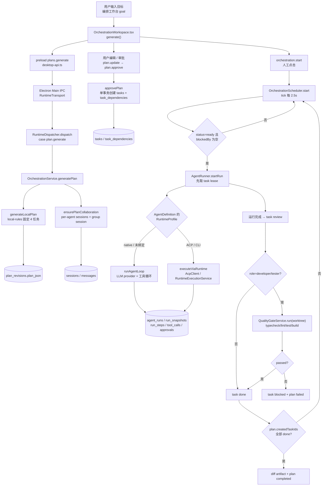
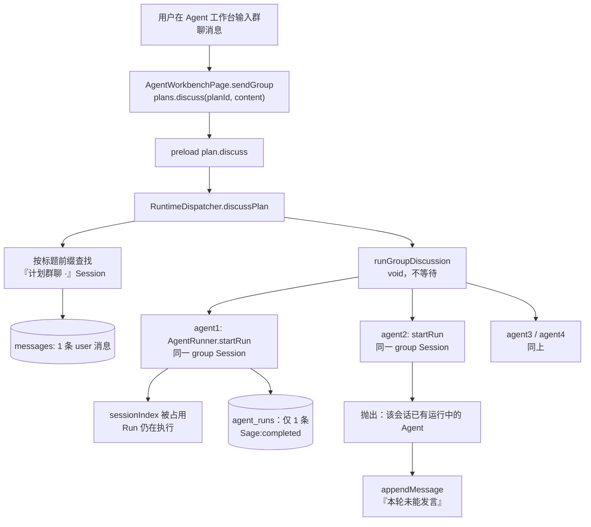
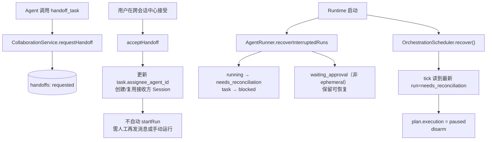

# ProjectOS V1.6 — Agent Teamwork 全面自检报告

> 审计对象：`C:\Users\Administrator\Desktop\workplace\ProjectOS` 当前工作区（`package.json` 版本 **1.7.0**，不是 1.6.0；工作区包含 V1.6/V1.7 进行中的修改）。
> 审计基线：`HEAD = 63ce47a`（`fix(v1.7): show ACP assistant text instead of raw JSON`），审计快照时间 **2026-10-21 01:06（America/Los_Angeles）**。
> 审计性质：只读代码审计 + 真实数据库只读检查 + `lint/typecheck/test/build` + 4 个基于本地假模型的 Electron E2E。**未修改任何业务代码、数据库结构或现有功能**。
> 重要提示：审计期间工作区被另一个会话并发修改（见 F.7）。本报告结论以 **01:06 代码快照**为准；01:06–01:11 期间该会话仍在新增 ADR-0009/0010 并修改 `agent-runner.ts`/`ai-connections.ts`，因此个别行号可能有 ±几行偏移，以函数名/文件为准。核心结论涉及的群聊循环、Session 互斥守卫、`orchestrator.ts` 调度器已重新读取确认逻辑未变。

---

## A. 总体结论

### A.1 先纠正一个前提

当前项目的真实能力结构不是「Agent 基本独立运行 + 后来补了一个群聊」。更准确地说：

- **V1.3–V1.6 已经存在一条真实可运行的计划 → DAG → 调度 → Agent 执行 → 验收链路**；调度器、依赖门禁、并发槽、失败重试、质量门禁、Worktree、Run 快照、审批、事件、持久化都有代码，并通过了部分实测。
- **群聊是整条链里最薄弱、且当前实际不可用的一环**：实测只有第一个 Agent 发言，其余 Agent 被同一会话的互斥守卫立即拒绝。
- 因此，项目距离 Teamwork 的差距**不是“缺调度器”**，而是**缺“组队/分配/回合/交接”这几块胶水**，以及群聊实现本身的缺陷。

### A.2 四个必答问题

1. **当前群聊属于普通多 Agent 聊天，还是具备真实协作能力？**
   **连“普通多 Agent 轮流回复”都没有真正实现。** 它是一条“单 Session + `agentId` 覆盖 + 顺序 `startRun`”的聊天路径；由于 `AgentRunner.startRun()` 在返回前不会等待运行结束，第一个 Agent 占住 `sessionIndex` 后，后续 Agent 的 `startRun` 立即抛出「该会话已有运行中的 Agent」。实测：`queued=4`，最终 `assistant=1`、`failed turns=3`，群聊里只有 1 条 Agent Run（Sage）。它没有群成员表、没有回合队列、没有任务绑定、没有结构化交接。

2. **当前是否具备自动规划、自动分配、自动执行和结果交接能力？**
   **都不完整。**
   - 自动规划：只有 `local-rules` 固定 4 节点模板（架构/实现/审查/验证），不是模型 Planner，也不按需求内容拆分。
   - 自动分配：没有。计划节点按角色硬编码到 `agt_architect/agt_engineer/agt_reviewer/agt_qa`，或由用户手工在计划编辑器选择；调度器只读 `task.assigneeAgentId`，无 assignee 时直接跳过并打日志。
   - 自动执行：需要用户在编排工作台手工点「开始执行」；执行中每次 `write_file`/`run_command`/`run_tests` 都要人工审批，计划会停在 `waiting_approval`。
   - 结果交接：`handoff_task` 只创建 `requested` 记录；接受后只改任务负责人和会话，**不会自动启动接收方运行**；没有把上游任务产物注入下游任务的机制。

3. **现有系统是否已经具备 Teamwork 的核心基础？**
   **是，而且基础比预期强。** 已存在：真实 `tasks` + `task_dependencies` DAG、依赖门禁、`OrchestrationScheduler` 的 ready/并发/重试/质量门禁、`AgentRunner` 的 AgentDefinition/RuntimeProfile 解析、`run_snapshots`、`task_leases`、`tool_calls`/`approvals`、Worktree、事件/消息/Artifact、`handoff`/`inbox`。这些不应推倒重写。

4. **是否需要重构，还是只需要整合现有模块？**
   **只需要整合 + 补 6 个胶水模块，不需要重构。** 具体见 E 节。

### A.3 总体判断

> **部分实现，需要集成。**
>
> - 不是「已实现真正 Teamwork」：自动分配、群聊回合、结构化交接、自动重规划都不成立。
> - 不是「目前主要是群聊，缺少核心调度」：调度器真实存在且实测能跑通 4 任务、重试、质量门禁、Worktree 合并；群聊反而是最弱的一环。
> - 不是「证据不足」：核心结论均有代码路径 + 实测输出。
> - 也不是「需要推倒重写」：现有 Task/DAG/Scheduler/AgentRunner/RunSnapshot/Approval 可以直接复用。

---

## B. 功能检查矩阵

> 状态只使用指定五档。证据列中 `[实测]` 表示本次实际运行并观察到结果，`[静态]` 表示只读代码/数据库检查、未运行验证。

| 功能 | 状态 | 代码位置 | 证据 | 缺失或问题 |
|---|---|---|---|---|
| Agent 群聊（多 Agent 轮流发言） | 部分实现 | `apps/runtime/src/dispatcher.ts:228-291`<br/>`apps/runtime/src/agent-runner.ts:194-195, 264-451`<br/>`apps/desktop/src/renderer/src/pages/AgentWorkbenchPage.tsx:696-739` | `[实测]` `queued=4`，最终 `assistant=1`、`system=5`、`failed turns=3`；群聊 Session 只有 `Sage:completed` 一条 Run；错误原文「Kai/Nova/Iris 本轮未能发言：该会话已有运行中的 Agent，请等待完成或取消」 | `runGroupDiscussion` 顺序 `await startRun()`，但 `startRun` 只创建 Run 后 `void execute()` 并返回；第一个 Agent 占住 Session，后续全部被 `resolveRunTarget` 互斥。没有回合等待、没有队列。 |
| 群聊消息触发实际任务执行 | 未实现 | `apps/runtime/src/dispatcher.ts:255-291`<br/>`apps/runtime/src/agent-runner.ts:293-300` | `[实测]` 群聊 Run 的 `taskId=null`；群聊没有创建任务、没有进入 `plan.createdTaskIds`；提示词只要求“头脑风暴/给判断/风险/分歧” | 群聊与 Task/DAG/调度器完全脱节；Agent 在群聊里即使调用 `create_task`，新任务也不会进入任何 `plan.createdTaskIds`，调度器不会看见。 |
| 群聊与已有工作流打通 | 未实现 | `apps/runtime/src/orchestration.ts:147-181, 317-338`<br/>`apps/runtime/src/orchestrator.ts:434-445` | `[静态]` 群聊 Session 与每个 Agent 的 `计划协作 · <Agent> · r<N>` 执行 Session 是**两套 Session**；调度器只往后者写；群聊里的任务/运行状态不会回写群聊 | 只共享了“计划/Agent 列表”和标题约定；不共享 Task、Run、Handoff、Inbox、Artifact。任务执行结果不会自动进入群聊，群聊发言不会改变计划。 |
| 独立 Agent（配置 / Run / 快照隔离） | 已实现且实测通过 | `packages/persistence/src/migrations.ts:637-694`<br/>`apps/runtime/src/agent-runner.ts:221-262, 476-531`<br/>`tests/agent-runner-guards.test.ts:251-281` | `[实测]` 单测确认 `run_snapshots` 持久化且 `run detail` 可读；真实数据库有 8 个 Agent、3 条 `agent_runtime_bindings`；每个 Run 有独立 `agentId`、`attempt`、`run_steps`、`run_snapshots` | 原生模式下所有 Agent 共享同一个 Node Runtime 进程，不是 OS 级独立实例；`agent_instances` 表存在但**零引用、零数据**（死表）。 |
| Runtime 绑定 / 独立 Harness | 已实现且实测通过 | `apps/runtime/src/agent-runner.ts:226-247, 715-826`<br/>`apps/runtime/src/agent-studio.ts:82-206`<br/>`tests/agent-runner-guards.test.ts:283-347`<br/>`tests/runtime-worktree.test.ts` | `[实测]` ACP fixture 真启动子进程并生成 `acp.permission` Approval，批准后 Run 完成；CLI Runtime 在隔离 Worktree 中真实执行；`resolveRunTarget` 对不可用 Runtime 直接阻断并给出中文原因 | Runtime 可用性依赖手动 `runtime.detect` 刷新；计划批准时不校验 Runtime 可用性；调度器不做换人/降级，Runtime 不可用会让**整个计划 failed**。 |
| 需求规划（自然语言 → 计划） | 部分实现 | `packages/planning/src/index.ts:20-96`<br/>`apps/runtime/src/orchestration.ts:183-197` | `[实测]` `plans.generate` 生成 `generatedBy: 'local-rules'` 的固定 4 任务；在 E2E 中 4 个任务标题是模板插值（`分析「...」的架构与影响面` 等） | 没有模型 Planner；`PlanGeneratorSchema` 的 `'provider'` 分支**从未被任何代码写入**；需求理解、范围澄清、任务粒度都依赖模板。 |
| 任务拆分 | 部分实现 | `packages/planning/src/index.ts:31-72`<br/>`apps/desktop/.../OrchestrationWorkspace.tsx`（计划编辑区） | `[实测]` 固定 `architecture → implementation → review → verification`；UI 可改标题/角色/Agent/依赖、可加/删节点 | 不能把任意自然语言需求拆成领域任务；拆分粒度固定；新增节点默认 `developer`、默认验收标准是“完成后由人工确认”。 |
| DAG 依赖关系 | 已实现且实测通过 | `packages/planning/src/index.ts:98-142`<br/>`packages/application/src/task-service.ts:52-65, 133-146`<br/>`packages/persistence/src/migrations.ts:79-84`<br/>`tests/orchestration.test.ts:62-87` | `[实测]` 并行 DAG E2E：`架构分析` 与 `并行实现` 同时启动，`依赖后验证` 在两个前置任务都结束后才启动（`verify started after both deps finished: true`）；环形依赖单测通过 | 计划修订不会 supersede 旧任务；DAG 只存在 SQLite，没有 per-task 工作区隔离。 |
| Agent 自动匹配（能力/Skills/Runtime/状态） | 未实现 | `packages/planning/src/index.ts:3-18`<br/>`apps/runtime/src/orchestration.ts:135-145, 275` | `[静态]` `agentForPlannedTask` 只做 `task.agentId ?? ROLE_AGENT[role]`；`validatePlanAgents` 只检查 Agent 存在 + `status === 'active'`；没有 capabilities/skills/runtime/load 打分 | 计划节点不会根据 Agent 的 Skills、capabilities、Runtime 可用性、当前负载自动选人；自定义 Agent 只能手工绑定。 |
| 自动调度 | 部分实现 | `apps/runtime/src/orchestrator.ts:62-136, 248-493`<br/>`apps/runtime/src/dispatcher.ts:971-986` | `[实测]` v13 编排 E2E：4 任务计划自动执行到 `done`，5 条 Run（含 1 次重试），2 份质量门禁报告，Worktree 创建并合并；并行 DAG E2E 完成 3 任务 | 必须人工点 `orchestration.start`；没有 assignee 的 ready 任务被 `logger.warn` 后跳过；没有自动分配/重新分配；同 Agent 并行会失败（见下一行）。 |
| 并行执行（不同 Agent） | 已实现且实测通过 | `apps/runtime/src/orchestrator.ts:414-459` | `[实测]` `Sage` 与 `Kai` 两条 Run 启动时间相差 47ms，重叠 **8256ms**；计划 `concurrency=2` | 只在“不同 Agent”且 DAG 产生并行分支时有效；默认模板是线性链，天然没有并行。 |
| 同一 Agent 并行 | 未实现 | `apps/runtime/src/orchestrator.ts:432-468`<br/>`apps/runtime/src/agent-runner.ts:194-195` | `[实测]` 两个同属 `agt_engineer` 的无依赖任务 + `concurrency=2`：计划直接 `failed`，错误「该会话已有运行中的 Agent，请等待完成或取消」；`实现 A=running`、`实现 B=ready`、仅 1 条 Run | 调度器用 `planSessionTitle(assignee, revision)` 复用同一个 Session；两个 ready 任务同 Agent 时第二个 `startRun` 冲突。正确做法是按 task 排队或按 task 建 Session。 |
| 任务交接（结构化 handoff） | 部分实现 | `packages/application/src/collaboration-service.ts:115-234`<br/>`packages/tools/src/index.ts:242-256`<br/>`apps/runtime/src/agent-runner.ts:1599-1610` | `[实测]` 应用层单测：`requestHandoff → accepted`，任务 `assigneeAgentId` 改为 `agt_qa`，创建接收方 Session；真实 DB 有 2 条 handoff | 必须人工接受；接受后**不启动 Run**；`payload` 只有 `taskTitle/fromAgentName`；`buildTaskHandoffSummary`（完成/未完成/风险三段式）导出但**未接线**；没有自动超时处理。 |
| Agent 间任务委派 | 部分实现 | `packages/tools/src/index.ts:226-256`<br/>`apps/runtime/src/agent-runner.ts:1579-1610, 1989-2016` | `[静态]` `send_agent_message` 会写 inbox 并在 `created` 时 `void wakeInbox()`；`handoff_task` 会创建 requested 记录 | Agent 无法发现目标 `toSessionId`（没有 `list_agents`/`list_sessions` 工具，上下文中也没有其他 Session ID）；群聊没有 taskId，`handoff_task` 传入空 taskId 会 `NOT_FOUND`；同任务委派时接收方 `startRun` 会撞上发送方持有的 task lease。 |
| 上游产物 / 上下文交接 | 部分实现 | `apps/runtime/src/agent-runner.ts:830-875`<br/>`packages/persistence/src/read-models.ts:346-358`<br/>`packages/context-engine/src/index.ts:130-132` | `[静态]` 有 task 时 `listArtifacts(projectId, taskId)` **只返回当前任务**的 Artifact；下游任务只能拿到自己的 Artifact + 项目级 requirements/decisions/knowledge；accepted handoff 只注入一段 `summary` 文本 | 上游任务的代码 diff、测试报告、审查结论不会自动给下游；唯一隐式传递是“所有 Agent 共享同一个 plan Worktree 的文件系统”。 |
| Worktree 隔离 | 部分实现 | `apps/runtime/src/orchestrator.ts:219-246`<br/>`packages/worktree/src/index.ts:27-73`<br/>`tests/worktree.test.ts` | `[实测]` v13 E2E 创建 `projectos/plan-...` 分支并合并；Worktree 单测覆盖 dirty main / merge conflict abort | **每个计划一个 Worktree**，不是每个任务/每个 Agent 一个；同一计划内多个 Agent 并发写同一文件没有锁、没有 per-file lease，last-write-wins。 |
| 多 Agent 改同一文件的冲突处理 | 部分实现 | `packages/worktree/src/index.ts:55-69`<br/>`apps/runtime/src/orchestrator.ts:164-180` | `[实测]` 合并冲突会 `git merge --abort` 并回到干净主工作区；主工作区 dirty 时拒绝合并 | 只在“计划完成 → 合并回主分支”时检测冲突；计划内部并发写同一文件时没有冲突检测/合并策略。 |
| 质量门禁（真实测试） | 部分实现 | `apps/runtime/src/quality-gate.ts:120-148`<br/>`apps/runtime/src/orchestrator.ts:306-361`<br/>`tests/orchestration.test.ts:90-125` | `[实测]` v13 E2E 生成 2 份 `test-report` Artifact；并行 DAG E2E 对 developer/tester 任务真实运行 `pnpm/npm test`；单测覆盖 exit 7 失败与 timeout 杀进程树 | 只对 `labels` 含 `developer`/`tester` 的任务跑；`architect`/`reviewer`/`custom` 无门禁；项目没有 typecheck/lint/test/build 脚本时 `executed.length === 0`，`passed: [].every(...) === true`，会被当作通过；reviewer 任务不做 Artifact 校验就自动 `done`。 |
| 失败重试 | 已实现且实测通过 | `apps/runtime/src/orchestrator.ts:276-302` | `[实测]` v13 E2E `retries: 1`（首次 provider 500 后重试），最终计划 `completed`；单测/代码覆盖退避 `2s * 2^used`，上限 30s，最多 `maxRetries` | 重试仍用同一个 `assigneeAgentId`，不会换 Agent；重试耗尽会把整个计划置 `failed`，而不是只失败该任务并继续其他分支。 |
| 重新规划 | 部分实现 | `apps/runtime/src/orchestration.ts:228-256`<br/>`apps/runtime/src/orchestration.ts:258-351` | `[静态]` `revisePlan` 新建 `id`、`revision+1`、`createdTaskIds: []`；批准新 revision 会再创建一整套 Task | 旧 revision 的 Task 不会被取消/标记 superseded；重新规划后看板会出现两套任务，且旧任务仍可被手动执行。 |
| 状态持久化 | 已实现且实测通过 | `packages/persistence/src/migrations.ts`（v1–v15）<br/>`packages/persistence/src/store.ts`<br/>`tests/runtime-protocol.test.ts` | `[实测]` v13 E2E 在页面 reload 后计划仍是 `completed`；真实 DB 只读检查：13 tasks、8 agents、8 sessions、20 messages、4 runs、6 artifacts、2 handoffs、3 inbox、1 approval、1 tool_call | 打包产物 DB 只到 **v13**，源码已到 **v15**；打包 runtime 的 `index.mjs` 不含 `run_snapshots` / `frozen run configuration snapshots` / `repair_agent_id`；`agent_config_versions` 只有 INSERT，没有读取接口。 |
| 权限审批 / 危险操作控制 | 已实现且实测通过 | `packages/policy/src/index.ts:57-120`<br/>`apps/runtime/src/agent-runner.ts:1303-1420, 1616-1790`<br/>`tests/agent-runner-guards.test.ts:283-364`<br/>`tests/policy.test.ts` | `[实测]` ACP permission → `waiting_approval` → 批准后 ToolCall `completed`；审批过期 → Run `failed` + task `blocked`；`write_file`/`run_command`/`run_tests` 都走 `require_approval`；受保护路径 `deny` | `PlannedTask.requiresApproval` **从未被 `approvePlan` 或调度器消费**；外部 Agent 写模式没有 Approval；`runtime.execute` / `agentDefinition.run` / `acpPrompt` 是绕过 Run/Approval 的原始执行入口；逐工具审批会让无人值守的 Teamwork 停在第一次写盘。 |
| 执行中断 / 跨会话恢复 | 部分实现 | `apps/runtime/src/agent-runner.ts:2067-2123`<br/>`apps/runtime/src/orchestrator.ts:192-199, 263-274`<br/>`tests/recovery.test.ts` | `[实测]` 单测：`running` 中断 → `needs_reconciliation` + task `blocked`；`waiting_approval`（非 ephemeral）保留可恢复；ephemeral（ACP/CLI）审批在重启后失效 → `needs_reconciliation`；scheduler `recover()` 会重新 arm `running` 计划 | 没有 `run.reconcile` API/UI；`needs_reconciliation` 只能靠 RunsPage 的「取消运行」→ task `ready` → 手动 resume 绕过；计划 tick 看到 `needs_reconciliation` 会 `paused` 并 disarm，不会自动继续；`resume` 会再次暂停。 |
| 并发限制 / 超时 / 取消 | 部分实现 | `apps/runtime/src/orchestrator.ts:80-100, 118-136, 420-426`<br/>`apps/runtime/src/runtime-executor.ts:49-52`<br/>`apps/runtime/src/agent-runner.ts:134-138, 967-993` | `[实测]` 计划 `concurrency=2` 生效；并行/同 Agent 测试均观察到并发槽行为；`cancel` 会遍历 `createdTaskIds` 调 `runner.cancel` | 只有计划级并发，没有 Agent 级/连接级并发上限；CLI Runtime 120s、quality gate 120s，但**原生 Agent Loop 没有 wall-clock 超时**，只有 `MAX_AGENT_STEPS`；没有计划总超时。 |
| 自主修复（V1.4 健康检查→提案→修复计划） | 已实现但未实测 | `apps/runtime/src/operations.ts:178-324, 412-492`<br/>`apps/runtime/src/dispatcher.ts:156-226`<br/>`tests/operations.test.ts` | `[静态+部分单测]` operations 单测 14 项通过，覆盖 finding 去重、secret redaction、proposal reopen、并发触发合并、circuit breaker；`autoStartRepairs` 需要 `approved-autofix` + 有效 grant + 非 high/critical | **本次未实测** `startRepair` 的完整“提案→建计划→scheduler.start→Worktree→质量门禁”链路；现有测试没有覆盖 dispatcher 层 `startRepair`。自主修复只面向健康检查发现，不是用户需求；高风险仍需人工批准。 |

**状态统计（本表 25 项）**：已实现且实测通过 7 项；已实现但未实测 1 项；部分实现 13 项；未实现 4 项；无法确认 0 项。

---

## C. 实际执行链路

> 以下只画当前真实存在的节点与分支；不存在的 Planner/自动分配/交接执行节点不画。

### C.1 计划 → DAG → 调度 → Agent 执行（真实主链）



**链路要点（真实代码）**

- `plan.generate` 只做本地规则：`apps/runtime/src/dispatcher.ts:939-942` → `OrchestrationService.generatePlan`（`orchestration.ts:183-197`）→ `generateLocalPlan`（`planning/index.ts:20-96`，`generatedBy: 'local-rules'`）。
- 计划审批创建真实 Task 和依赖：`approvePlan` 在 `store.transaction` 内按拓扑序创建（`orchestration.ts:258-351`），依赖通过 `task_dependencies` 持久化。
- 调度器只处理 `plan.createdTaskIds`：`orchestrator.ts:257-260`、`363-369`、`411-418`；`blockedBy.length > 0` 的 ready 任务不会启动（`399`）。
- 每个任务启动前都会走 `AgentRunner.resolveRunTarget`：解析 AgentDefinition、`primaryRuntimeProfileId`、Runtime 状态、Skill 存在性、Provider 路由（`agent-runner.ts:183-262`）。
- 原生执行走 `runAgentLoop`（`packages/agent-runtime/src/index.ts:76-180`）；外部 Runtime 走 `executeViaRuntime`（`agent-runner.ts:715-826`）。
- 运行结束 `tryMoveTask(task, 'review')`（`agent-runner.ts:1022`），调度器对 developer/tester 跑质量门禁，然后自动 `done`（`orchestrator.ts:306-361`）。
- 计划完成生成 diff Artifact（`orchestrator.ts:367-389`），合并需人工 `worktree.merge`（`orchestrator.ts:164-180`）。

### C.2 群聊真实链路（含实测失败分支）



**实测原文（见 F.3）**：`queued=4` → `assistant=1`、`failed turns=3`；消息序列为 2 条 system 建档消息 + 1 条 user + 3 条「未能发言」+ 1 条 assistant（Sage）。这不是“顺序发言”，而是“第一个 Agent 发言，其余被拒”。

### C.3 交接与恢复真实链路



**要点**

- `handoff.accept` 只做 `updateHandoff` + `updateTask(assigneeAgentId)` + `appendMessage`（`collaboration-service.ts:160-217`），没有 `runner.startRun`。
- 恢复时 `recoverInterruptedRuns` 把未完成 Run 置 `needs_reconciliation` 并阻塞 task（`agent-runner.ts:2067-2123`）；scheduler tick 看到该状态会 `paused` + disarm（`orchestrator.ts:263-274`）。
- 没有 `run.reconcile` 方法；只能通过 `run.cancel` 把 Run 置 `cancelled`、task 回 `ready`，再手动 `orchestration.resume`。

---

## D. 主要问题

### D.0 五个重点问题的直接回答

| 问题 | 直接回答 | 关键证据 |
|---|---|---|
| 群聊与任务编排是否脱节？ | **是，完全脱节。** 群聊是一个普通 Session；任务执行是每个 Agent 的 `计划协作 · <Agent> · r<N>` Session。群聊不创建 Task、不带 taskId、不写 `plan.createdTaskIds`；调度器不往群聊写任何东西。 | `dispatcher.ts:255-291`；`orchestration.ts:147-181, 317-338`；`orchestrator.ts:434-445`；群聊实测 `taskId=null`。 |
| 是否存在伪自动调度？ | **调度器是真的，但“自动组队”是伪的。** `tick()` 真的查 ready、查 blockedBy、按并发槽启动、失败重试；但 Agent 是计划里预先写死的（角色默认或手工选），调度器不按能力/技能/Runtime/负载选人；没有 assignee 就跳过。 | `orchestrator.ts:399-459`；`planning/index.ts:3-18`；`orchestration.ts:135-145, 275`；`orchestrator.ts:427-430`。 |
| 是否有重复架构？ | **没有两套 Task/Orchestrator/AgentRegistry；但有两类重复。** ① Runtime 调用有 4 条路径，审计/审批/快照覆盖不一致；② 群聊重复了 `CollaborationService` 已经具备的“多 Agent 消息/回合”语义，却不用 envelope/inbox/handoff。 | 真实 DB 只有一张 `tasks`、一张 `agents`；`OrchestrationService` 与 `OrchestrationScheduler` 互补；`RuntimeRunService`/`ExternalAgentRunner`/`runtime.execute`/`acpPrompt` 与 `AgentRunner` 并存；群聊不用 `CollaborationService`。 |
| 是否存在 Agent 角色与 Runtime 配置不生效？ | **执行时会生效，调度时完全不参与。** `resolveRunTarget` 会按 Agent 的 `primaryRuntimeProfileId` 选 Runtime，不可用会阻断；但计划批准/调度不校验 Runtime、Skills、能力，角色默认硬编码。`requiresApproval`/`expectedArtifacts` 从不被消费；`agent_config_versions` 只写不读。 | `agent-runner.ts:221-262`；`orchestration.ts:135-145`；`planning/index.ts:3-18`；全仓库 `requiresApproval` 仅 planning/contracts/UI；`store.ts:1600` 只有 INSERT。 |
| 是否存在状态丢失或无法恢复？ | **状态不丢，但恢复闭环不完整。** 所有关键状态在 SQLite；但 `running` 中断会变 `needs_reconciliation`，计划会 `paused`，没有 `run.reconcile` API/UI；只能取消运行→task ready→手动 resume。打包 DB 还停在 v13，缺 `run_snapshots`。 | `agent-runner.ts:2067-2123`；`orchestrator.ts:263-274`；F.5 数据库检查；打包 runtime 字符串检查。 |

### P0（阻断“真正 Teamwork”的问题）

**P0-1 群聊实测只有第一个 Agent 发言，多 Agent 协作不成立。**
- 代码：`dispatcher.ts:248-291` 顺序 `await runner.startRun()`；`agent-runner.ts:264-451` 的 `startRun` 在 `this.sessionIndex.set(session.id, runId)`（410 行）后立即 `void this.execute()`（442 行）并返回；`agent-runner.ts:194-195` 对同一 Session 直接抛 `CONFLICT`。
- 实测：`queued=4`，`assistant=1`，`failed turns=3`；群聊只有 `Sage:completed` 一条 Run。
- 影响：所谓“多 Agent 头脑风暴”实际上只有一个 Agent（默认计划里固定是架构师 Sage）能发言；这是功能级失败，不是体验问题。

**P0-2 没有自动分配，调度器只执行“已被指派的 ready 任务”。**
- 代码：`planning/index.ts:3-18` 硬编码 `ROLE_AGENT`；`orchestration.ts:135-145` 只校验存在/active；`orchestrator.ts:427-430` 对 `!card.assigneeAgentId` 只 `warn` + `continue`。
- 影响：用户说“开发一个用户权限管理模块”，系统不会根据 Agent 的 Skills、capabilities、Runtime、当前负载选人；自定义 Agent 必须手工绑定；未指派任务永远不会被调度。这不是“自动组队”，只是“自动执行已排好的任务”。

**P0-3 同一 Agent 的并行任务会让整个计划失败，并留下运行中任务。**
- 代码：`orchestrator.ts:432-445` 按 `planSessionTitle(assignee, revision)` 复用 Session；`agent-runner.ts:194-195` 互斥；`orchestrator.ts:462-468` 捕获 `startRun` 异常后把整个 plan 置 `failed` 并 return。
- 实测：两个 `agt_engineer` 无依赖任务 + `concurrency=2` → `plan failed`，错误「该会话已有运行中的 Agent，请等待完成或取消」；`实现 A=running`、`实现 B=ready`、仅 1 条 Run（仍在 running）。
- 影响：只要 DAG 出现“同角色并行”（很常见，例如两个开发子任务），计划就会崩；失败后第一个 Run 还会继续跑，计划状态与运行状态不一致。

**P0-4 没有自动交接/再分配；现有 handoff 是“人工签收单”。**
- 代码：`collaboration-service.ts:160-217` 接受后不启动 Run；`tools/index.ts:242-256` 的 `handoff_task` 只创建 request；`agent-runner.ts:1579-1610` 的 `send_agent_message` 需要 `toSessionId`，但 Agent 没有发现其他 Session 的工具/上下文。
- 影响：Agent 不能真正“把工作交给另一个 Agent 并让对方继续做”；失败后也不会换人重试。群聊里没有 taskId，`handoff_task` 直接不可用。

**P0-5 上游任务的实际产物不会传给下游。**
- 代码：`agent-runner.ts:830-875` 的 artifacts 只按 `taskId` 取；`read-models.ts:346-358` 证实 `listArtifacts(projectId, taskId)` 只查当前任务；`context-engine` 只接收 `handoffSummary` 字符串。
- 影响：架构任务的 ADR、开发任务的 diff、审查任务的意见、测试报告，不会自动进入下游任务的上下文。唯一共享是同一个 plan Worktree 的文件系统；一旦上游只有文本/决策、没有落盘，下游完全看不到。

**P0-6 “自动执行”被逐工具审批和缺失的计划级授权阻断。**
- 代码：`policy/index.ts:80-110` 对 `write_file`/`run_command`/`run_tests` 一律 `require_approval`；`agent-runner.ts:1358-1391` 创建 Approval 并让 Run 进入 `waiting_approval`；`approvePlan` 从不消费 `PlannedTask.requiresApproval`（全仓库只有 planning/contracts/UI 引用）。
- 影响：一个真正会改代码的 Teamwork 计划，会在第一次 `write_file` 停下等人工；没有“批准该计划内的写操作”这种计划级授权，也没有批量审批。当前 v13 E2E 之所以能“4 任务自动完成”，是因为假模型只返回文本、从不调用工具；这不代表真实开发能自动跑完。

### P1（严重，但可在现有架构内修）

1. **质量门禁可被“没有脚本”绕过**：`quality-gate.ts:140-143` 用 `executed.every(...)`，`executed.length === 0` 时结果为 `true`；`orchestrator.ts:323` 只把 `skipped` 写进报告文本，仍会 `done`。
2. **质量门禁只覆盖 developer/tester**：`orchestrator.ts:308-310` 只对这两个 role 跑；architect/reviewer/custom 任务只要进入 `review` 就被 `done`（`353-360`），不检查审查 Artifact、不检查验收标准是否被真实覆盖。
3. **重新规划会复制任务**：`revisePlan` 新 revision 的 `createdTaskIds: []`；批准后创建一整套新 Task，旧 Task 不取消、不 supersede（`orchestration.ts:228-256, 258-351`）。看板会出现两套同目标任务。
4. **恢复路径缺“核对”闭环**：`needs_reconciliation` 没有 `run.reconcile` API/UI；只能取消运行再 resume。计划 `resume` 会因 latest run 仍是 `needs_reconciliation` 再次 `paused`（`orchestrator.ts:263-274`）。
5. **Runtime 不可用会拖垮整个计划**：`resolveRunTarget` 阻断（`agent-runner.ts:241-247`）→ `orchestrator.ts:462-468` 把 plan `failed`；没有自动切换同能力 Agent 或把该任务标记 blocked 后继续其他分支。
6. **群聊 Session 按标题前缀查找，可能打开错误的计划群**：`dispatcher.ts:231-234` 只用 `startsWith('计划群聊 ·')`，没有按 `planId` 关联；同一项目多个 revision 时可能取到旧群。Session 表也没有 `plan_id`/成员表，群成员是从 `plan.tasks` 临时推导的。
7. **群聊返回的 `queued` 是乐观值**：`discussPlan` 在 `void runGroupDiscussion` 后立即返回 `agents.length`（`dispatcher.ts:244-245`）；实测 `queued=4` 但实际只启动 1 条 Run。
8. **Agent 创建的 Task 不会进入调度器**：`agent-runner.ts:1415-1433` 的 `create_task` 只写 `tasks`；调度器只看 `plan.createdTaskIds`（`orchestrator.ts:257-260`）。Agent 在运行中拆出的子任务会被“孤儿化”。
9. **`send_agent_message` 的同任务委派会撞租约**：接收方 `resumeInbox` 用 envelope 的 `taskId` 启动（`agent-runner.ts:1989-2016`），而发送方仍持有该 task lease（`store.ts:700-724`），接收方会失败；wake 失败只记 warning，不重试、不改 inbox 状态。
10. **外部 Agent 写模式没有 Approval**：`external-runner.ts:60-108` 只校验 plan Worktree 和 `allowWrite`，创建 run 级 ToolCall，但没有 `createApproval`；`claude/codex` 的写权限由 CLI 自己控制，ProjectOS 无法逐工具审计。
11. **原始 Runtime 入口绕过 Run/Approval/快照**：`dispatcher.ts:650-653` 的 `runtime.execute` 直接调 `RuntimeExecutionService.execute`；`agent-studio.ts:264-281` 的 `acpPrompt` 直接起 ACP；`runtime-run.ts:70-153` 自建 Session/Run，不写 `run_snapshots`、不创建 ToolCall 审批（只写一条 `runtime.execute` ToolCall）。这与 `AgentRunner` 的审计路径不一致。
12. **RunSnapshot 字段不完整**：`agent-runner.ts:476-531` 的 `worktreeId`、`workflowNodeId` 恒为 `null`；快照没有记录 planId/plan revision/taskId（taskId 在 Run 上，但快照自身不自描述）。`agent_config_versions` 只有 INSERT（`store.ts:1600`），没有读取历史版本的 API。
13. **打包产物明显落后于源码**：正在运行的 `ProjectOS-1.7.0-win-x64-portable` 的 `%APPDATA%\ProjectOS\data\projectos.db` 只到 `schema_migrations v13`，且打包 `resources/runtime/index.mjs` 不含 `run_snapshots`/`repair_agent_id`；源码已到 v15。也就是说，**V1.6 的 Run 快照/修复 Agent 能力没有进入当前正在运行的打包产物**（详见 F.5）。
14. **没有 Agent 级/连接级并发上限**：`concurrency` 只限制单个计划；两个计划可以同时用同一个 Agent（不同 Session）跑，`AgentBackendBinding.maxConcurrency` 只约束模型连接，不约束 Agent 任务。
15. **没有计划总超时 / 原生 Run wall-clock 超时**：`MAX_AGENT_STEPS` 限制轮次，但单个 LLM 调用或工具可无限挂起；`runtime-executor` 有 120s，原生循环没有。计划级也没有超时，只能人工取消。

### P2（结构性/卫生问题）

1. **群聊与既有协作层是两套实现**：`CollaborationService` 有 envelope/inbox/handoff/ack/delivery 状态；群聊完全不用它，只在 `messages` 上加 `metadata.agentId`。`buildTaskHandoffSummary`、`replyEnvelope`、`CrossSessionTransport`、`deliveryLabel` 导出但未接线。
2. **没有 Team/Group 实体**：`sessions.agent_id` 只有一个 lead；群成员靠 `plan.tasks` + 标题前缀推导；`agent_instances` 表 0 行、零引用。没有 `session_participants` 或 `teams` 表。
3. **计划字段大量“只写不读”**：`PlannedTask.requiresApproval`、`expectedArtifacts` 只在 planning/contracts/UI 出现，执行期不消费；`workflowNodeId` 恒 null。
4. **死代码/未使用 UI**：`TeamSettingsPanel.tsx`、`GeneralSettingsPanel.tsx`、`SystemSettingsPanel.tsx` 仍导出但没有任何 import；`agent_instances` 死表。
5. **计划模板写死**：`generateLocalPlan` 固定 4 节点、固定标题前缀；`PlanGeneratorSchema` 的 `provider` 分支是死枚举。
6. **群聊 UI 的“参与 Agent 数”来自 per-agent `计划协作` Session 数量**（`AgentWorkbenchPage.tsx:132, 706`），不是群成员表；如果某个 Agent 没有任务，计数会不准。
7. **质量报告内存缓存按 taskId**：`orchestrator.ts:310-331` 的 `qualityReports` 只增不减；同一任务重新 review 会复用旧报告，不重新跑。
8. **文档/测试数量漂移**：`docs/v1.7/plan-collaboration.md` 写 25 files/118 tests，当前是 27 files/130 tests；`README.md`/`docs/status.md`/`docs/architecture.md` 也在审计期间被并发修改。以代码和实际命令为准。

### D.4 历史版本兼容与重复架构（专项回答）

| 检查项 | 结论 | 证据 |
|---|---|---|
| 是否有两套独立的 Task 系统？ | **没有。** 只有一张 `tasks` + 一张 `task_dependencies`；`plan_revisions.plan_json` 是审批前的草稿 DAG，批准时物化成 Task。**但有两个任务来源**：计划审批创建的 Task（进入 `plan.createdTaskIds`）和看板/Agent 工具创建的 Task（不进入任何计划的 `createdTaskIds`）。 | `migrations.ts:59-84, 436-448`；`orchestration.ts:267-349`；`agent-runner.ts:1415-1433`；`orchestrator.ts:257-260`。 |
| 是否有两套 Orchestrator？ | **没有。** `OrchestrationService` 负责计划生命周期（生成/编辑/审批/修订），`OrchestrationScheduler` 负责执行 tick；`OperationsService` 是健康检查/自主修复，但最终复用同一个 `scheduler.start`。 | `orchestration.ts:24-388`；`orchestrator.ts:35-495`；`dispatcher.ts:173-226`（`startRepair` 调 `scheduler.start`）。 |
| 是否有两套 Agent Registry？ | **没有。** 只有一张 `agents`（V13 扩展出 persona/config/version），Skill/Runtime 绑定在独立关联表；`agent_config_versions` 只写不读，`agent_instances` 是 0 行死表，`agent_backend_bindings` 是模型路由不是 Agent 注册表。 | `migrations.ts:104-124, 637-694, 402-414`；`read-models.ts:387-432`；真实 DB：8 agents、3 runtime bindings、0 agent_instances。 |
| 是否有重复的 Runtime 调用实现？ | **有，4 条路径。** `AgentRunner.executeViaRuntime`（有 Run/Snapshot/ToolCall/Approval）；`RuntimeRunService.run`（自建 Session/Run，无 Snapshot、无逐工具 Approval）；`ExternalAgentRunner.execute`（有 run 级 ToolCall，无 Approval）；`dispatcher` 的 `runtime.execute` / `agent-studio.acpPrompt`（原始执行，几乎无审计）。 | `agent-runner.ts:715-826`；`runtime-run.ts:70-153`；`external-runner.ts:60-108`；`dispatcher.ts:650-653`；`agent-studio.ts:264-281`。 |
| 群聊和工作流是否共用执行服务？ | **共用 `AgentRunner.startRun`，但不共用协作协议/调度状态。** 群聊和调度任务都走同一个 `AgentRunner`、同一套 Runtime/Provider/审批；但群聊不写 Task、不用 inbox/handoff、不进入 `OrchestrationScheduler`。 | `dispatcher.ts:273-280` 与 `orchestrator.ts:446-459` 都调 `runner.startRun`；群聊无 taskId；调度器不读群聊 Session。 |
| V1.3/V1.4/V1.5 已有功能是否还在？ | **在，且有测试。** V1.3：扫描/计划/DAG/图投影/Worktree/质量门禁；V1.4：operations 健康检查/提案/自主修复；V1.5：AI 连接/模型路由/用量/价格。没有为了 V1.6 群聊而删除旧链路。 | `tests/orchestration.test.ts`、`tests/operations.test.ts`、`tests/ai-connections.test.ts`、`tests/runtime-protocol.test.ts`；v13 编排 E2E 通过。 |
| 是否建议推倒重写？ | **不建议。** 现有 Task/DAG/Scheduler/AgentRunner/RunSnapshot/Approval/Worktree 是可复用的；缺的是 Resolver、群聊回合、结构化交接、上游产物、reconcile、Runtime 网关这 6 个胶水模块。 | 见 E 节。 |

---

## E. 最小整改方案（本轮只给方案，不执行）

### E.1 可复用（不要重写）

| 现有模块 | 复用方式 |
|---|---|
| `packages/application/src/task-service.ts` + `task_dependencies` | 保留依赖门禁、环检测、验收 Artifact；只加“计划/任务归属”查询。 |
| `apps/runtime/src/orchestrator.ts` 的 `tick()` | 保留 ready/blockedBy/并发槽/重试/质量门禁主流程；只改“启动失败隔离”和“同 Agent 排队”。 |
| `apps/runtime/src/agent-runner.ts` | 保留 `resolveRunTarget`、`startRun`、`run_snapshots`、`decideApproval`、`recoverInterruptedRuns`；加 `waitForRun()`/回合队列；加 reconcile。 |
| `AgentDefinition` + `RuntimeProfile` + `agent_runtime_bindings` | 保留为“执行配置”；新增 Resolver 读取它们做匹配，不复制配置。 |
| `packages/collaboration` + `CollaborationService` | 保留 envelope/inbox/handoff；群聊改为复用 inbox/handoff，而不是再造一套消息语义。 |
| `packages/worktree` | 保留计划级 Worktree；第二阶段再评估 per-task worktree，不要一开始就改。 |
| `QualityGateService` | 保留真实命令执行；加 strict 模式（skipped 不算 pass）和角色覆盖。 |
| `packages/context-engine` | 保留上下文预算/来源；新增“上游任务产物”注入。 |

### E.2 需要补充的 6 个胶水模块

1. **`AgentAssignmentResolver`（自动选人）**
   - 输入：`PlannedTask`（role/title/description/required capabilities）、项目 Agent 列表、`AgentDefinition.skills/capabilities/status`、`RuntimeProfile.status`、当前活跃 Run 数。
   - 输出：`agentId + reasons + rejected[]`；显式 `task.agentId` 优先，其次能力/技能/角色匹配，最后回退 `agentForPlanRole`。
   - 接线点：`OrchestrationService.generatePlan`/`updatePlan`/`approvePlan`（写 `assigneeAgentId`）、`OrchestrationScheduler.tick`（无 assignee 时调用 Resolver，而不是 `continue`）。
   - 复用：`packages/skills` 的 `selectSkills` 打分思路；`ai-connections.resolveForRun` 的“能力/并发/回退”模式。

2. **`GroupTurnQueue`（群聊回合）**
   - 在同一 group Session 上串行执行：`startRun` → **等待 Run 终态**（`completed/failed/cancelled`）→ 再启动下一个 Agent；或改成“每个 Agent 自己的 Session + inbox 消息 + 汇总到 group Session”。
   - 必须支持：超时、失败继续下一个、取消整轮、幂等 user message。
   - 接线点：`dispatcher.runGroupDiscussion`；`AgentRunner` 增加 `waitForRun(runId, timeoutMs)` 或事件订阅。
   - 最小改法：先 `await waitForRun()`，不要改数据库；这是 P0-1 的最小修复。

3. **`TeamSession` / 群成员（或复用 plan 作为成员来源）**
   - 最小：给 `sessions` 加 `metadata.planId`（或新表 `session_participants`），`discussPlan` 按 `planId` 精确查找 group；群成员从 `plan.tasks` 解析后持久化快照。
   - 不建议：只靠标题前缀和 `plan.tasks` 临时推导（当前 bug 来源）。
   - 如果不想改表：在 `messages.metadata`/`app_settings` 里存 `planId → groupSessionId` 映射，至少消除前缀误配。

4. **`TaskHandoffService`（结构化交接 + 自动执行）**
   - 把 `handoff` payload 扩展为：`completed[] / remaining[] / risks[] / artifacts[] / upstreamRunIds[]`；复用 `buildTaskHandoffSummary`。
   - 接受策略：`auto`（低风险，自动 accept + 启动接收方 Run）、`manual`（当前行为）。默认 manual，但允许计划级配置。
   - 接线点：`CollaborationService.acceptHandoff` 末尾调用 `runner.startRun`（需处理 task lease/assignee/session），或由 scheduler 的下一 tick 发现 `assignee` 变化后启动。
   - 同时补 `list_agents`/`list_sessions` 工具或在上下文中给出可委派 Session ID。

5. **`UpstreamArtifactContext`（上游产物注入）**
   - 从 `task_dependencies` 找直接前置任务，取它们的 `artifacts`（kind: diff/test-report/design/document）+ 最近 Run `summary`，以低优先级注入 `buildContext`；预算不足时截断。
   - 复用 `context-engine` 的 `Candidate`/预算机制；新增 `kind: 'upstream-artifact'`。
   - 接线点：`AgentRunner.buildMessages`（`agent-runner.ts:830-875`）。

6. **`ReconcileService`（人工核对闭环）**
   - API：`run.reconcile(runId, decision: 'resumed' | 'abandoned', note)`；`resumed` 时清 task blocked/lease，`abandoned` 时 task ready/blocked 由用户选。
   - 接线点：`agent-runner.recoverInterruptedRuns` 只标记，不自动恢复；UI 在 RunsPage/编排页提供“核对并继续/放弃”。
   - 计划 `resume` 时允许跳过/重试 `needs_reconciliation`，不要无限 pause。

### E.3 推荐集成顺序（不推倒现有架构）

**Phase 0（1–2 天，先止血）**
1. 修 P0-1：`runGroupDiscussion` 等待每个 Run 终态；补 `waitForRun`；把 `queued` 改成真实启动数。
2. 修 P0-3：调度器对同 Agent 的 ready 任务做“每 Agent 串行队列”（同一 tick 只启动一个）；`startRun` 冲突时把该 task 标 `blocked` 并继续其他分支，不要整个 plan `failed`。
3. 修 P0-2 的第一步：无 assignee 时调用 Resolver（先做“角色 + active + Runtime available”最小匹配），不要 `continue`。

**Phase 1（3–5 天，打通协作）**
4. 加 `TeamSession`/planId 关联；群聊按 planId 精确取群；群聊成员持久化。
5. 加 `TaskHandoffService` 结构化 payload + 可选自动 accept/启动；补 `list_agents`/`list_sessions`。
6. 加 `UpstreamArtifactContext`；下游任务能看到上游 Artifact/摘要。

**Phase 2（3–5 天，质量与恢复）**
7. 质量门禁 strict：skipped 不算 pass；reviewer/custom 至少要求一个 `review`/`test-report` Artifact；消费 `requiresApproval`。
8. `ReconcileService` + UI；计划 `resume` 支持核对后继续；加计划/原生 Run 超时。
9. 计划修订 supersede 旧任务（旧任务 `cancelled` 或标记 `superseded`）；避免重复 DAG。
10. 收敛 Runtime 入口：`RuntimeRunService`/`ExternalAgentRunner`/`runtime.execute` 至少统一写 RunSnapshot + ToolCall + Approval；`acpPrompt` 明确标注为诊断入口。

**Phase 3（收尾）**
11. 清理死字段/死代码/死表；更新 README/status/architecture/testing 与覆盖矩阵；补 E2E 隔离（`--user-data-dir`）。
12. 把打包产物重新构建到包含 v14/v15 迁移和上述修复；用 `test:package` 验证。

**明确不建议**：不要新写第二套 Task/Orchestrator/AgentRegistry；不要为了“看起来自动”绕过 Approval/Lease；不要把群聊消息当任务事实来源。

---

## F. 测试情况

### F.1 实际执行的命令与结果

| 命令 | 结果 | 说明 |
|---|---|---|
| `pnpm lint` | **PASS**（审计开始时 1 次；并发修改后 01:06 再跑 1 次） | `eslint .` + `node scripts/check-boundaries.mjs`，边界检查通过。 |
| `pnpm typecheck` | **PASS**（2 次） | `tsc -p tsconfig.json --noEmit`。 |
| `pnpm test` | **PASS**：第一次 27 files / 128 tests（00:55）；第二次 27 files / 130 tests（01:05，含并发新增的 archive 测试） | 测试总数变化来自并发修改，不是本审计。 |
| `pnpm build` | **PASS**（00:57） | runtime tsup 1.59MB；desktop electron-vite 构建通过。 |
| `node scripts/v13-orchestration-e2e.mjs` | **FAIL（启动超时，非代码回归）** | 本机已有打包版 ProjectOS 持有单实例锁；脚本未传 `--user-data-dir`，Electron 60s 内未出现窗口。 |
| `node .tmp/v13-orchestration-e2e-isolated.mjs` | **PASS** | 仅把 `args: ['.']` 改为 `args: ['.', '--user-data-dir=<temp>']`；断言未改。输出：4-task plan auto-executed to done；5 runs；retry 1；quality reports 2；worktree merged yes。 |
| `node .tmp/group-chat-audit.mjs` | **PASS（审计脚本）/ 功能失败** | 假 OpenAI-compatible 本地服务，1.5s 延迟；`queued=4`，`assistant=1`，`failed turns=3`，群聊 Run 只有 `Sage:completed`。 |
| `node .tmp/parallel-dag-audit.mjs` | **PASS** | 3 任务自定义 DAG；`Sage`/`Kai` 重叠 8256ms；`依赖后验证` 在两个前置完成后启动；plan completed。 |
| `node .tmp/same-agent-audit.mjs` | **PASS（审计脚本）/ 功能失败** | 两个 `agt_engineer` 无依赖任务 + concurrency=2；plan `failed`「该会话已有运行中的 Agent」；A running / B ready；1 条 Run。 |
| `node .tmp/audit-db.mjs` / `audit-db2.mjs` | **PASS（只读）** | 读取 `%APPDATA%\ProjectOS\data\projectos.db`，只执行 SELECT/PRAGMA。 |

### F.2 v13 编排 E2E 的实测输出（摘要）

```text
V1.3 ORCHESTRATION E2E PASS — 4-task plan auto-executed to done, usage recorded, state persisted.
  provider requests: 5
  usage: 5 runs / 240 input / 48 output tokens
  execution: completed · 5 runs
  quality reports: 2
  retries: 1
  worktree: projectos/plan-pln_... · merged yes
```

**必须同时说明**：这个 E2E 的 provider 是本地假服务，只返回文本「已完成该计划任务。」，**从不调用 `write_file`/`run_command`**。所以它验证的是“调度器/DAG/重试/质量门禁/Worktree/持久化”的管道，不是“Agent 真实改代码”的 Teamwork。该 E2E 还跑在 git 仓库 + 空 diff 上，质量门禁的 `test` 脚本是 `node -e "process.exit(0)"`。

### F.3 群聊实测输出（关键原文）

```text
discuss result: {"groupSessionId":"ses_01m5eqepz4w94wq0516161f9rz","queued":4}
group session: 计划群聊 · r1 · 开发一个用户权限管理模块
[system] 计划群聊已建立（草案）...
[system] 计划群聊已建立...
[user] 请确认权限模块的接口边界和分工。
[system] Kai 本轮未能发言：该会话已有运行中的 Agent，请等待完成或取消
[system] Nova 本轮未能发言：该会话已有运行中的 Agent，请等待完成或取消
[system] Iris 本轮未能发言：该会话已有运行中的 Agent，请等待完成或取消
[assistant] agent=Sage content=reply-1

assistant count: 1
system count: 5
failed turns: 3
runs in group session: [ 'Sage:completed' ]
plan tasks: ['architect:(role default)', 'developer:(role default)', 'reviewer:(role default)', 'tester:(role default)']
```

### F.4 并行 / 同 Agent 实测输出

```text
=== parallel-dag-audit ===
status=completed, concurrency=2, runIds=3
Sage 架构分析 start=...08.348 finish=...16.651
Kai 并行实现 start=...08.395 finish=...16.661
Iris 依赖后验证 start=...19.479 finish=...27.507
arch/impl overlap ms: 8256
verify started after both deps finished: true
provider requests: 3

=== same-agent-audit ===
FINAL PLAN: {"status":"failed","error":"该会话已有运行中的 Agent，请等待完成或取消","runIds":1}
TASKS: [ '实现 A=running', '实现 B=ready' ]
RUNS: [ 'Kai:running:' ]
provider requests: 1
```

### F.5 真实数据库只读检查

数据库：`C:\Users\Administrator\AppData\Roaming\ProjectOS\data\projectos.db`（最后一次写入 `2026-10-20T16:09:03Z`，733,184 bytes）。

| 项目 | 实测值 | 说明 |
|---|---|---|
| `schema_migrations` 最大版本 | **13**（`agent definitions skills and runtime profiles`） | 源码 `migrations.ts:726-727` 已有 **14**（`run_snapshots`）和 **15**（`repair_agent_id`）。 |
| `run_snapshots` | **表不存在** | 与该 DB 对应的打包 runtime 是旧构建。 |
| `agents` | 8 行（5 builtin + 3 custom） | 自定义：`阿帆`(external/runtime)、`阿帆2`(external/runtime)、`通用助理`(external/runtime)。 |
| `agent_runtime_bindings` | 3 行 | `阿帆 → Claude Code (cli, unavailable)`；`阿帆2/通用助理 → OpenCode (acp, available)`。 |
| `runtime_profiles` | 7 行 | Native、Claude Code、Codex、Qwen、Gemini、DeepSeek Harness（available）、OpenCode（available）。 |
| `tasks` | 13 行（done 3 / running 2 / ready 2 / review 1 / blocked 1 / backlog 3 / cancelled 1） | 全部是 demo/历史任务，没有 plan 任务。 |
| `task_dependencies` | 8 行 | DAG 真实存在。 |
| `task_attempts` / `task_leases` | 0 / 0 行 | 当前没有活跃执行。 |
| `agent_runs` | 4 行（completed 2 / failed 1 / cancelled 1） | 最近 4 条均无 run_snapshot。 |
| `sessions` / `messages` | 8 / 20 行 | 没有 `计划群聊`/`计划协作` Session（该 DB 早于 V1.6/V1.7 的 plan 协作）。 |
| `plan_revisions` | **0 行** | 表存在，schema 为 `plan_json`（无 `generated_by` 列；代码把整个 PlanDraft 存 JSON）。 |
| `handoffs` | 2 行（requested 1 / accepted 1） | 说明 handoff 数据结构真实可用，但均为 demo 数据。 |
| `agent_inbox` | 3 行（delivered 1 / accepted 1 / completed 1） | 跨会话投递真实存在。 |
| `tool_calls` / `approvals` | 1 / 1 行（denied / cancelled） | 审计路径有数据，但样本很小。 |
| `agent_instances` | **0 行** | 全仓库无引用；独立 Agent 实例并未落库。 |
| `agent_config_versions` | 4 行 | 只有写入，无读取 API。 |
| `skills` / `agent_skill_bindings` | 0 / 0 行 | Skill 注册表为空；Skill 匹配当前只依赖内置 `BUILTIN_SKILLS`。 |
| `automation_runs` | 1 行（checks/completed） | 自主健康检查跑过。 |
| 打包 runtime | `resources/runtime/index.mjs`（1,638,421 bytes） | `plan.discuss` 存在；`run_snapshots`、`frozen run configuration snapshots`、`repair_agent_id` **不存在**。 |

**结论**：真实 DB 是 **v13 的旧打包产物数据**，不是当前源码 v15 的结构；V1.6 的 Run 快照/修复 Agent 迁移尚未应用到用户正在运行的包。审计中的源码 E2E 用的是当前源码构建，不是这个打包产物。

### F.6 未运行 / 未验证

| 项目 | 原因 |
|---|---|
| `node scripts/agent-e2e.mjs`、`command-e2e.mjs`、`v12-e2e.mjs`、`v13-e2e.mjs`、`v17-*`、`test:package` | 本机打包版 ProjectOS 持有单实例锁；这些脚本未传 `--user-data-dir`。`v13-orchestration-e2e.mjs` 已实测该失败模式（60s 启动超时），并用隔离副本跑通。 |
| `v16-dag-runtime-e2e.mjs`、真实 DSH/OpenCode/Claude Code 端到端 | 需要真实 `DEEPSEEK_API_KEY`/已安装 CLI/认证；按用户要求不使用真实生产凭据。 |
| 真实模型 Planner | 代码中不存在，无法运行。 |
| 真实代码写入 + 审批 + 下游消费 | 未跑完整计划；v13 E2E 的假模型不调用工具。审批路径有单测（ACP/过期/策略），但没有“计划内多任务连续写盘”的 E2E。 |
| Runtime 崩溃重启后的完整计划恢复 | 有单测覆盖 Run 标记/恢复，但没有“计划执行中杀 Runtime → 重启 → 人工核对 → 计划继续”的 E2E。 |
| 真实 ACP/CLI 群聊回合 | 群聊在原生 provider 下已实测失败；未测试外部 Runtime 下的群聊（同样会被 Session 互斥拦住）。 |

### F.7 审计期间工作区被并发修改（必须披露）

审计开始时 `git status` 已有 22 个修改文件；审计过程中（00:58–01:05）又出现新的修改，包括：

- `apps/runtime/src/agent-studio.ts`（新增 `setStatus`，00:58:42）
- `apps/desktop/src/renderer/src/components/AgentStudioModal.tsx`（归档 UI，00:59:20）
- `tests/agent-studio.test.ts`（新增 archive 测试，00:59:28）
- `apps/runtime/src/agent-runner.ts`（01:01:10，新增 ephemeral approval 判断）
- `apps/runtime/src/dispatcher.ts`（00:58:42）
- `README.md`、`docs/architecture.md`、`docs/status.md`、`docs/testing.md`、`docs/v1.6/design-coverage.md`、`docs/audits/v1.7-completeness-fix-handoff.md`（01:04–01:05）
- `apps/desktop/src/renderer/src/pages/RunsPage.tsx`（01:03:36）、`OrchestrationWorkspace.tsx`（01:03:01）

**这些修改不是本审计产生的**。本审计只新增了 `.tmp/*.mjs` 脚本和本报告；没有修改业务代码。由于工作区是移动目标，报告中的行号以 01:06 快照为准；01:06–01:11 期间该会话仍在修改 `agent-runner.ts`、`ai-connections.ts`、`AgentStudioModal.tsx`，并新增了 `docs/adr/0009-external-runtime-audit-boundary.md`、`docs/adr/0010-run-configuration-snapshot.md`（对应上一轮审计的外部 Runtime 审计边界与 Run 快照修复）。这些后续修改可能改变局部行号和个别实现状态；核心群聊/调度结论已重新读取确认未变，但**建议在整改前先冻结一个 commit 再复核本报告的行号**。

---

## G. 给独立评估 AI 的摘要

### 《供 ChatGPT 复核的 Agent Teamwork 审计摘要》

**1. 当前项目的实际架构**

ProjectOS 是 Electron + React Renderer + Node Runtime 子进程 + SQLite（单写者）的本地优先桌面应用。Renderer 只通过 typed preload API 调 IPC；Main 持有窗口/密钥/Runtime supervisor；Runtime 通过 `RuntimeDispatcher` 分发方法，`CoreServices`（Task/Session/Project/Collaboration）写 SQLite；`AgentRunner` 负责一次 Agent Run 的生命周期，`OrchestrationScheduler` 负责计划 DAG 的 tick 调度。关键表：`projects/tasks/task_dependencies/task_attempts/task_leases/agents/sessions/messages/agent_runs/run_steps/run_snapshots/checkpoints/tool_calls/approvals/artifacts/plan_revisions/agent_inbox/handoffs/runtime_profiles/agent_runtime_bindings/agent_config_versions/skills/agent_skill_bindings`。源码 `package.json` 是 **1.7.0**，迁移到 **v15**；正在运行的打包产物 DB 只到 **v13**。

**2. 群聊真实实现方式**

`plan.discuss` → `RuntimeDispatcher.discussPlan` → 按标题前缀 `计划群聊 ·` 找 Session（不按 planId）→ 写一条 user message → `void runGroupDiscussion` 顺序遍历 `plan.tasks` 的 Agent → 每个 Agent 用 `agentId` override 在同一 group Session 调 `AgentRunner.startRun`，`promptOverride` 里拼最近 transcript。`startRun` 创建 Run 后立即 `void execute()` 返回；第一个 Run 占住 `sessionIndex`，第二个 `startRun` 被 `resolveRunTarget` 的「该会话已有运行中的 Agent」拒绝。实测 `queued=4`，`assistant=1`，`failed=3`，只有 Sage 一条 Run。群聊没有成员表、没有 taskId、不创建 Task、不调用 inbox/handoff。

**3. 任务规划与调度真实情况**

Planner = `packages/planning/generateLocalPlan` 的固定 4 节点模板（architecture/implementation/review/verification），`generatedBy: 'local-rules'`，标题是 goal 插值；`PlanGeneratorSchema` 的 `provider` 从未写入。计划可编辑（标题/角色/Agent/依赖/增删节点），审批在单事务里创建 `tasks` + `task_dependencies`。调度器 `OrchestrationScheduler.tick()` 每 2.5s：处理失败重试退避 → 对 review 任务跑质量门禁 → 自动 done → 把 backlog/重试到期任务提升 ready（检查 `blockedBy`）→ 按 `concurrency - running` 取 ready → `AgentRunner.startRun`。默认计划是线性链；实测不同 Agent 可并行（重叠 8256ms），依赖后任务会等前置完成；同 Agent 并行会因 Session 复用冲突让整个计划 failed。执行必须人工点 `orchestration.start`；没有自动分配/重新分配。

**4. Agent 与 Runtime 的绑定情况**

`AgentDefinition`（agents 表 + persona_json/config_json + `agent_skill_bindings` + `agent_runtime_bindings`）与 `AgentRun`（agent_runs + run_snapshots）是分离的。`resolveRunTarget` 按 `primaryRuntimeProfileId ?? runtimeProfileIds[0]` 选 Runtime；native/未绑定走内置 LLM provider + `runAgentLoop`；ACP/CLI 走 `executeViaRuntime`（`AcpClient` 或 `RuntimeExecutionService`）。运行时可用性在 `resolveRunTarget` 阻断；ACP permission 会创建真实 Approval；Run 创建时写 `run_snapshots`（persona/skills/permissions/runtime/model），单测验证。但调度阶段完全不看 Runtime/Skills/能力；计划批准只校验 Agent 存在且 active。`worktreeId`/`workflowNodeId` 在快照中恒 null；`agent_config_versions` 只写不读。另有 4 条 Runtime 调用路径（AgentRunner/executeViaRuntime、RuntimeRunService、ExternalAgentRunner、runtime.execute/acpPrompt），审计/审批/快照覆盖不一致。

**5. 关键代码文件路径**

- 群聊：`apps/runtime/src/dispatcher.ts:228-291`、`apps/runtime/src/agent-runner.ts:194-195, 264-451`、`apps/desktop/src/renderer/src/pages/AgentWorkbenchPage.tsx:696-739`、`packages/contracts/src/api.ts:827-830`
- 规划/审批：`packages/planning/src/index.ts`、`apps/runtime/src/orchestration.ts:183-351`、`packages/contracts/src/orchestration.ts:35-90`
- 调度：`apps/runtime/src/orchestrator.ts:62-495`、`apps/runtime/src/dispatcher.ts:971-986`
- Agent 执行：`apps/runtime/src/agent-runner.ts:183-531, 715-826, 1303-1420, 1616-1792, 2067-2123`
- 协作/交接：`packages/application/src/collaboration-service.ts`、`packages/collaboration/src/index.ts`、`packages/tools/src/index.ts:226-256`
- 质量门禁：`apps/runtime/src/quality-gate.ts`、`apps/runtime/src/orchestrator.ts:306-361`
- 持久化/迁移：`packages/persistence/src/migrations.ts`（v13/v14/v15）、`store.ts`、`read-models.ts`
- 权限：`packages/policy/src/index.ts`、`apps/runtime/src/agent-runner.ts:1303-1420`
- Worktree：`packages/worktree/src/index.ts`、`apps/runtime/src/orchestrator.ts:219-246`

**6. 主要缺失功能**

（1）真正的多 Agent 群聊回合（当前只有第一个发言）；（2）能力/Skills/Runtime/负载驱动的自动分配与重新分配；（3）同 Agent 并行任务的排队/隔离；（4）自动 handoff + 接收方自动启动；（5）上游任务 Artifact/diff/测试报告的向下游传递；（6）计划级审批/自动写入授权（`requiresApproval` 未消费）；（7）`needs_reconciliation` 的核对/恢复 API/UI；（8）计划修订的 supersede；（9）质量门禁 strict 与 reviewer/custom 覆盖；（10）统一 Runtime 调用审计路径；（11）打包产物包含 v14/v15。

**7. 建议的整改方向**

不重写。复用 Task/DAG/Scheduler/AgentRunner/RunSnapshot/Approval/Worktree；新增 6 个胶水模块：`AgentAssignmentResolver`、`GroupTurnQueue`（+ planId/成员）、`TaskHandoffService`（结构化 payload + 可选自动启动）、`UpstreamArtifactContext`、`ReconcileService`、统一 `RuntimeGateway`（或至少让非 AgentRunner 路径也写 Snapshot/ToolCall/Approval）。顺序：先修群聊回合、同 Agent 并行、无 assignee 跳过（P0）；再做自动匹配、handoff 自动执行、上游产物（P1）；最后质量门禁 strict、计划 supersede、恢复 UI、打包一致性（P2）。

**8. 哪些结论已实测、哪些仅为推测**

- **已实测**：`pnpm lint/typecheck/test/build` 通过；v13 编排 E2E（隔离副本）4 任务/重试/质量门禁/Worktree 合并；群聊 `queued=4 → assistant=1/failed=3`；不同 Agent 并行重叠 8256ms、依赖后启动；同 Agent 并行 plan failed + task running/ready 不一致；真实 DB 表结构/行数/v13 迁移；打包 runtime 不含 `run_snapshots`。
- **仅静态检查/未实测**：上游 Artifact 不注入下游（代码路径）；`requiresApproval`/`expectedArtifacts` 未消费（全仓库引用）；计划修订复制任务（代码路径）；`runtime.execute`/`acpPrompt` 绕过审计（代码路径）；自动分配缺失（代码路径）；打包产物与源码差异的完整影响（只检查了关键字符串/DB 版本）。
- **证据不足**：真实付费模型下的完整 Teamwork 行为；真实 ACP/DSH 在计划 DAG 中的多任务连续执行；Runtime 崩溃后完整恢复；多租户/远程 Worker（不在当前范围）。

---

### 审计结论一句话

**ProjectOS 已经有一条可运行、可测试的“计划 → DAG → 调度 → Agent 执行 → 质量门禁 → Worktree 合并”骨架；但“群聊/组队/自动分配/结构化交接”仍是半成品，其中群聊当前实测只有第一个 Agent 能发言。距离真正 Agent Teamwork 是“补 6 个胶水模块 + 修 3 个 P0”，不是重写。**
