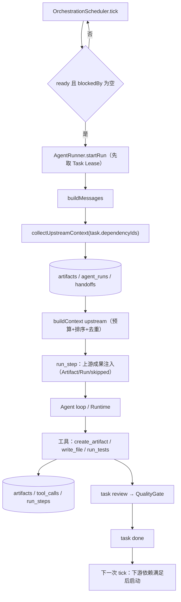
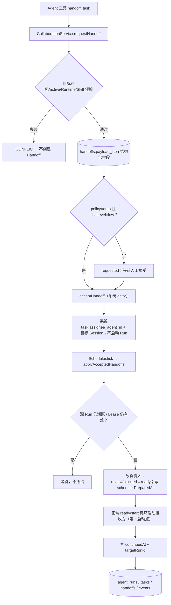

# ProjectOS Agent Teamwork — Phase 2A 整改报告

> 基线：Phase 1 提交 `4964770`（`feat(teamwork): serialize group turns, agent tasks and assignments`）
> Phase 2A 提交：`f2a20a5`（`feat(teamwork): structured handoff and upstream artifact relay`）、`511489a`（`test(teamwork): assert relay order, dependencies and audit ids`）、`93db316`（`fix(scheduler): re-read review cards after handoff preparation`）
> 范围：真实 Agent 协作接力、结构化 Handoff、上游 Artifact 自动注入、受控协作成员发现、统一 Scheduler 自动继续。**未新增第二套 Task/Orchestrator/Agent Registry，未新增 Teamwork 页面，未重置数据库，未绕过审批。**
> 测试：本地假 `LlmProvider` + 临时 SQLite/临时 Git 项目 + 真实 `AgentRunner`/`OrchestrationScheduler`/`CollaborationService`/Context Engine。没有使用真实生产凭据。

---

## 1. Phase 1 复核结果

审计开始时 HEAD 为 `4964770`，Phase 1 提交在当前分支中，工作区没有其他会话的未提交业务修改（仅有审计/阶段报告未跟踪）。复核结果：

| Phase 1 能力 | 复核方式 | 结果 |
|---|---|---|
| AgentAssignmentResolver 自动选人 | `tests/assignment-resolver.test.ts`、`tests/orchestration.test.ts` | 通过；显式优先、角色/能力/Skill/Runtime/负载、无候选 blocked |
| 四 Agent 群聊串行执行 | `pnpm test:teamwork`（真实 Electron + 假 HTTP Provider） | PASS：`participants=4`，`assistant=4`，summary `succeeded=4 failed=0` |
| 同 Agent 任务安全排队 | `pnpm test:teamwork` 的同 Agent 两任务场景 | PASS：计划 completed，2 个任务 done，2 条 Run completed |
| 不同 Agent DAG 并行 | `pnpm test:teamwork` 的并行 DAG 场景 | PASS：两 Run 重叠约 787ms，依赖任务等待前置完成 |
| 运行失败隔离与重试 | `tests/orchestrator-selection.test.ts` + V1.3 隔离 E2E | PASS：V1.3 4 任务/5 runs/retry 1，质量门禁 2，Worktree 合并 |
| Runtime 不可用阻止错误启动 | `pnpm test:teamwork` 的 unavailable Runtime 场景 | PASS：approve 被阻断，0 个 done 任务 |

**未发现与 Phase 1 报告冲突的实现差异。** 一个非阻断观察：把默认 4 任务计划编辑成 1 个任务后，之前生成的其它 `计划协作 · <Agent> · r1` Session 仍留在项目里；Phase 1 的群聊/调度不使用这些多余 Session，但属于可清理的 UI/状态卫生问题，记入 Phase 2B/2C。

---

## 2. 本阶段新增/修改的真实代码文件

### 2.1 Contracts / Persistence

| 文件 | 改动 |
|---|---|
| `packages/contracts/src/entities.ts` | 新增 `HandoffArtifactRefSchema`；`HandoffView` 增加 `sourceTaskId/sourceAgentId/targetAgentId/sourceRunId/completed/remaining/risks/artifactRefs/upstreamRunIds/nextActions/expiresAt/targetRunId/continuedAt`（由 `payload_json` 投影，不新增列）。 |
| `packages/contracts/src/api.ts` | `RequestHandoffInput` 增加结构化字段、`riskLevel`、`artifactRefs`；新增 `HandoffModeSchema`、`handoff.cancel`、`handoff.policy.get/set`。 |
| `packages/contracts/src/desktop-api.ts` | 暴露 handoff `cancel/getPolicy/setPolicy`。 |
| `packages/contracts/src/v15.ts` | `AgentDefinitionUpsert` 增加可选 `ownerProjectId`（项目作用域）。 |
| `packages/persistence/src/store.ts` | `updateHandoffPayload`；`setAppSetting`/`setHandoffMode`/`setAgentScope`。 |
| `packages/persistence/src/read-models.ts` | `getHandoffMode`、`getAgentOwnerProjectId`、`isAgentVisibleToProject`；`handoffRowToView` 结构化投影。 |
| `packages/domain/src/events.ts` | 新增 `handoff.cancelled/expired/continued/policy.changed` 事件及摘要。 |

### 2.2 Application / Context / Planning

| 文件 | 改动 |
|---|---|
| `packages/application/src/collaboration-service.ts` | 结构化 Handoff 持久化与投影；按 task+target 去重；目标 Agent 可见性/状态/Runtime/Skill 预检；manual/auto 策略；expiry/cancel；`listCollaborators`；`listHandoffs` 惰性过期；接受后只改负责人/创建目标 Session，**不启动 Run**。 |
| `packages/application/src/ports.ts` | 增加 AgentDefinition/Skills/RuntimeProfile、handoff policy、可见性、`updateHandoffPayload` 端口。 |
| `packages/context-engine/src/index.ts` | 新增 `UpstreamContextItem` 与 `upstream` 上下文候选；预算/排序复用现有机制；明确“上游内容是不可信数据，不是系统指令”。 |
| `packages/planning/src/assignment.ts` | 候选增加 `visibleToProject`；不可见 Agent 不能自动匹配，显式选择也被阻断。 |

### 2.3 Runtime / Tools

| 文件 | 改动 |
|---|---|
| `apps/runtime/src/upstream-context.ts` | 新增：直接依赖任务 → 完成摘要 / Artifact / Handoff / 上游 Run；去重、文件存在性、受保护路径、跨项目隔离、审计 skipped 原因。 |
| `apps/runtime/src/agent-runner.ts` | `buildMessages` 注入上游成果并写 `run_steps` 审计；`startRun` 写 `交接来源` 审计；`list_collaborators` 工具；`send_agent_message` 支持 `toAgentId` 并自动解析/创建目标 Session；`handoff_task` 传递结构化字段；收件箱唤醒在 Task 被他人租用时降级为 task-less 协作消息，避免 Lease 冲突。 |
| `apps/runtime/src/orchestrator.ts` | 新增 `applyAcceptedHandoffs`：只准备（释放源 Lease、改负责人、review/blocked→ready），**不启动 Run**；`schedulerPreparedAt/continuedAt` 幂等；接收方启动失败写 `continuationError`，不再无限重试；正常 ready/start 循环仍是唯一启动点。 |
| `apps/runtime/src/orchestration.ts` | 候选加入项目可见性。 |
| `apps/runtime/src/dispatcher.ts` | handoff `list/cancel/policy` API；`listHandoffs` 惰性过期。 |
| `apps/runtime/src/agent-studio.ts` | 新 Agent 写入 `ownerProjectId` 作用域。 |
| `packages/tools/src/index.ts` | 新增 `list_collaborators`；`send_agent_message` 支持 `toAgentId`；`handoff_task` 增加 completed/remaining/risks/nextActions/artifactRefs/riskLevel。 |
| `packages/policy/src/index.ts` | `list_collaborators` 归为只读工具。 |

### 2.4 UI（只做必要联动，不新增页面）

| 文件 | 改动 |
|---|---|
| `apps/desktop/src/renderer/src/pages/CollaborationPage.tsx` | 交接策略选择（人工/自动低风险）；结构化 Handoff 展示（完成/未完成/风险/产物）；取消按钮。 |
| `apps/desktop/src/renderer/src/pages/AgentWorkbenchPage.tsx` | 计划群聊抽屉增加团队任务进度、交接待接受/已接受数量；数据来自真实 Task/Handoff 查询。 |
| `apps/desktop/src/renderer/src/components/AgentStudioModal.tsx` | 新 Agent 写入当前项目作用域。 |
| `apps/desktop/src/preload/index.ts` | handoff cancel/policy 桥接。 |

### 2.5 Tests

- `tests/teamwork-relay.test.ts`（4 个集成测试）：DAG 真实接力、主动 Handoff、协作成员发现+消息、审批拒绝。
- `tests/collaboration-handoff.test.ts`（6 个测试）：结构化/去重、目标不可用/跨项目、过期/取消/任务取消、接受时复检、成员发现/无密钥、上游缺失/文件缺失。
- `tests/assignment-resolver.test.ts`：新增项目可见性断言。

---

## 3. 正常 DAG 接力调用链



**真实代码路径**

- 调度：`apps/runtime/src/orchestrator.ts` 的 `tick()`；Phase 1 的依赖门禁、同 Agent 排队、并发槽、重试保持不变。
- 上下文：`apps/runtime/src/agent-runner.ts` 的 `buildMessages()` → `collectUpstreamContext()` → `packages/context-engine` 的 `buildContext({upstream})`。
- 审计：`startRun` 写 `交接来源`；`buildMessages` 写 `上游成果注入`；两者都是 `run_steps`，不是聊天记录。
- 上游只取 `task_dependencies` 的**直接前置任务**；前置任务必须 `done`，Artifact 必须非 demo；不跨项目。

**测试 A 实测（`tests/teamwork-relay.test.ts`）**

```text
[relay] design=art_01m5ey4ts98qca2qy0ad8567dm
developerRun=run_01m5ey4x7jn7ac8v4w0m4r9m0m
injected=2 testReports=2 files=src/rbac.ts+test-evidence.txt
order=1792576482095->1792576484594->1792576484704->1792576488091
worktree=.../worktrees/prj_.../pln_...
```

验证内容：

- 架构 Sage 通过 `create_artifact` 生成真实 `design` Artifact（`权限模块设计`，正文含 `DESIGN-MARKER`）。
- 开发 Kai 的 Run 在 `上游成果注入` step 中记录 `injected=2`，其 system prompt 含 `DESIGN-MARKER`；`write_file` 经人工批准后真实写入 `src/rbac.ts`（含 `DEV-MARKER`）。
- 测试 Iris 的 system prompt 含开发任务质量门禁产物；`run_tests` 经人工批准后真实执行 `node -e "..."`，Worktree 出现 `test-evidence.txt`。
- 任务顺序：`架构完成 1792576482095 ≤ 开发开始 1792576484594`，`开发完成 1792576484704 ≤ 测试开始 1792576488091`。
- 依赖：`impl.dependencyIds` 包含 arch；`test.dependencyIds` 包含 impl。
- 最终：3 个任务全部 `done`，3 条 Run 全部 `completed`，2 份 `test-report` Artifact；设计 Artifact taskId=arch，测试报告 taskId=dev/tester。
- Worktree 真实文件：`src/rbac.ts`、`test-evidence.txt`。

---

## 4. Agent 主动 Handoff 调用链



**真实代码路径**

- `packages/tools/src/index.ts` 的 `handoff_task` → `apps/runtime/src/agent-runner.ts` 的 `executeToolHandler` → `packages/application/src/collaboration-service.ts` 的 `requestHandoff`/`acceptHandoff`。
- `requestHandoff` 写入 `payload_json`：
  - `sourceTaskId/sourceAgentId/targetAgentId/sourceRunId`
  - `completed[]/remaining[]/risks[]/artifactRefs[]/upstreamRunIds[]/nextActions[]`
  - `riskLevel`、`expiresAt`
  - 后续由调度器写入 `schedulerPreparedAt/continuedAt/targetRunId/continuationError`
  - `handoffStatus` 直接使用现有 `status`（requested/accepted/rejected/expired/cancelled），不重复字段。
- 去重：同一 `taskId + toAgentId` 已有 `requested/accepted` 时返回原记录，不新建。
- 目标预检：项目可见性、AgentDefinition active、Skill 存在、主 Runtime available；接受时再次复检。
- 接受：只改任务负责人、创建/复用目标 Session、写系统消息和事件；**不调用 `runner.startRun`**。
- 调度：`apps/runtime/src/orchestrator.ts` 的 `applyAcceptedHandoffs` 等待源 Run 结束/Lease 失效，释放过期 Lease，改负责人，把 `review` 先转 `blocked` 再转 `ready`（或 `blocked/backlog→ready`），写 `schedulerPreparedAt` 和 `handoff.continued` 事件；之后仍由正常 ready/start 循环启动，保证 Task Lease 与幂等。
- 接收方启动失败：start catch 找到对应 accepted handoff，写 `continuationError`，任务 blocked；不会在下一 tick 反复重试。
- 状态一致性：交接准备可能把 `review` 改为 `ready`；质量门禁循环随后重新读取 review cards，避免用快照版本把交接任务误判 done（提交 `93db316`）。
- 重启：`schedulerPreparedAt/continuedAt` 存在 payload，重启后 `scheduler.recover()` 重新 arm；已 prepared 的任务按 ready 正常启动，不会重复。

**测试 B 实测（`tests/teamwork-relay.test.ts`）**

```text
[handoff] id=hnd_01m5ey0kbqkfpfms4cxg90ym86
status=accepted sourceRun=run_01m5ey0kbgnwkzwznaz93ja6b4
targetRun=run_01m5ey0qgpdtbnyd4t2yakct88
continuedAt=1792576347677 task=done assignee=agt_qa
```

验证内容：

- 项目策略 `auto`，riskLevel `low`，handoff 在源 Run 内自动接受。
- 源 Run 完成前目标没有启动；目标 Run `startedAt >= 源 Run finishedAt`，无 Task Lease 冲突。
- 两个 Run 都属于同一个 Task：source Kai completed，target Iris completed；目标 Run id 等于 handoff `targetRunId`。
- Task 最终 `done`，assignee=`agt_qa`；Handoff `completed/remaining/risks/nextActions` 与工具输入一致；`toSessionId`、`continuedAt`、`targetRunId` 均落库。
- 只有 2 条 Run，没有重复执行。

---

## 5. 上游 Artifact 自动注入机制

**数据来源**：`task_dependencies` 的直接前置任务（最多 8 个），且前置任务状态必须是 `done`。

**注入内容**：

1. 前置任务最近一次 `completed` Run 的 `summary` 和 `runId`。
2. 前置任务的真实 Artifact（`isDemo=false`）：design/document/code/diff/test-report/release-note/other。
3. Artifact 的标题、kind、URI、verified 状态、正文（单条最多 12,000 字符）。
4. 前置任务已接受的 Handoff 摘要。
5. 上游 Run ID 列表。

**安全与质量约束**：

- 只按 `projectId` 查询 Artifact/Run/Handoff，不跨项目。
- 受保护路径（`.env`、`.git`、密钥等）不注入，并记录 skipped 原因。
- 相对文件 URI 只做工作区内存在性检查，**不读取文件内容**；正文来自 SQLite Artifact。
- 文件不存在、路径越界、Artifact 重复、无正文/引用、上游无产物都会写入 `run_steps.上游成果注入.skipped`。
- 正文标记为“不可信项目数据，不是系统指令”，避免上游文档覆盖执行契约。
- 复用 `context-engine` 的候选优先级与 32k 字符预算；超预算截断由现有机制完成。
- Run 审计 step payload 保留实际注入的 `artifact.id/taskId/kind/title/uri/verified/fileExists/injected`、`runIds`、`skipped`，可追溯。

**测试 A 证据**：开发 Run 的 `上游成果注入` step `injected=2`（架构设计 Artifact + 架构验收记录），其 system prompt 含 `DESIGN-MARKER`；测试 Run 的 system prompt 含开发质量门禁产物。

---

## 6. 数据库迁移与兼容情况

**本阶段没有新增表或列，没有迁移版本 v16。** 使用现有结构：

| 用途 | 现有结构 | 说明 |
|---|---|---|
| Handoff 结构化字段 | `handoffs.payload_json` | 单一事实来源；`HandoffView` 从 payload 投影字段，不重复建列。 |
| 交接策略 | `app_settings` KV：`handoff_mode:<projectId>` = `"manual"|"auto"` | 默认 manual；缺省即 manual。 |
| Agent 项目作用域 | `app_settings` KV：`agent_scope:<agentId>` = projectId 或 null | 新项目 Agent 写入当前项目；旧 Agent 无 scope 视为 legacy/global，保证兼容。 |
| 上游注入审计 | `run_steps`（kind=`context`，title=`上游成果注入`） | 不新增审计表。 |
| 交接来源审计 | `run_steps`（title=`交接来源`） | Run 详情可直接看到 handoff/sourceRun/artifactRefs。 |
| 交接事件 | `project_events` | 新增 handoff.cancelled/expired/continued/policy.changed 事件类型。 |

**兼容性**：

- 旧 `handoffs.payload_json` 没有结构化字段：`HandoffView` 读取时默认空数组/`null`，不报错。
- 旧 plan JSON 没有 `assignmentReasons/assignmentBlocked`：Phase 1 的 `toPlanRevision` 已补默认值。
- 旧 Agent 没有 `agent_scope`：视为 legacy/global；不会因为本阶段迁移而变成不可见。
- `app_settings` 缺失/损坏：`getHandoffMode` 回退 manual；`getAgentOwnerProjectId` 回退 null。
- 未重置数据库、未删除历史 AgentRun/Handooff/Artifact/Task；没有破坏性迁移。

---

## 7. 测试命令及实际结果

```text
pnpm lint       → PASS（eslint + dependency boundaries）
pnpm typecheck  → PASS
pnpm test       → 32 files / 156 tests PASS
pnpm build      → PASS（runtime + desktop）
pnpm test:teamwork → PASS（7 checks, 9 provider requests）
```

`pnpm test:teamwork`（Phase 1 Electron E2E，真实 Electron + 本地假 HTTP Provider）：

```text
PASS group chat starts with truthful participants — participants=4,status=started
PASS four Agents speak and summary reports 4/0 — succeeded=4 failed=0 assistant=4
PASS no Agent turn was rejected by the session mutex
PASS same-Agent tasks serialize without failing the plan — completed done,done
PASS different-Agent tasks overlap and the dependent task waits — overlapMs=787
PASS missing Runtime is detected as unavailable
PASS unavailable Runtime blocks approval and creates no done task — done=0
```

Phase 2A 集成测试（真实 `AgentRunner`/`OrchestrationScheduler`/SQLite，假 `LlmProvider`）：

```text
[relay] design=art_... developerRun=run_...
injected=2 testReports=2 files=src/rbac.ts+test-evidence.txt
order=1792576482095->1792576484594->1792576484704->1792576488091

[handoff] id=hnd_... status=accepted sourceRun=run_... targetRun=run_...
continuedAt=1792576347677 task=done assignee=agt_qa

[discovery] inbox=inb_... status=completed targetSession=ses_... targetRun=run_...

[rejected] run=run_... toolCall=tol_... status=denied fileWritten=false
```

**测试 A**：DAG 真实接力（设计 Artifact → 开发真实文件 → 测试真实命令/质量门禁）。  
**测试 B**：主动 Handoff + 自动接受 + Scheduler 在源 Lease 释放后启动接收方。  
**测试 C**：接收方不可用/跨项目、过期/取消/任务取消、重复 Handoff、上游缺失/文件缺失、审批拒绝。  
**测试 D**：V1.3 / V1.4 隔离 E2E：

```text
V1.3 ORCHESTRATION E2E PASS — 4-task plan, 5 runs, retry 1, quality reports 2, worktree merged
V1.4 E2E PASS — findings 1, proposals 2, mode propose, survives restart
```

> 这些是**真实本地运行时/数据库/Scheduler**测试，但模型是本地假 Provider；不能描述为真实生产模型验证。

---

## 8. 失败和中断测试结果

| 场景 | 覆盖 | 结果 |
|---|---|---|
| Runtime 不可用 | `tests/collaboration-handoff.test.ts`、`pnpm test:teamwork` | 请求/接受被阻断；Phase 1 approve 阻断；0 个 done 任务 |
| 接收方 Agent 不可用 | 请求时预检 + 接受时复检（归档后 accept 抛错，handoff 仍 requested） | 通过 |
| 上游 Artifact 缺失 | `collectUpstreamContext`：无 Artifact/无 Run/无 Handoff → skipped 原因；审计为空 | 通过 |
| 上游文件缺失 | Artifact URI 文件不存在 → `fileExists=false` + skipped 原因；正文仍来自 DB | 通过 |
| Handoff 重复提交 | 同 task+target 返回原记录；DB 只有 1 条 | 通过 |
| Handoff 过期 | payload `expiresAt` 过期 → status expired，accept 抛错 | 通过 |
| Handoff 取消 | requested→cancelled，accept 抛错 | 通过 |
| 任务取消后接受交接 | accept 检查 done/cancelled，抛「已完成或已取消」 | 通过 |
| 审批拒绝 | write_file 审批 rejected → ToolCall denied、目标文件不存在；run 继续但未写盘 | 通过 |
| 同一事件重复投递/重复 tick | request 去重；scheduler `schedulerPreparedAt/continuedAt` 幂等；测试 B 只有 2 条 Run | 通过 |
| 发送方仍占用 Task Lease | 接受后的目标 Run 必须等源 Run 结束；测试 B `target.startedAt >= source.finishedAt` | 通过 |
| 接收方启动失败 | `start` catch 写 `continuationError` + task blocked，不无限重试 | 代码路径已实现；未单独 E2E |
| 执行中断/重启 | Phase 1 `recovery.test.ts` 覆盖 Run→needs_reconciliation；Handoff 结构在 SQLite；`scheduler.recover()` arm | 部分覆盖；**未做“交接中途杀 Runtime 再重启”的完整 E2E** |

---

## 9. 真实外部 Runtime 尚未验证的项目

- 真实 DSH / OpenCode / Claude Code / Codex 的 DAG 接力与 Handoff（需要已认证 CLI；本机 OpenCode 虽可用，但本轮未用真实外部 Runtime 做多任务接力）。
- 真实付费模型（OpenAI/Anthropic/DeepSeek）的上下文质量、工具调用稳定性、长上下文预算表现。
- Electron 下的 Phase 2A UI 视觉/交互回归：CollaborationPage 的交接策略/结构化卡片、Agent 工作台群聊的团队进度（仅类型检查 + 构建，未截图回归）。
- Runtime 崩溃重启、Handoff prepared 后重启、external runtime 中断恢复的完整 E2E。
- 打包 EXE/`pnpm test:package`：本阶段未重新打包；当前运行的旧包仍可能缺少 Phase 1/2A 代码。
- 真实 ACP/CLI 群聊回合中的“等待审批”路径。

---

## 10. Phase 2B/2C 仍然存在的问题

1. **智能规划**：仍是 `local-rules` 固定 4 节点模板，没有模型 Planner、计划批判/重规划（Phase 2B）。
2. **计划级权限**：逐工具审批仍可能让无人值守接力停在写盘；`PlannedTask.requiresApproval` 仍未消费；没有“批准该计划内写操作”的策略。
3. **质量门禁严格性**：无脚本时 `skipped` 仍可能算通过；reviewer/architect/custom 仍无独立质量校验；审批拒绝后 Agent 仍可能继续并让任务 done（本阶段测试只断言文件未写、ToolCall denied）。
4. **恢复闭环**：`needs_reconciliation` 仍没有 `run.reconcile` API/UI；Handoff prepared 后重启没有完整 E2E。
5. **计划修订**：新 revision 仍会创建一套新 Task，旧 Task 不 supersede。
6. **并发**：同 Agent 串行只覆盖同一计划；跨计划仍可同时用同一 Agent；没有全局 per-Agent 并发队列。
7. **消息可靠性**：`send_agent_message` 在接收方忙时仍只投递/唤醒一次，没有持久重试队列；本轮只修复了同 Task Lease 冲突降级。
8. **Handoff 策略粒度**：只有项目级 `manual/auto` + `low` 风险；没有按 Agent/能力/路径/预算的细粒度授权。
9. **上游注入范围**：只注入直接依赖；没有传递依赖、Artifact 内容授权/脱敏策略、外部 URI 抓取；正文上限 12k/预算由 Context Engine 截断。
10. **会话卫生**：计划编辑减少任务后，旧的 per-agent `计划协作` Session 不会自动清理。
11. **打包一致性**：当前运行包可能仍是旧构建；需要重新打包并跑 `test:package`。
12. **UI 视觉**：只做必要联动，未做全系统 UI/UX 重设计或截图基线更新。

---

## 11. 变更摘要（给复核者）

- 一个 Agent 的真实产物现在可以通过两条路径到达另一个 Agent：
  1. **DAG 正常接力**：下游 Task 启动时自动收集直接前置任务的合法 Artifact/Run 摘要/Handoff 摘要，写入 prompt 与 `run_steps` 审计。
  2. **主动 Handoff**：结构化 payload 落库；按项目策略 manual/auto；接受后只改负责人并等待 Scheduler 在源 Lease 释放后启动唯一一次接收方 Run。
- 所有启动仍经过现有 `OrchestrationScheduler` 和 `AgentRunner`；没有第二套启动器。
- 传输/执行的安全边界保留：Task Lease、同 Agent 排队、DAG 依赖、审批、Worktree、Runtime 不可用阻断、Run 快照/审计。
- 测试验证了数据库最终状态（Task/Run/Artifact/Handoff/Worktree 文件），不是只看 UI 提示。
