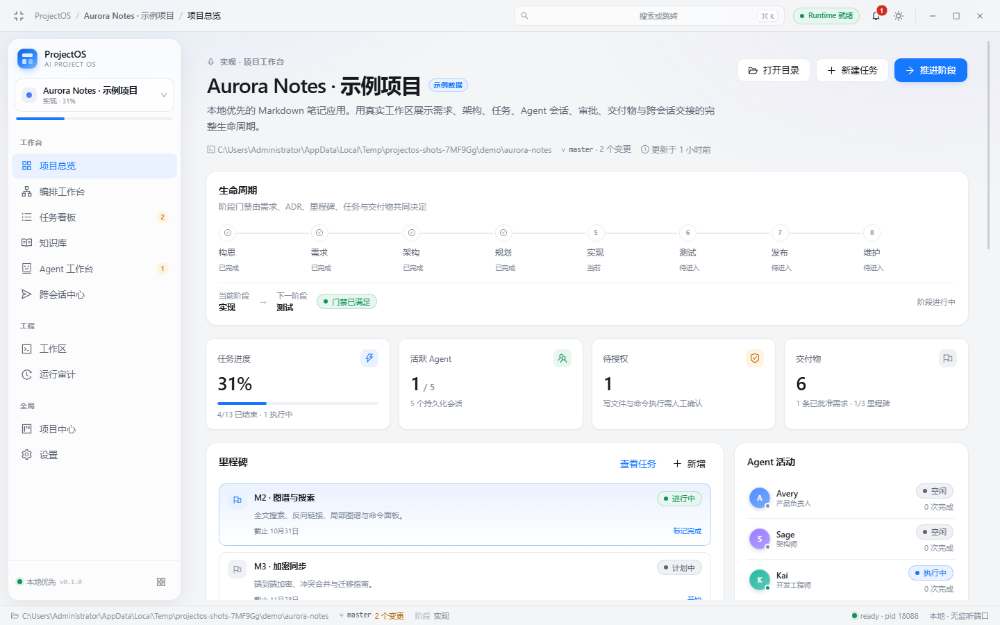
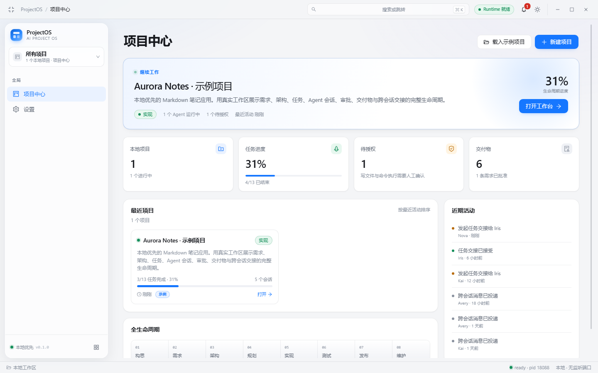
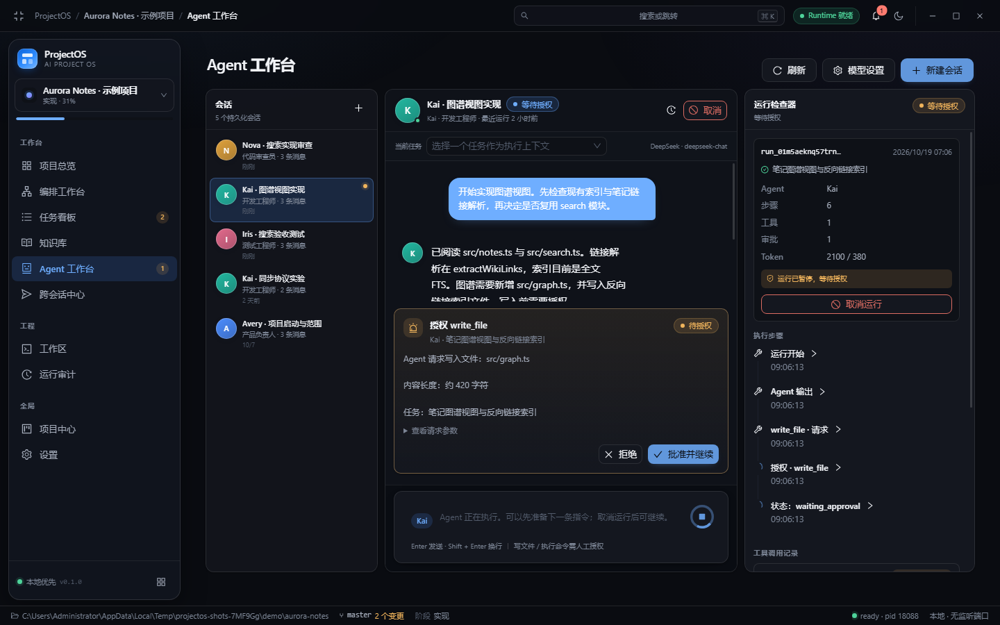
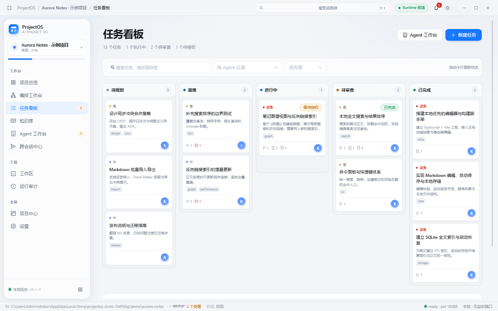
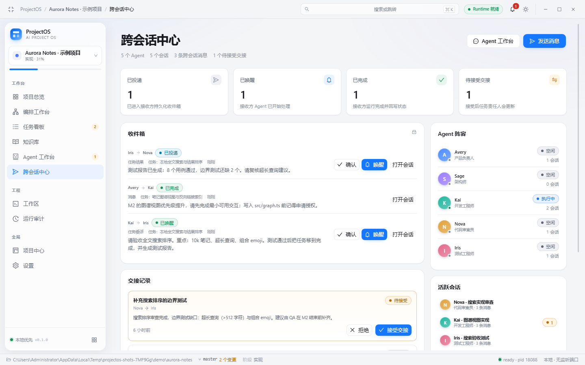
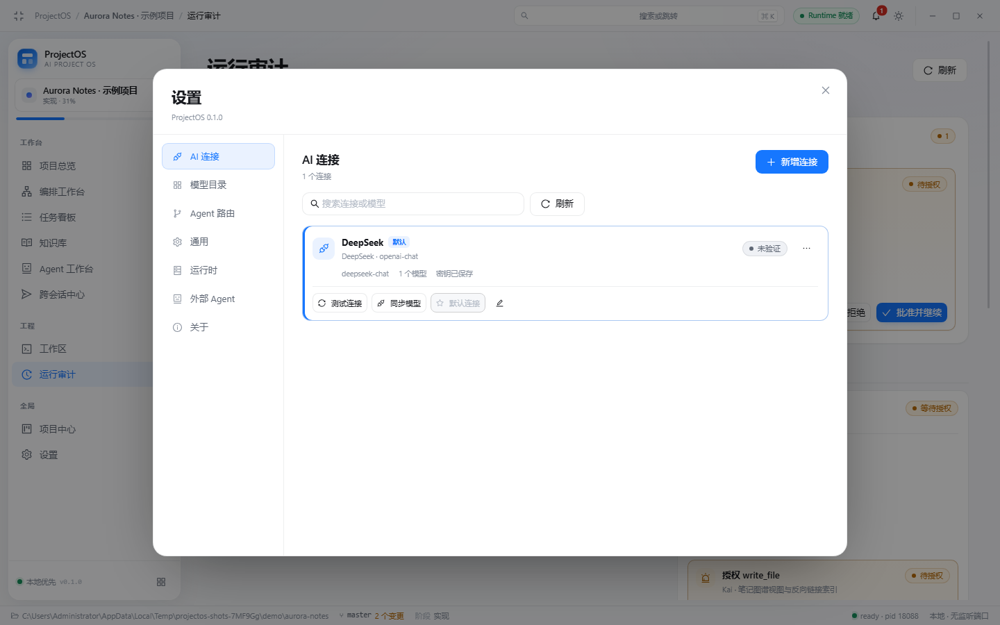
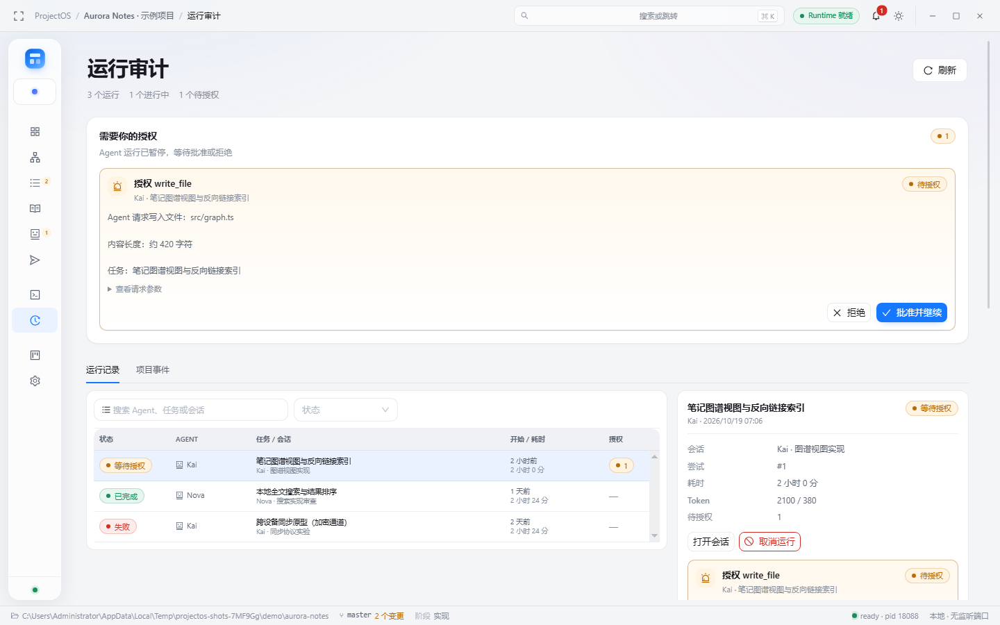
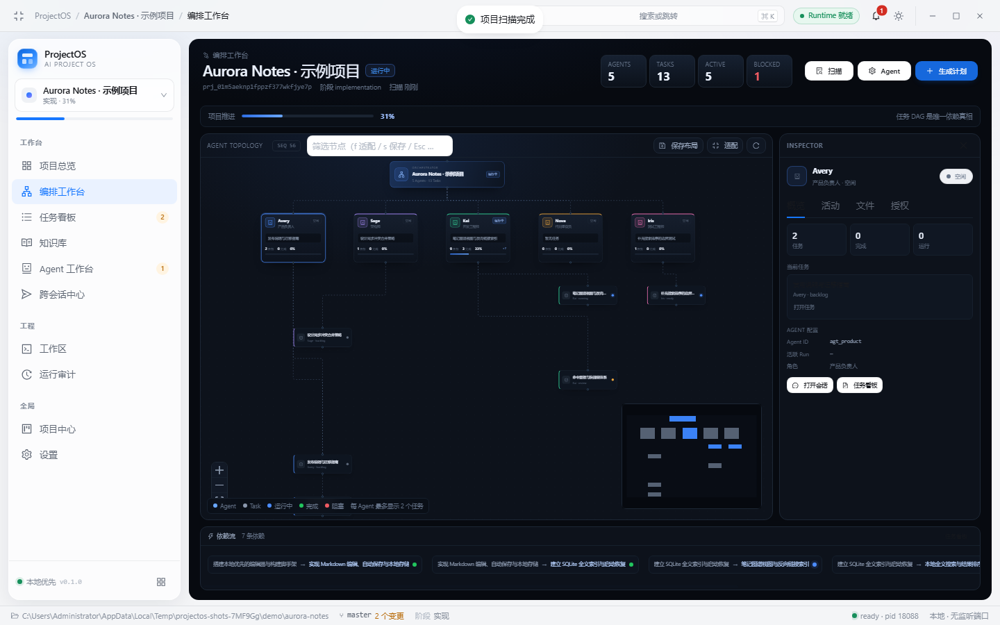
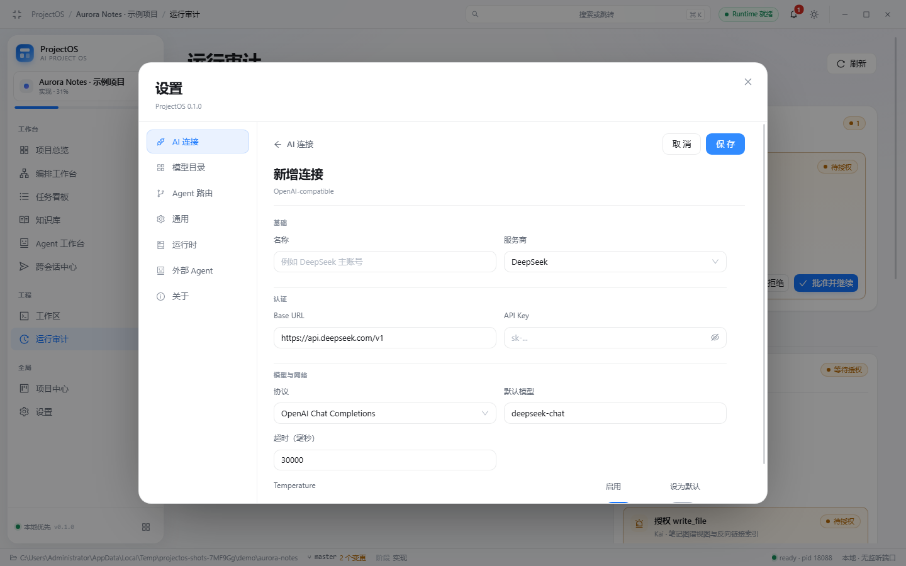

# ProjectOS

> Local-first, AI-native project lifecycle workspace.  
> TypeScript · Node.js · React · Ant Design · Ant Design X · Electron · pnpm monorepo

ProjectOS 把项目从构思、需求、架构、规划、实现、测试、发布到维护的全过程放进一个本地工作台。
需求、任务、Agent 会话、运行步骤、工具调用、审批、交付物和跨会话消息都持久化在 SQLite 中，
不以聊天记录作为项目状态的真相。



## 直接运行（Windows x64）

已编译便携版，**无需安装 Node/Electron，双击即可运行**：

[**下载 / 打开 ProjectOS-0.1.0-portable.exe**](release/ProjectOS-0.1.0-portable.exe) · 约 99 MB

```powershell
.\release\ProjectOS-0.1.0-portable.exe
```

- 未签名：SmartScreen 提示时选择“更多信息 → 仍要运行”。
- 默认数据目录：`%APPDATA%\ProjectOS\data`；可用 `PROJECTOS_DATA_DIR` 覆盖。
- 校验：`release/SHA256SUMS.txt`；构建/布局说明见 [docs/packaging.md](docs/packaging.md)。
- 调试用解包目录：`release\win-unpacked\ProjectOS.exe`。

## 当前交付状态（诚实版）

已完成并经过实际验证：

- **本地 Runtime 架构**：Electron Main 监管独立 Node Runtime 子进程，stdin/stdout 分帧 IPC、
  握手、心跳、退避重启、优雅关闭；Runtime 是 SQLite 的唯一写者。
- **项目与生命周期**：本地项目创建/导入目录、8 阶段生命周期、阶段门禁、里程碑、需求审批、
  ADR、交付物、项目事件时间线。
- **任务管理**：看板拖拽、验收标准、任务 DAG、依赖环检测、乐观并发版本、完成门禁、运行记录。
- **Agent 原生循环**：OpenAI-compatible `/chat/completions` 流式 Provider、工具调用、
  `read_file` / `write_file` / `run_command` 等工具、审批暂停与恢复、checkpoint、Token 统计。
- **真实审批闭环**：写文件/执行命令先暂停运行并创建 Approval；人工批准后执行、记录 ToolCall、
  继续模型循环；拒绝时给出结构化结果。E2E 已验证。
- **Ant Design X 工作台**：流式消息、工具步骤、授权卡片、运行检查器。
- **跨 Agent 会话**：持久化收件箱、幂等键去重、投递状态、ACK、唤醒运行、结构化 Handoff。
- **工作区**：真实文件树、Monaco 只读查看、Git diff、只读终端白名单、跨平台进程执行。
- **可恢复性**：重启扫描未完成 Run、Lease 过期、待审批；未知副作用进入 `needs_reconciliation`，
  不自动重试。
- **UI/UX**：设计令牌、Light/Dark/System、克制玻璃拟态、响应式 1440×900 与 1024×768、
  设置弹层、显式折叠侧栏、截图验证。
- **测试**：65 个单元/集成/协议测试 + 六个 Playwright Electron E2E + 打包产物冒烟测试。

## 二期增量（V1.2 核心）

- **AI 连接中心**：多连接 CRUD、启停、默认、测试、删除；设置改为全局弹层。
- **连接诊断**：L1 配置 / L2 可达性 / L3 真实推理；错误分类与处理建议。
- **模型目录**：OpenAI-compatible `/models` 发现、手动录入、默认模型、能力状态。
- **SecretVault**：按连接 ID 的 safeStorage 加密；SQLite 只存 `secret_ref`。
- **旧配置迁移**：V1.1 单 Provider 幂等迁移为默认连接。
- **默认连接执行**：同步既有 ProviderManager，真实 Agent 运行无需重写。
- **外部 Agent**：Claude Code / Codex 安装与版本检测（仅检测，不执行）。
- **UI 修复**：显式折叠与窄窗口共用紧凑侧栏；主要页面删除解释性副标题。

未完成：角色/项目路由、外部 CLI 执行、费用/预算、Anthropic 原生协议。

详见 [docs/v1.2/acceptance-report.md](docs/v1.2/acceptance-report.md) 与
[docs/v1.2/baseline-audit.md](docs/v1.2/baseline-audit.md)。

## 三期增量（V1.3 核心）

- **项目扫描**：识别 TypeScript/React/Vite/Electron/Monorepo 与 Java/Maven/Gradle/Spring，
  生成持久化 ProjectSnapshot。
- **计划与审批**：目标生成 4 任务 DAG（架构 → 开发 → 审查 → 测试），可编辑标题/角色；
  批准后创建真实任务与依赖。
- **多 Agent 图工作台**：React Flow 画布投影真实 Agent、任务、依赖与状态；节点点击联动
  Inspector；保存/恢复布局。
- **连接编辑体验修复**：新增/编辑 AI 连接改为设置内容区内联视图，不再叠加二层 Modal。
- **自动编排**：计划 start/pause/resume/cancel、并发执行、自动验收推进与重启恢复。
- **Worktree**：计划级隔离分支、diff artifact、干净主工作区才可合并，UI 提供查看/合并/丢弃。
- **计划修订与知识库**：已批准计划创建新 revision；SQLite FTS5 全文检索与知识库页面。
- **Agent 路由与用量**：按任务/Agent/项目/全局路由连接，Run 结束记录 tokens 与用量汇总。
- 数据库 v3：`project_snapshots` / `plan_revisions` / `graph_layouts`。

未完成：外部 Agent 执行、事件 seq 断线补齐、200 节点压测；完整台账见 [docs/v1.3/full-completion-plan.md](docs/v1.3/full-completion-plan.md)。

详见 [docs/v1.3/acceptance-report.md](docs/v1.3/acceptance-report.md) 与
[docs/audits/v1.3-baseline.md](docs/audits/v1.3-baseline.md)。

明确**未完成**或未宣称完成：

- OCS 外部 Adapter（`leeguooooo/open-cross-session`）未接入；本地邮箱是权威存储，接口已预留。
- Claude Code 已支持只读 Plan 模式执行；写模式、Codex 执行与授权状态探测未完成。
- Git 计划级 Worktree 已实现；真实 Git push/deploy 工具、插件进程隔离、代码签名、安装器与自动更新未实现
  （已有未签名便携版 EXE，可直接运行）。
- 知识库页面与 FTS5 全文检索已实现；旧决策失效标记仍未实现。
- M5 的完整插件市场/多租户/云控制台不在范围内。

详见 [docs/status.md](docs/status.md) 与 [docs/adr](docs/adr/)。

## 技术栈

| 领域 | 选型 |
|---|---|
| 语言 / 运行时 | TypeScript strict、Node.js 24、Electron 44 |
| 仓库 | pnpm workspace + Turborepo + 独立 `tooling` |
| 桌面 | Electron + electron-vite；Main 只负责窗口、IPC、密钥与 Runtime 监管 |
| 前端 | React 19、Vite 8、Ant Design 6、Ant Design X 2、Zustand、TanStack Query |
| 运行时 | 独立 Node 子进程、分帧 NDJSON over stdio、Zod 边界校验 |
| 数据 | SQLite（Node 内置 `node:sqlite`）、WAL、FK、迁移校验、单写者 |
| 测试 | Vitest + Playwright（Electron） |
| 可观测 | Pino 日志、项目事件、RunStep、ToolCall、审计时间线 |

## 快速开始

要求：Node.js 24（`.nvmrc`）、pnpm 9（`corepack enable pnpm`）。

```bash
pnpm install
pnpm build:runtime      # 构建 Runtime 子进程 bundle
pnpm dev                # 同时启动 Runtime watch 与 Electron + Vite
```

如果环境中已经设置了 `ELECTRON_RUN_AS_NODE=1`（某些 Electron 工具链会设置），项目脚本会用
`cross-env` 自动清除它；只有在你直接运行 `electron .` 时才需要手动移除：

```powershell
Remove-Item Env:ELECTRON_RUN_AS_NODE
```

打开应用后：

1. 在“项目中心”点击“新建项目”，选择一个本地目录。
2. 在“设置 → AI 连接”配置 OpenAI-compatible 服务（密钥使用 Electron `safeStorage`
   加密，不写入 SQLite 或日志）。
3. 在“编排工作台”扫描项目、生成计划并批准创建任务。
4. 在“Agent 工作台”选择/创建会话，选择任务上下文并发送指令。
5. 写文件或执行命令时运行会暂停，前往授权卡片批准或拒绝。
6. 也可以点击“载入示例项目”生成一个完整的 Aurora Notes 演示项目（标注为示例数据）。

## 常用命令

```bash
pnpm typecheck          # 全仓库 TypeScript strict 检查
pnpm lint               # ESLint + 自定义包边界检查
pnpm test               # Vitest：domain/persistence/application/provider/loop/recovery/runtime
pnpm build              # Runtime bundle + Electron main/preload/renderer
pnpm test:e2e           # 构建后执行桌面创建项目 + 重启恢复 E2E
pnpm test:agent         # 构建后执行真实 Agent 审批/写文件/恢复循环 E2E
pnpm test:command       # 构建后执行命令审批与真实 run_command E2E
pnpm test:v12           # AI 连接弹层、测试、模型发现、默认连接真实运行、重启
pnpm test:v13           # 扫描、计划 DAG 批准、真实图、布局持久化、内联连接编辑
pnpm test:orchestration # 4 任务自动编排、用量记录、重启恢复
pnpm package:win        # 构建 Windows x64 便携版 EXE（release/）
pnpm package:dir        # 只生成解包目录，便于调试
pnpm test:package       # 对 release/win-unpacked 做真实创建/重启冒烟
pnpm screenshots        # 构建后生成 1440/1024、Light/Dark 截图
```

## 目录结构

```text
apps/
  desktop/        Electron Main / Preload / React Renderer
  runtime/        独立 Node Runtime（IPC、调度、Agent 执行、Demo Seed）
packages/
  contracts/      Zod 边界、实体、IPC/Runtime 协议、Desktop API 类型
  domain/         任务/Run/交接状态机、DAG、生命周期门禁、事件摘要
  application/    用例服务：项目、任务、会话、协作
  persistence/    SQLite schema/迁移/仓储/读模型
  connection-diagnostics/ 连接错误分类与用户建议
  project-analyzer/ 项目技术栈扫描
  planning/       计划 DAG 生成与校验
  graph-projection/ 真实任务/Agent 图投影
  agent-runtime/  与持久化解耦的原生 Agent Loop
  context-engine/ 带来源和预算的上下文组装
  collaboration/  CrossSessionEnvelope、邮箱、Handoff
  session-manager/会话历史与消息规范化
  skills/         Skill Manifest 与选择器
  tools/          工具 Schema 与能力过滤
  policy/         路径/审批/密钥脱敏策略
  workspace/      文件树、Monaco 数据、Git、只读/审批命令、跨平台执行
  provider-interfaces/  Provider 抽象
  provider-openai-compatible/ 流式 OpenAI-compatible Provider
  kernel/         容器、能力注册、插件生命周期
  design-tokens/  设计令牌与 CSS variables
  ui/             AppShell、导航、状态、指标、反馈等
  ai-ui/          Ant Design X 消息、工具链、审批卡片
docs/
  adr/            架构决策记录
  screenshots/    真实桌面截图
  v1.2/           V1.2 审计、迁移、兼容性与验收报告
scripts/          E2E、打包冒烟、截图、包边界检查
release/          便携版 EXE、unpacked 目录、SHA256（构建产物，gitignore）
tests/            Vitest 测试
```

## 架构与安全边界

```text
React Renderer（无 Node 权限）
      │ 命名 preload API + Zod 校验
Electron Main（窗口 / IPC / secrets / supervisor）
      │ request-response + event stream（NDJSON）
Node Runtime（application / agent loop / tools）
      ├── SQLite（唯一写者，WAL）
      ├── 本地工作区（FS / Git）
      ├── OpenAI-compatible Provider
      └── 受审批工具进程
```

- Renderer 不暴露通用 `invoke(channel, any)`，只暴露固定命名 API；Main 与 Runtime 双重校验。
- API Key 只保存在 Main 的 OS 加密存储中，通过私有 stdio 交给 Runtime，内存持有。
- 默认不监听 TCP 端口；CSP 禁止外部脚本、frame、对象与未授权连接。
- 工具调用先写意图和幂等键，再执行并记录结果；受保护路径、`../` 和符号链接越界被拒绝。
- Runtime 崩溃后由 Main 退避重启；运行中的未知副作用进入待核对，不自动重试。
- 任务租约使用单调 fencing token；旧 token 不能续约或提交。

## 跨会话

本地持久化邮箱是权威状态。消息至少一次投递，消费方用 `idempotencyKey` 去重；状态区分
`delivered → accepted → completed`，并显式支持 `failed/unknown`。`agent.wake` 只表示唤醒请求，
不等于任务完成。详见 [docs/cross-session.md](docs/cross-session.md)。

## 验证记录

在 Windows 11 + Node 24.22 + Electron 44 上实际运行：

```text
pnpm lint       → 0 errors, 0 warnings
pnpm typecheck  → pass
pnpm test       → 17 files, 65 tests passed
pnpm build      → Runtime bundle + Electron main/preload/renderer built
node scripts/e2e.mjs       → PASS（UI 创建项目，关闭重启后恢复）
node scripts/agent-e2e.mjs → PASS（审批暂停、批准写文件、继续循环、Run completed）
node scripts/command-e2e.mjs → PASS（命令审批、真实执行 node --version、ToolCall completed）
node scripts/v12-e2e.mjs   → PASS（设置弹层、连接测试/模型发现、默认连接真实运行、重启、折叠侧栏）
node scripts/v13-e2e.mjs   → PASS（扫描、计划批准、真实图、布局持久化、内联连接编辑）
node scripts/v13-orchestration-e2e.mjs → PASS（4 任务自动编排完成、用量记录、重启恢复）
node scripts/package-smoke.mjs → PASS（打包 EXE 创建项目、写 starter 文件、重启恢复）
ProjectOS-0.1.0-portable.exe → 直接启动成功（无 node_modules，Runtime ready，SQLite/示例数据正常）
```

完整测试矩阵与未覆盖项见 [docs/testing.md](docs/testing.md)。

## 界面

| 项目中心 | Agent 工作台 |
|---|---|
|  |  |

| 任务看板 | 跨会话中心 |
|---|---|
|  |  |

| 设置弹层 | 折叠侧栏 |
|---|---|
|  |  |

| 编排工作台 | 内联连接编辑 |
|---|---|
|  |  |

## 设计取舍

- **不使用原生 SQLite addon**：使用 Node 24 内置 `node:sqlite`，避免 Electron ABI 重编译；
  代价是暂时没有 Drizzle ORM，仓储层用手写 SQL + 类型映射，见 ADR-0002。
- **不接入未核实的外部 Agent API**：外部 Driver/OCS 只保留接口和文档，不伪造实现。
- **UI 是交付物**：所有页面使用真实数据；示例项目明确标注“示例数据”。

## License

MIT


