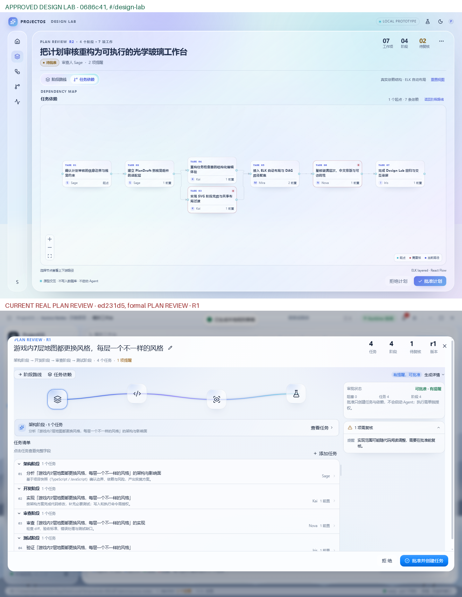

# ProjectOS 已认可视觉基线调查

日期：2026-10-23  
状态：**停止 UI 修改；仅调查、双路由截图、差异分析与安全迁移方案**  
当前分支：`feature/projectos-next-ui-full-migration`  
当前 HEAD：`85f2ae5`  
工作区：仅新增调查文档与截图，未修改业务源码  
稳定分支：未合并

## 0. 事实来源

本轮以用户提供的 `ProjectOS_Approved_UI_Baseline.zip` 为唯一视觉事实：

```text
APPROVED_design_lab_DAG.jpeg
REJECTED_current_plan_modal.png
APPROVAL_TRUTH.md
```

- **APPROVED**：Design Lab 的 DAG 工作台
- **REJECTED**：正式 Plan Review 的常规 Modal
- 这两个结论不因分支名、Agent 总结或测试结果改变。

## 1. `#/design-lab` 是否仍然存在？

**存在。**

路由仍由：

```text
apps/desktop/src/renderer/src/router.tsx
```

暴露为 `#/design-lab`，页面实现位于：

```text
apps/desktop/src/renderer/src/features/design-lab/DesignLabPage.tsx
```

`pnpm dev:design-lab` 使用：

```text
PROJECTOS_START_ROUTE=design-lab
```

启动独立 Design Lab 页面。

在隔离 Worktree：

```text
C:\Users\Administrator\Desktop\workplace\ProjectOS-visual-baseline-0686c41
```

中实际启动 Electron，进入 `#/design-lab` 并切换到“任务依赖”，
得到与 `APPROVED_design_lab_DAG.jpeg` 一致的 DAG 工作台：

```text
docs/next-ui/visual-regression/APPROVED-design-lab-dag.png
```

当前主分支的 Design Lab 仍然存在，但它的视觉已被后续 commit 改过，
**不能用当前版本冒充 approved**。已认可版本必须从 `0686c41` Worktree 运行。

## 2. 当前正式计划审核使用哪个组件？

正式计划审核不是 Design Lab。

入口与实现：

```text
apps/desktop/src/renderer/src/features/orchestration/pages/OrchestrationWorkspace.tsx
apps/desktop/src/renderer/src/features/orchestration/components/PlanReviewNext.tsx
apps/desktop/src/renderer/src/features/orchestration/components/StageJourney.tsx
apps/desktop/src/renderer/src/features/orchestration/components/TaskGraph.tsx
apps/desktop/src/renderer/src/features/orchestration/components/plan-review-logic.ts
```

正式页面由 `OrchestrationWorkspace` 的 `DialogShell` 承载 `PlanReviewNext`，
使用真实 PlanDraft / tasks / dependencies / approval API。

Design Lab 使用：

```text
apps/desktop/src/renderer/src/features/design-lab/DesignLabPage.tsx
apps/desktop/src/renderer/src/features/design-lab/StageJourney.tsx
apps/desktop/src/renderer/src/features/design-lab/TaskGraph.tsx
apps/desktop/src/renderer/src/features/design-lab/TaskInspector.tsx
apps/desktop/src/renderer/src/features/design-lab/design-lab.css
apps/desktop/src/renderer/src/features/design-lab/data.ts
```

**结论：两套独立实现。**

- Design Lab：演示数据、原型交互、完整工作台构图
- 正式 Plan Review：真实业务数据、常规 Dialog 构图

两者共享视觉词汇，但从来没有真正合并为同一个页面。

## 3. 昨晚重构改坏了什么？

既改了 Design Lab，也没有把 Design Lab 迁移到正式页面。

### 3.1 Design Lab 自身被改

根因提交：

```text
8c4e578 fix(design-lab): apply frozen UI contract and typography fixes
```

它修改了：

```text
features/design-lab/StageJourney.tsx
features/design-lab/design-lab.css
features/design-lab/TaskInspector.tsx
features/design-lab/TaskGraph.tsx
features/design-lab/DesignLabPage.tsx
```

主要视觉变化：

- 删除阶段图标下的名称/说明/数量，改为 Tooltip
- 图标缩小、路线压缩
- review/inspector 面板移除部分玻璃 blur
- 任务行和面板密度压缩
- 把 `approved-*` 与 `post-fix-*` 同时提交为 baseline，导致后续误判

`fa75923` 又把 Design Lab 的 TaskInspector 接入共享 Overlay，进一步改变
inspector 结构和视觉。

### 3.2 正式页面没有迁移 Design Lab 构图

正式 Plan Review 一直是：

```text
OrchestrationWorkspace → DialogShell → PlanReviewNext
```

而不是：

```text
Design Lab 全屏工作台 + StageJourney + TaskGraph + TaskInspector
```

后续长程任务做了大量正式页面样式覆盖：

```text
28fc994 开始引入 next-ui-app.css 全局皮肤
5d8d03d 把 icon-only 阶段路线复制到正式 StageJourney
dbf43c0 调整正式 DAG / typography
```

但这些都是在正式 Plan Review 原有 Modal 结构上做局部美化，
没有把 Design Lab 的 Shell、布局、DAG 工作区和字体系统整体迁移过去。

## 4. 已认可设计对应哪个准确 Commit？

**已认可 Commit：**

```text
0686c41 feat(design-lab): premium liquid glass desktop workspace
```

来源分支：

```text
feature/v1.6-liquid-glass-design-lab
```

验证 Worktree：

```text
C:\Users\Administrator\Desktop\workplace\ProjectOS-visual-baseline-0686c41
```

Tag：

```text
visual-baseline-approved-0686c41
```

对应组件/资产：

| 类型 | 路径 |
|---|---|
| 页面 | `apps/desktop/src/renderer/src/features/design-lab/DesignLabPage.tsx` |
| 阶段路线 | `.../design-lab/StageJourney.tsx` |
| DAG | `.../design-lab/TaskGraph.tsx` |
| Inspector | `.../design-lab/TaskInspector.tsx` |
| 样式 | `.../design-lab/design-lab.css` |
| 数据 | `.../design-lab/data.ts` |
| 视觉资产 | `docs/design-system/v1.6-commercial-ui/design-lab/lab-dag.png` |
| 用户基线截图 | `docs/next-ui/visual-regression/APPROVED-design-lab-dag.png` |

`8c4e578` 不是 approved；它是第一次视觉改差。

## 5. 为什么此前把图一错误判定为认可版本？

五个原因：

1. **把路由混为一谈**
   - 图二是 `#/design-lab` 的 Design Lab 工作台。
   - 图一是正式 Plan Review 的 `PLAN REVIEW · R1` Modal。
   - 两者数据和场景不同，却被当成“同一页面的两个版本”。

2. **用分支名/提交标题代替截图**
   - 看到 `fix(design-lab): apply frozen UI contract`、测试 PASS，就误以为
     `8c4e578` / 后续版本是 approved。
   - 没有先核对用户提供的两张真实截图。

3. **把“契约修复”置于用户视觉之上**
   - 契约写了 icon-only、去文字，就据此删除了用户认可的布局细节。
   - 当文字契约与用户截图冲突时，应截图优先。

4. **把当前 Design Lab 截图当成历史认可版本**
   - 当前 `#/design-lab` 已被 `8c4e578` / `fa75923` 改过，
   - 我用当前页面截图去证明“没丢”，这是循环论证。

5. **数据不同导致错误对比**
   - 图一 9 任务/8 阶段来自真实草案；
   - 图二 7 任务/4 阶段来自 Demo 数据。
   - 用不同数据直接比较，掩盖了“正式页面从未采用 Design Lab 构图”这一事实。

## 6. 双路由截图

| 标注 | 路由 | 证据 |
|---|---|---|
| **APPROVED DESIGN LAB** | `#/design-lab` @ `0686c41` | `visual-regression/APPROVED-design-lab-dag.png` |
| **CURRENT REAL PLAN REVIEW** | `OrchestrationWorkspace` @ `ed231d5` | `visual-regression/REJECTED-current-real-plan-review.png` |

并排：



上图：Design Lab DAG 工作台，已认可。  
下图：正式 Plan Review Modal，明确不认可。

## 7. 安全迁移方案（待用户确认后实施）

**不在本轮实施。**

### Phase 0 — 冻结

- 保护 `0686c41` Worktree 与 Tag。
- 不修改主分支业务代码。
- 所有实验在独立 Worktree/分支。

### Phase 1 — 提取 Design Lab Shell

把以下视觉结构提取为可复用工作台：

- `DesignLabPage` 的左 rail + 全屏光学 canvas + header
- `StageJourney`
- `TaskGraph`（DAG 工作区、节点、图例）
- `TaskInspector` 的查看/编辑结构
- `design-lab.css` 的 tokens / materials / typography / motion

输出：`PlanReviewWorkspace`（纯视觉壳，接收真实 draft、真实回调）。

### Phase 2 — 接真实业务

- 用真实 `PlanDraft` / `PlannedTask` / dependencies 替换 demo data。
- header 改为真实指标：工作项 / 阶段 / 待复核（不显示 R1/版本列）。
- DAG 用真实 ELK 布局与真实 dependsOn。
- 审批按钮调用现有真实 approve/reject；不调用 Design Lab 模拟审批。
- 保留授权、执行、Replan、Inspector 编辑和所有校验。

### Phase 3 — 正式路由替换

- 计划生成仍从编排页启动。
- 生成完成后进入 `PlanReviewWorkspace` 全屏页面，而不是 Dialog。
- 关闭/返回编排保留。
- 原 Dialog 仅保留生成表单的过渡，最终也移除。

### Phase 4 — 视觉验收

- 使用同一份真实 9 任务草案截图，与 approved 图对比“设计语言”，
  不要求 demo 数据一致。
- 必须覆盖 1440/1100/125%、浅色/暗色、DAG default/focus、Inspector。
- 用户确认后才能继续其他页面。

### Phase 5 — 其余页面

- 以同一 Shell 和 tokens 逐页迁移。
- 不做一次性全局 CSS 覆盖。

## 8. 工作区保护

当前状态：

```text
branch: feature/projectos-next-ui-full-migration
HEAD: 85f2ae5
worktree: C:\Users\Administrator\Desktop\workplace\ProjectOS-next-ui-full-migration
```

安全备份：

```text
backup/next-ui-before-restore-20261022 @ ef7bfee
backup/formal-plan-review-20261023 @ 85f2ae5
```

外部 bundle / patch：

```text
C:\Users\Administrator\Desktop\workplace\_projectos-next-ui-pre-restore-20261022
```

未执行：

- `git reset --hard`
- `git clean -fd`
- 强制覆盖
- 强制推送
- 自动合并
- 删除 Worktree / 分支

## 9. 停止状态

本轮只完成调查、双页面截图、Commit/组件定位和安全迁移方案。

**未继续修改业务页面，未自动实施迁移，等待用户确认。**
