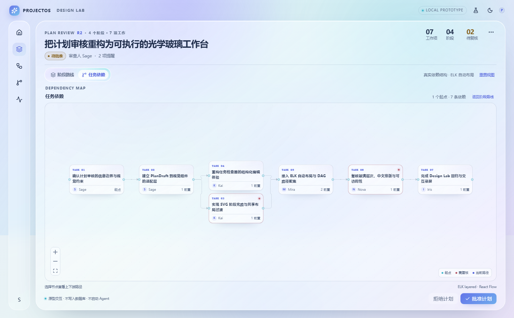
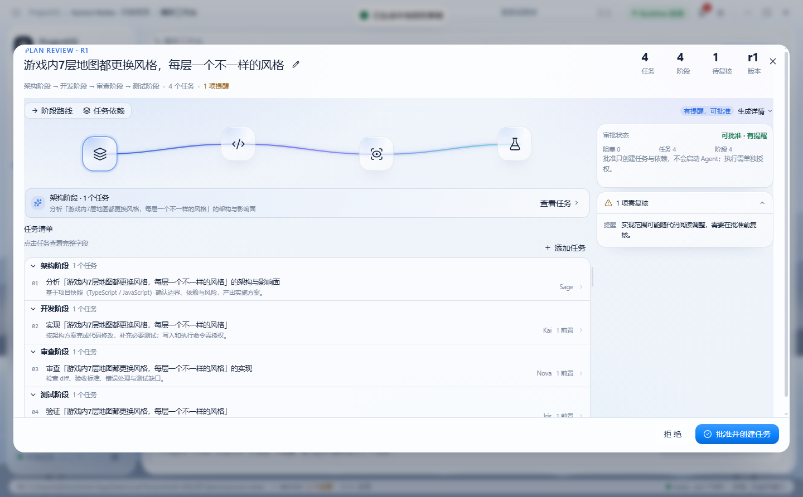

# Premium Liquid Glass Approved Baseline

状态：**受保护视觉基线（以用户提供的 APPROVED_design_lab_DAG.jpeg 为唯一事实）**  
批准日期：2026-10-23  
已认可 Commit：`0686c41 feat(design-lab): premium liquid glass desktop workspace`  
已认可 Tag：`visual-baseline-approved-0686c41`  
已认可路由：`#/design-lab`（Design Lab 独立页面）  
已认可截图：`docs/next-ui/visual-regression/APPROVED-design-lab-dag.png`  
最后更新：2026-10-23

## 1. 唯一视觉事实

用户明确认可的是 **Design Lab 的 DAG 工作台**，不是正式 Plan Review Modal。

不可混淆的指纹：

- 左侧独立竖向导航，左上 `PROJECTOS DESIGN LAB`
- 近全屏珍珠白 + 蓝紫青 Premium Liquid Glass 工作台
- `PLAN REVIEW R2`，`4 个阶段 · 7 项工作`
- 右侧 `07 / 04 / 02`，标签为 `工作项 / 阶段 / 待复核`
- 主画布 `DEPENDENCY MAP` / `任务依赖`
- 7 个紧凑任务节点、分叉/汇合依赖图和底部图例
- 右下 `拒绝计划` / `批准计划`



## 2. 明确不认可的版本

`REJECTED_current_plan_modal.png` 是正式 Plan Review 的常规白 Modal：

- 覆盖在应用上的 Dialog，背景模糊
- `PLAN REVIEW · R1`
- `9 任务 / 8 阶段 / 7 待复核`
- 左侧图形很小，右侧警示栏拥挤
- `任务清单` 列表布局
- `批准并创建任务`



该版本**不能**被称为已验收设计。

## 3. 受保护文件

Design Lab 已认可实现：

```text
apps/desktop/src/renderer/src/features/design-lab/DesignLabPage.tsx
apps/desktop/src/renderer/src/features/design-lab/StageJourney.tsx
apps/desktop/src/renderer/src/features/design-lab/TaskGraph.tsx
apps/desktop/src/renderer/src/features/design-lab/TaskInspector.tsx
apps/desktop/src/renderer/src/features/design-lab/design-lab.css
apps/desktop/src/renderer/src/features/design-lab/data.ts
docs/design-system/v1.6-commercial-ui/design-lab/*
```

任何改动必须提供与 `APPROVED_design_lab_DAG.png` 的并排截图，并经用户确认。

## 4. 正式页面迁移原则

正式页面必须继承 Design Lab 的：

- 全屏工作台构图（不是普通 Modal）
- 左侧导航/工作区关系
- Shell、tokens、typography、motion、glass materials
- DAG 工作区、节点尺寸、图例和交互
- 计划审核的 header 和 readiness 语言

同时保留真实业务：

- 真实 Planner / PlanDraft / tasks / dependencies
- 真实审批、授权、执行 API
- 不把 Design Lab 的模拟数据/模拟审批接入生产

## 5. 禁止事项

- 不得把正式 Plan Review Modal 当作已认可设计
- 不得用不同数据/不同路由的截图证明视觉一致
- 不得继续全系统批量迁移
- 不得删除、reset、clean、强制覆盖当前工作区
- 不得自动合并 stable

## 6. 当前状态

- 当前分支：`feature/projectos-next-ui-full-migration`
- 当前 HEAD：`85f2ae5`（本轮仅调查，不改业务代码）
- 已认可版本：`0686c41`，位于隔离 Worktree
  `C:\Users\Administrator\Desktop\workplace\ProjectOS-visual-baseline-0686c41`
- 未提交的实验已保存到安全备份分支
- 等待用户确认安全迁移方案后再实施

## 7. 相关文件

- `docs/next-ui/APPROVED_BASELINE_INVESTIGATION.md`
- `docs/next-ui/visual-regression/APPROVED-vs-REAL-plan-review.png`
- `C:\Users\Administrator\Desktop\workplace\ProjectOS_Approved_UI_Baseline.zip`
