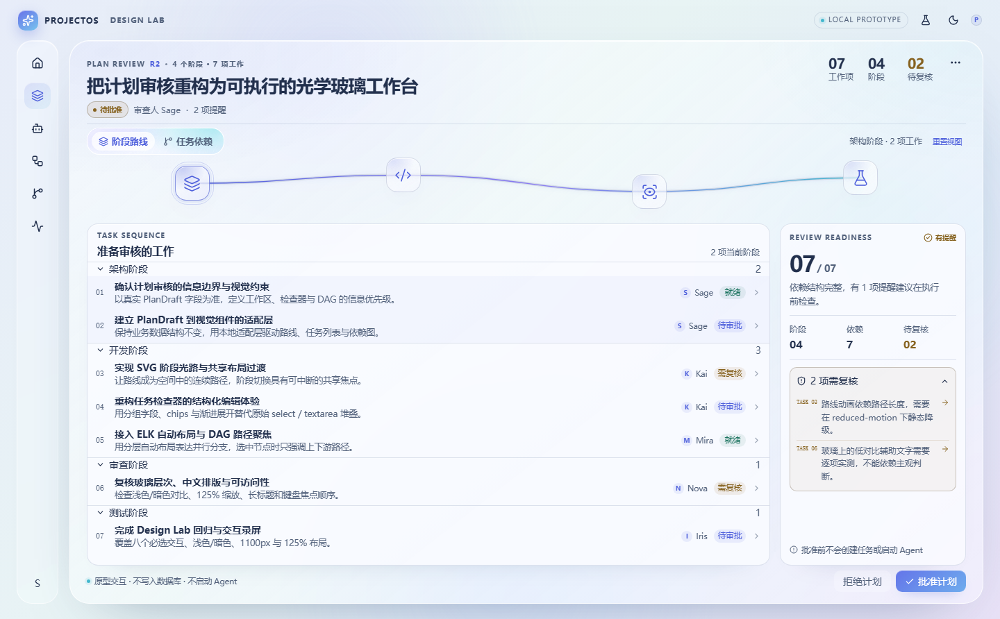
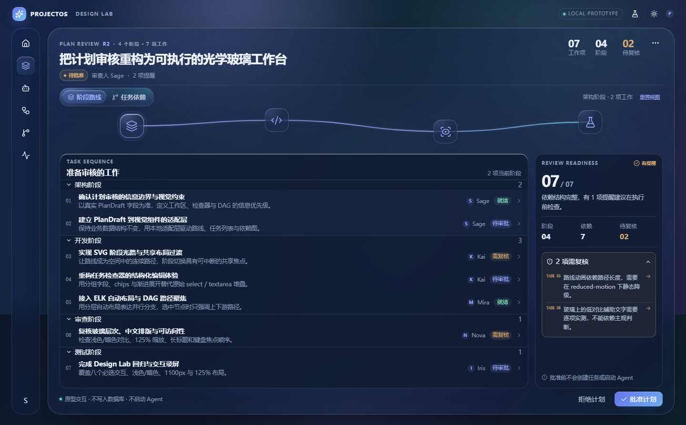

# Premium Liquid Glass Approved Baseline

状态：**受保护视觉基线**  
用户确认日期：2026-10-22  
基线 Commit：`10d84f4`  
基线 Tag：`visual-baseline-approved-icons-10d84f4`  
已认可截图：`docs/next-ui/visual-regression/current-10d84f4.png`  
最后更新：2026-10-22

## 1. 唯一视觉事实

用户已明确确认：**阶段图标上不显示文字**。已认可版本是 icon-only 路线：

- Premium Liquid Glass 光学玻璃环境
- 蓝紫青柔和背景光
- 四个阶段图标沿平滑曲线排列
- **图标下方不常驻阶段名称、说明、数量**
- 阶段信息通过 hover/focus tooltip 和选中阶段摘要查看
- 任务序列面板与右侧 readiness 面板
- 任务依赖 DAG
- 光学玻璃 review / inspector 面板





## 1.1 认可的是哪个路由

用户认可的界面是 **Design Lab 页面**：

```text
#/design-lab
```

不是正式业务页 `PLAN REVIEW · R1` 的 Dialog。两者目前不是同一实现：

| 区域 | 已认可 Design Lab | 当前正式 Plan Review |
|---|---|---|
| 顶部版本 | 无 R1 字样 | `PLAN REVIEW · R1` / 版本列 |
| 指标 | 工作项 / 阶段 / 待复核 | 任务 / 阶段 / 待复核 / 版本 |
| 列表标题 | `TASK SEQUENCE` + `准备审核的工作` | `任务清单` |
| 字体 | Design Lab 14px 任务标题体系 | 正式页 12.5px 压缩体系 |
| 容器 | 完整 Design Lab 工作台 | 业务 DialogShell |

正式 Plan Review 目前**没有得到用户视觉认可**，不能拿它当 approved 证据。

## 2. 已排除的错误候选

以下版本**不是**用户认可的基线：

```text
0686c41  feat(design-lab): premium liquid glass desktop workspace
```

该版本在图标下方常驻“架构阶段 / 确认边界与风险 / 2 项工作”等文字。
此前调查误把它当成 approved，原因是 `docs/design/baselines/approved-light.png`
保留了标签版截图，而用户实际认可的是其后的 icon-only 版本。

恢复 Worktree `ProjectOS-visual-baseline-0686c41` 仅作为历史候选保留，
**不得用于恢复**，也不得用来覆盖当前 Design Lab。

## 3. 受保护文件

未经用户视觉确认，不得修改以下文件的视觉语义：

```text
apps/desktop/src/renderer/src/features/design-lab/StageJourney.tsx
apps/desktop/src/renderer/src/features/design-lab/TaskGraph.tsx
apps/desktop/src/renderer/src/features/design-lab/TaskInspector.tsx
apps/desktop/src/renderer/src/features/design-lab/design-lab.css
apps/desktop/src/renderer/src/features/design-lab/DesignLabPage.tsx
apps/desktop/src/renderer/src/features/orchestration/components/StageJourney.tsx
apps/desktop/src/renderer/src/features/orchestration/components/TaskGraph.tsx
docs/next-ui/visual-regression/current-10d84f4.png
```

## 4. 禁止事项

- 不要在阶段图标下重新加回常驻名称、说明、数量。
- 不要用 `0686c41` 的标签版覆盖当前 icon-only Design Lab。
- 不要在没有前后截图对比的情况下修改阶段图标尺寸、路线高度或玻璃面板。
- 不要继续全系统页面重构。
- 不要合并 stable。

## 5. 验收规则

任何受保护组件改动必须同时提供：

1. `1440×900` 浅色
2. `1440×900` 暗色
3. `1100px`
4. `125%`
5. 与 `current-10d84f4.png` 的并排对比
6. 用户明确确认

未满足以上条件，不得合入。

## 6. 当前状态

- 本轮已停止 UI 修改。
- 当前分支 `feature/projectos-next-ui-full-migration` @ `10d84f4`，工作区只保留调查文档和受保护基线材料。
- 未提交的修复尝试保存在 `backup/next-ui-before-restore-20261022` @ `ef7bfee`。
- 未合并 stable。

## 7. 相关文件

- `docs/next-ui/VISUAL_REGRESSION_INVESTIGATION.md`
- `docs/next-ui/visual-regression/`
- `docs/next-ui/BASELINE_AND_RECOVERY.md`
- `docs/next-ui/OPEN_ISSUES.md`


