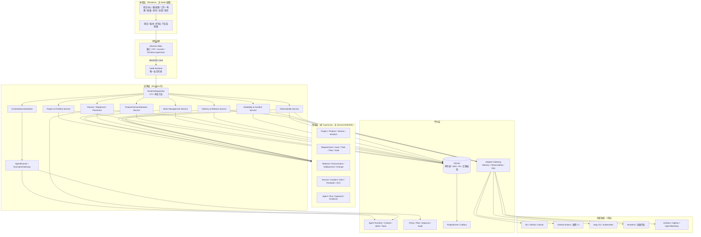
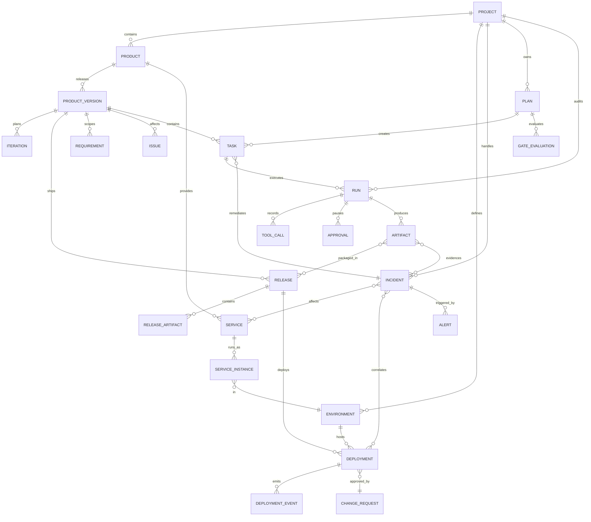
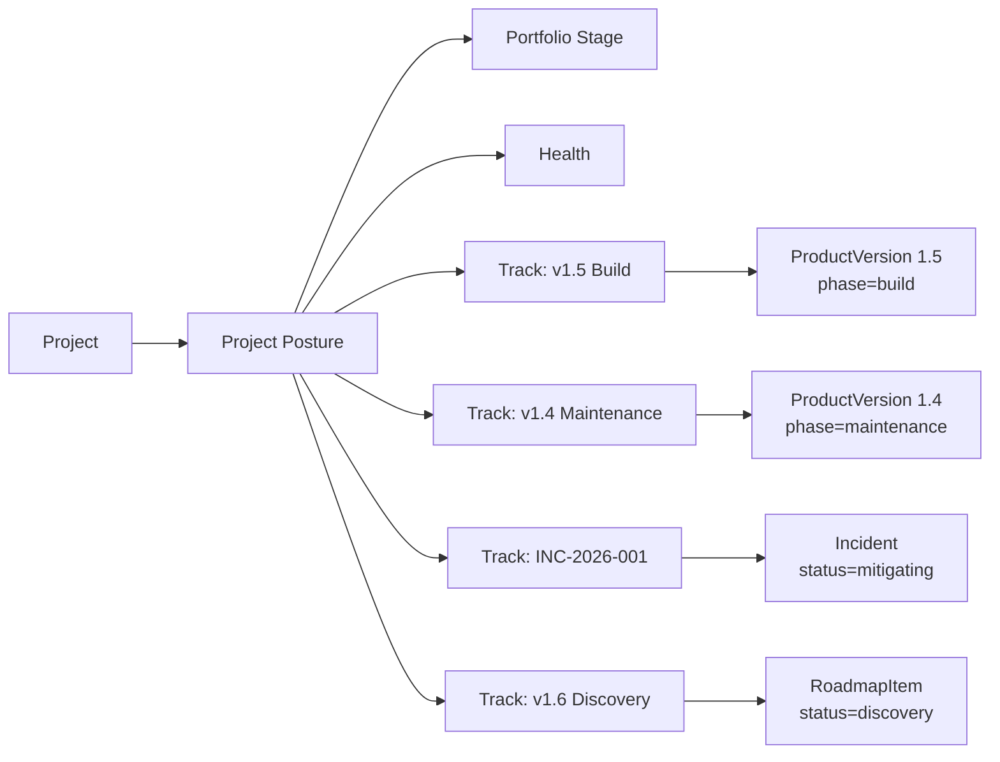
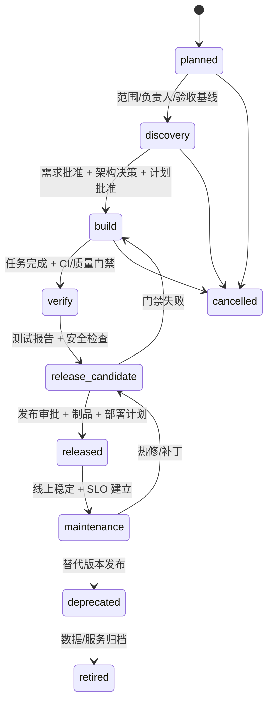
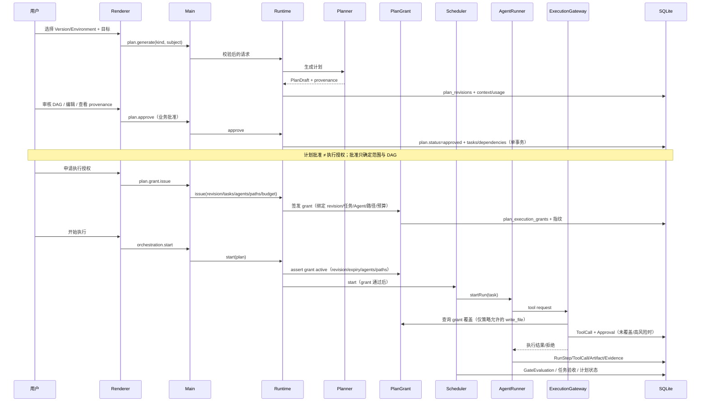
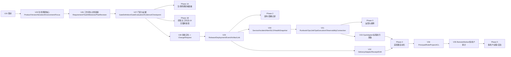

# ProjectOS V2.0 全生命周期总体产品与技术架构设计

> 文档性质：总体产品架构 + 技术架构 + 领域模型 + 信息架构设计  
> 证据版本：V2.0-draft-2（含 8 个开源项目源码复核，2026-10-27）  
> 适用阶段：V2.0 立项评审；**本轮不实施代码、不改数据库、不重绘 UI**  
> 上游依据：《ProjectOS V2.0 现状架构与能力审计报告》（`docs/v2/01_现状架构与能力审计报告.md`）  
> 核心约束：不恢复已删除的 Agent 路由；不新增第二套 Planner/Scheduler/Agent Registry/Runtime Registry；不删除已有真实业务；不覆盖已认可的 UI 设计基线；不直接复制 AGPL 代码；不把未实现能力描述成已完成。

---

## 1. 文档目的与设计边界

### 1.1 目的

本文回答五个问题：

1. ProjectOS V2.0 最终是什么产品，服务谁，解决什么完整生命周期问题。
2. 如何在不重写现有 AI 执行内核的前提下，支持多版本、多迭代、多环境、发布、部署、故障、监控和退役。
3. 一个项目如何同时进行“开发新版本、维护线上版本、处理故障、规划下一版本”，而不是被一个 `currentStage` 钉死。
4. 现有 ObjectOS 的哪些模块必须保留、哪些适合重构、哪些不应继续扩展。
5. 一期到后续阶段如何渐进落地，每阶段的依赖和验收标准是什么。

### 1.2 设计边界

**本文包含：**

- 产品定位、目标用户、核心场景。
- 领域划分、领域对象、生命周期、数据关联。
- 统一 Agent 执行平台与领域工作流。
- 交付/部署/可观测性适配器边界。
- 本地优先与未来远程执行。
- 产品信息架构、导航、页面职责。
- 与现有 ObjectOS 的差距、保留/重构清单。
- 数据迁移、兼容、安全、回滚、验收标准。
- 架构决策与开放问题。

**本文不包含：**

- 具体代码、迁移 SQL、组件实现、视觉稿。
- 对现有仓库的合并、重置、删除、重绘。
- 把发布/部署/运维能力声称为“已实现”。
- 对开源项目源码的复制或直接引入。

### 1.3 事实与设计的分层

本文严格区分三类内容：

| 类型 | 标记 | 含义 |
|---|---|---|
| 现状事实 | **现状** | 已在 ObjectOS 源码/测试中验证 |
| 目标设计 | **设计** | V2.0 建议的模型/流程/边界，尚未实现 |
| 待验证 | **待验证** | 依赖用户决策、外部系统或后续源码研究 |

---

## 2. 产品定位、目标用户与核心场景

### 2.1 最终定位

**ProjectOS 是一个本地优先、AI 原生、可审计的项目全生命周期管理与自主运营平台。**

它不是“一次性需求开发流水线”，而是把以下活动放在同一个项目工作区中持续运营：

- 项目立项、需求、架构、规划。
- 多版本、多迭代并行。
- AI 多 Agent 自主研发与协作。
- 测试、缺陷、质量验收。
- 构建、制品、发布、交付。
- 多环境部署、晋升与回滚。
- 线上指标、日志、链路、监控、告警。
- 故障事件、根因分析、修复与热更新。
- 持续运维、自主优化、知识沉淀、项目退役。

一句话：**从“把需求做完”升级为“把产品持续运营好”。**

### 2.2 目标用户

| 用户 | 核心诉求 | V2.0 对应能力 |
|---|---|---|
| 独立开发者 / 小团队技术负责人 | 一个人也要能同时开发、发布、运维 | 多版本并行、Agent 执行、发布/部署记录、故障闭环 |
| 产品/项目负责人 | 看清项目现在处于什么状态、下一步该做什么 | 项目姿态、路线图、版本/迭代、门禁与风险 |
| 架构师/技术负责人 | 需求、架构决策、版本范围可追溯 | Requirement/ADR/Version/Release 关联、证据链 |
| QA/质量负责人 | 测试、缺陷、验收与发布门禁 | TestPlan/Defect/GateEvaluation/Release gate |
| Release Manager（常由负责人兼任） | 发布什么、部署到哪、能否回滚 | Release/Deployment/Environment/ChangeRequest |
| SRE/运维（常由开发者兼任） | 线上是否健康、出故障怎么处理 | Service/Incident/Alert/Runbook/Observability |
| AI Agent | 在明确边界内执行任务、产出证据 | 统一 Run/Tool/Approval/Lease/Evidence |

**一期不追求大型多租户 SaaS、ITIL 全流程、7×24 值班团队**；但领域模型必须为这些能力留出扩展位。

### 2.3 核心使用场景

#### 场景 A：绿地项目从 0 到 1

立项 → 需求 → 架构决策 → 版本/迭代规划 → AI 计划 → 多 Agent 开发 → 测试/验收 → 发布候选 → 部署到测试/生产 → 观察指标 → 进入维护。

#### 场景 B：已上线项目直接导入

导入现有仓库/服务/环境 → 建立 Product/Version/Environment/Service 基线 → 导入现有需求/缺陷（可选）→ 记录当前线上版本与部署 → 不伪造历史发布/故障 → 从“当前真实状态”继续规划。

#### 场景 C：多版本并行

线上 v1.4 维护安全补丁；v1.5 开发新功能；v1.6 规划中；同时处理一个 P1 线上故障。四类活动各有自己的状态、负责人、门禁和证据，但在同一个项目工作区中可见、可关联。

#### 场景 D：发布与回滚

Release Candidate 通过测试/安全/质量门禁 → 发布审批 → 部署到 staging → 健康验证 → 晋升到 production → 观察 SLO → 异常则回滚到上一 Deployment，并生成事故/复盘。

#### 场景 E：故障响应

告警触发 → 创建/关联 Incident → 分派 Incident Commander → 诊断/缓解（回滚、热修、开关）→ 恢复验证 → 复盘 → 行动项进入下一迭代。

#### 场景 F：持续优化与退役

SLO/健康趋势 → Finding/优化提案 → 进入版本规划 → 验证收益；旧版本停止支持 → 标记 deprecated/EOL → 服务/数据归档 → 项目退役，知识保留。

### 2.4 非目标（V2.0 明确不做）

- 不做 Kubernetes 控制平面、Argo CD 替代品、Grafana/SigNoz 替代品、Rundeck 替代品。
- 不做通用 BPMN/低代码工作流引擎。
- 不做大型多租户 SaaS、计费、云控制台。
- 不做移动端。
- 不做“无人值守自动改生产”的默认模式；生产变更必须可审批、可回滚、可审计。
- 不把 AI 生成的内容当作事实；所有状态必须有证据。

---

## 3. 设计原则

1. **本地优先，单写者不变。** SQLite 仍是本地真相，Runtime 仍是唯一写者；远程能力是可选适配器，不是新的真相源。
2. **一个执行内核，领域工作流组合。** Planner、Replanner、Scheduler、AgentRunner、Policy、Approval、Run 只有一套；发布/故障/运维通过 `PlanKind`、`WorkType`、`Gate` 组合，不复制内核。
3. **生命周期是复数。** 项目不是一个阶段，而是“项目姿态 + 多条版本/活动轨道”；`currentStage` 保留原名作为 legacy 兼容事实，不再做全局门禁权威。
4. **版本是一等公民。** 产品版本有独立生命周期、范围、发布、部署、支持和退役状态；计划修订号不是产品版本。
5. **证据高于声明，且证据必须拆维。** 每条证据必须记录 `EvidenceType`、`VerificationStatus`、`Assurance` 与 `Provenance`；`LifecycleStatus` 属于版本/发布/部署/事故主体，不属于证据。门禁按条件判定，不能用一个线性等级数字代替。
6. **不可逆动作必须人类授权。** 生产部署、回滚、数据迁移、删除、密钥变更等默认需要审批；风险分级，紧急变更可 break-glass 但必须审计。
7. **适配器，不嵌入。** CI/CD、部署、监控、运维作业通过边界适配器接入；不把 Argo/Grafana/Rundeck 服务器塞进 ProjectOS。
8. **增量迁移，拒绝大爆炸。** 新领域以 additive migration + 双读 + 特性开关落地；旧项目可无损升级、可备份恢复。
9. **视觉基线是交付物。** 0686c41 是已批准视觉基线；任何新页面先在隔离分支对齐 shell/tokens/graph/inspector，再逐页迁移。
10. **文档不得超越实现。** 未实现的能力在 UI/文档/演示中必须标注“未实现/设计中”，不能用占位页面冒充。
11. **事实持久，状态派生，偏好独立。** 只持久化 durable facts（Run/部署/告警/审批/证据）；显示状态由读模型派生；`currentStage` 保留原名作为 legacy fact，不改成 `primaryFocus`；用户当前关注对象放独立 `project_focus` 偏好。
12. **未知不重试。** `dispatched/unknown` 的副作用必须进入 `needs_reconciliation`；先查询/对账，再决定补偿，绝不盲目重放。

---

## 4. 总体架构

### 4.1 分层架构



**关键点：**

- 体验层只通过命名 preload API 访问后端；版本/环境是“上下文”，不是新路由的私有状态。
- 应用层新增领域服务，但**不新增第二套执行内核**；发布/故障计划复用 Planner/Scheduler/Runner。
- 适配器网关是唯一的外部副作用出口；适配器不直接写业务库。
- 外部系统全部可选；本地优先模式没有它们也能运行，只是能力降级。

### 4.2 进程与信任边界（保持不变）

```text
Renderer（不可信）
  │ 命名 preload + Zod
Electron Main（可信边界：窗口 / IPC / secrets / supervisor）
  │ NDJSON over stdio
Node Runtime（业务唯一写者）
  ├── SQLite
  ├── 工作区 FS/Git
  ├── Provider HTTP
  ├── Agent Runtime
  └── Adapter Gateway（新）
```

**不变量：**

- Renderer 不接触 Node/SQLite/FS/Shell/部署凭据。
- Main 不写业务库；只负责窗口、秘密、Runtime 监管与少量主进程方法。
- Runtime 是唯一业务写者；所有状态变更走事务与事件。
- 外部适配器调用也必须经过 Runtime 的 Policy/Approval/ToolCall 记录，不允许 Renderer 直连。
- 不允许监听 TCP 端口作为业务入口；远程能力走显式、可认证的适配器/Worker 协议。

### 4.3 部署形态

| 形态 | 说明 | 阶段 |
|---|---|---|
| 本地桌面单机 | Electron + 本地 Runtime + SQLite；可选外部适配器 | 一期 |
| 本地 + 外部系统 | 连接 Git/CI/Argo/Grafana/Rundeck；凭据在 Main | 后续 |
| 本地 + 远程 Worker | 远程执行 Agent/作业；本地仍是控制面与真相源 | 后续 |
| 团队共享（可选） | 同步服务/共享 DB；需要身份/ACL/冲突策略 | 更后续 |

---

## 5. 领域划分与领域对象关系

### 5.1 限界上下文

| 上下文 | 职责 | 核心对象 | 与现有代码的关系 |
|---|---|---|---|
| Portfolio & Project | 项目组合、项目状态、成员/治理 | Project, ProjectPosture, Membership | 扩展现有 `projects` |
| Product & Version | 产品、版本、路线图、迭代 | Product, ProductVersion, Iteration, RoadmapItem | **新增** |
| Work Management | 需求、缺陷、任务、验收 | Requirement, Issue, Task, Acceptance | 扩展 `requirements/tasks` |
| Planning & Orchestration | 计划、修订、授权、调度、门禁 | Plan, PlanRevision, PlanGrant, GateEvaluation | 复用现有 Plan/Scheduler |
| Agent Platform | Agent、Runtime、Skill、Run、Tool、Approval | AgentDefinition, RuntimeProfile, Run, ToolCall | 保持现有 |
| Delivery & Release | 制品、发布、环境、部署、变更、回滚 | ArtifactRef, Release, Environment, Deployment, ChangeRequest | **新增** |
| Reliability & Operations | 服务、事故、告警、Runbook、SLO | Service, Incident, Alert, Runbook, OpsJob, SLO | **新增**（现有 OperationsService 保留为研发健康） |
| Knowledge & Evidence | 知识、决策、证据链接、复盘 | KnowledgeEntry, Decision, EvidenceLink, Postmortem | 扩展 `knowledge_entries/decisions/artifacts` |
| Identity, Policy & Audit | 主体、角色、权限、审批、审计 | Principal, Role, Policy, Approval, ProjectEvent | 扩展现有 Approval/Policy |
| Integrations | 外部系统连接与适配器 | Connector, AdapterConfig, SecretRef, Webhook | **新增** |

### 5.2 领域对象关系（目标模型）



> 说明：图中 `RELEASE_ARTIFACT`、`DEPLOYMENT_EVENT`、`SERVICE_INSTANCE`、`GATE_EVALUATION` 是关联/事件实体，不是新的聚合根。所有 `*_id` 关联在 SQLite 中必须有 FK 或显式应用层校验。

### 5.3 对象职责与不变量

| 对象 | 职责 | 关键不变量 |
|---|---|---|
| Project | 项目容器、治理边界、组合视图 | 不直接拥有“唯一阶段”；姿态是派生 |
| Product | 可交付产品/服务集合 | 一个项目可有 1..N 个产品；一期默认 1 个 |
| ProductVersion | 一条可独立开发/发布/维护的版本线 | 版本号在 Product 内唯一；状态机独立 |
| Iteration | 版本内的时间盒 | 迭代必须属于一个版本；同一版本可多迭代 |
| Requirement | 需求与验收标准 | 可归属版本/迭代；批准后才进入范围 |
| Issue/Defect | 缺陷/质量问题 | 记录发现版本、修复版本、环境、复现、证据 |
| Task | 可执行工作单元 | 有 workType/version/iteration/sourceRef；DAG 无环 |
| Plan | 一次领域计划（开发/质量/发布/故障/运维） | 有 kind + subject；批准后才建任务；修订不可原地改 |
| Release | 一次可发布的不可变制品集合 | 发布后制品不可变；可被多个环境部署 |
| Environment | 部署目标（dev/staging/prod/custom） | 环境保护级别、审批策略、连接器作用域 |
| Deployment | 一次“发布到环境”的尝试 | 有状态机、期望/实际版本、健康、回滚目标 |
| ChangeRequest | 变更单（标准/常规/紧急） | 生产变更必须关联；有风险、回滚计划、审批 |
| Service | 可运维的服务/组件 | 有 owner、criticality、SLO、依赖 |
| Incident | 生产/环境故障事件 | 有严重级别、指挥官、时间线、影响范围、复盘 |
| Alert | 来自观测系统的告警 | 可关联 Incident；保留外部 ID/指纹 |
| Runbook/OpsJob | 可重复的运维作业 | 有风险、审批策略、执行审计、幂等 |
| GateEvaluation | 对某主体的一次门禁评估 | 必须绑定 subject + 证据；不可只写“通过” |
| Evidence | 一条有类型、验证状态、保证程度、来源的验证事实 | 必须有 `EvidenceType` + `VerificationStatus` + `Assurance` + `Provenance`（source/hash/revision/actor/time）；`LifecycleStatus` 属于主体，不写入证据等级 |
| Checkpoint / ContextPack | 一次 Run/会话的结构化收尾与可复现上下文 | 必须记录 open loops、next action、context hash、token 预算与完整性；不能替代未记录历史 |
| DeliveryReceipt / AdoptionCredential | 精确制品交付回执与下游采用凭证 | 绑定 artifact SHA、contract SHA、completion receipt；授权/采用/失效分离，且必须标注回执来源 |
| ProjectFocus | 用户当前关注对象（UI 偏好） | 只影响视图/默认定位；不是生命周期事实，不参与门禁，不改写 `current_stage` |

### 5.3.1 证据模型（四维，禁止单一线性等级）

AWR 的 `designed → released` 单一枚举把“验证保证程度”和“产品生命周期”压在一个维度上。ProjectOS 不照搬，拆成四个正交维度：

| 维度 | 取值 | 归属 | 说明 |
|---|---|---|---|
| `EvidenceType` | `test_report` / `code_diff` / `build_artifact` / `run_log` / `metric_snapshot` / `deployment_receipt` / `approval_record` / `review_record` / `manual_attestation` / `postmortem` / `other` | 证据 | 证据“是什么” |
| `VerificationStatus` | `pending` / `passed` / `failed` / `unknown` / `waived` | 证据 | 这次验证的结论；`unknown` 不得当 passed |
| `Assurance` | `self_declared` / `source_observed` / `independently_reproduced` / `externally_confirmed` | 证据 | 结论有多可信、由谁确认 |
| `LifecycleStatus` | Version phase / Release status / Deployment status / Incident status | **主体** | 产品/环境处于什么阶段；不能写到证据上充当“等级” |

**Provenance（来源）是每条证据的必填项：**

```text
Provenance {
  sourceSystem: local|git|ci|deployment-adapter|observability|human|import
  sourceRevision: string|null
  uri: string|null
  contentHash: string
  command: string|null
  actor: string
  environmentId: string|null
  capturedAt: timestamp
  validUntil: timestamp|null
  receiptId: string|null      // 仅 adapter/external trusted 有
}
```

**Gate 条件（不是等级比较）：**

```text
GateDefinition {
  id, subjectScope, key, policyProfile, blocking,
  conditions: [{
    evidenceType, requiredStatus: passed, minAssurance,
    sourceSystem?, environmentId?, maxAgeMs?, minCount?, allowSelfDeclared?
  }]
}
GateEvaluation {
  id, gateId, subjectType, subjectId,
  status: passed|failed|pending|waived,
  conditionResults: [{ conditionIndex, satisfied, evidenceIds[], reason }],
  evaluatedBy, evaluatedAt
}
```

- `minAssurance` 只表达“最低保证”，不表达产品阶段；`LifecycleStatus` 由 subject 自己维护。

**Assurance 比较语义（固定，不允许各页面自定义）：**

| 序 | Assurance | 含义 | 能否满足 `minAssurance` |
|---:|---|---|---|
| 0 | `self_declared` | 用户/Agent 自己声明 | 仅当 `allowSelfDeclared=true` |
| 1 | `source_observed` | 从来源系统/文件/日志直接观察到 | `minAssurance<=source_observed` |
| 2 | `independently_reproduced` | 独立重跑/重算/复核 | `minAssurance<=independently_reproduced` |
| 3 | `externally_confirmed` | 外部系统签名/回执/独立主体确认 | `minAssurance<=externally_confirmed` |

- 比较是**偏序阈值**（`>= minAssurance`），不是“等级相等”；需要精确等级时用可选的 `exactAssurance`。
- `allowSelfDeclared` 默认 **false**；缺失来源/哈希/状态为 `unknown` 时 **fail closed**。
- `source_observed` 不等于独立复核；`independently_reproduced` 必须能重放/重算；`externally_confirmed` 必须有 receipt/签名。
- `waived` 只能由有权主体批准，记录理由/批准人/有效期；不能把 `waived` 当作 `passed`。
- `GateEvaluation.conditionResults` 必须逐条记录满足/不满足及 evidenceIds；禁止只存一个“level”。
- `manual_attestation` 只能是 `self_declared`；只有策略显式 `allowSelfDeclared` 时才可满足门禁，并在 UI 标注“人工声明/未外部确认”。
- `deployment_receipt` 只有在 adapter 返回可验证外部 ID/回执时才是 `externally_confirmed`；人工登记的部署不是 receipt。
- `independently_reproduced` 表示独立重跑/复现，不等于生产已发布；发布阶段仍由 Release/Deployment 状态机决定。

### 5.4 与现有模型的映射

| 现有 | 目标 | 处理 |
|---|---|---|
| `projects.current_stage` | **legacy stage fact**（保留原名） | 保留列与 API；读模型暴露 `legacyStage`；不作为全局门禁权威；**不改名为 primaryFocus** |
| `project_stages` | 版本/阶段检查清单 | 保留为兼容读模型；新门禁绑定 subject |
| （新增）`project_focus` | 用户当前关注对象（UI 偏好） | 独立表/设置；只影响视图；不写生命周期 |
| `requirements` | Requirement | 增加 `version_id`/`iteration_id`/`priority`/`owner` |
| `tasks` | Task | 增加 `work_type`/`version_id`/`iteration_id`/`source_type`/`source_id` |
| `plan_revisions` | Plan/PlanRevision | 增加 `kind`/`subject_type`/`subject_id`/`environment_id` |
| `artifacts` | Artifact/Evidence | 增加 `artifact_links`（release/deployment/incident/version） |
| `approvals` | Approval（泛化） | 增加 `scope`/`subject_type`/`subject_id`；`run_id` 可空（迁移期双写） |
| `health_check_runs`/`findings` | 研发健康检查 | 保留；新增 Reliability 域，不混用 |
| `milestones` | Milestone/RoadmapItem | 增加 `version_id`/`release_id`/`type` |
| `decisions` | Decision/ADR | 增加 `version_id`/`supersedes` 链已有 |
| `knowledge_entries` | Knowledge/Postmortem | 增加 `kind`/`subject_ref`/`valid_until` |

---

## 6. 生命周期与并行版本模型

### 6.1 核心决策：项目生命周期不是单一 `currentStage`

**现状问题：** `projects.current_stage` 是单标量，`project_stages` 主键是 `(project_id, stage)`，`advanceStage` 禁止回退并校验所有前置门禁。这只能表达“一次性开发流水线”。

**V2.0 设计：四层分离，禁止把“事实、业务状态、读模型、UI 偏好”混成一个字段**

| 层 | 内容 | 存储/归属 | 是否参与门禁 |
|---|---|---|---|
| 1. 持久化事实 | `current_stage`（legacy）、version.phase、iteration.state、environment、gate evaluation、evidence、events | SQLite 表/事件 | 事实可作为证据输入，但字段本身不直接判门禁 |
| 2. 业务状态机 | Version/Iteration/Release/Deployment/Incident/Gate 的合法转移 | 领域服务 + 事务 | 是，按主体状态机 |
| 3. 派生读模型 | `ProjectPosture`、`Version360`、`ServiceHealth`、`EnvironmentStatus` | 查询时计算，不落库为可手改字段 | 只展示/排序，不写回 |
| 4. UI 偏好 | `project_focus`（用户当前关注版本/事故/发布） | 独立表/设置，按本地用户 | **否**，绝不影响业务状态 |

```text
项目姿态（Project Posture，派生）
  ├─ 组合阶段：incubating / active / maintaining / retiring / retired
  ├─ 健康：green / amber / red（由版本、发布、故障、SLO 派生）
  ├─ 当前关注：focusedSubject（来自 project_focus，不是 currentStage）
  └─ 活动轨道（Tracks）
       ├─ version_build（v1.5 开发）
       ├─ version_maintenance（v1.4 维护）
       ├─ incident_response（P1 故障）
       ├─ roadmap_discovery（v1.6 规划）
       ├─ release_rollout（v1.5 发布/部署）
       └─ continuous_ops（SLO/优化/巡检）
```

- `ProjectPosture` 是**读模型**，不是新状态机；它由版本、迭代、发布、部署、事故、门禁等聚合派生。
- **`current_stage` 保留原名、原列、原 API**，读模型只把它暴露为 `legacyStage`；**不得直接改名为 `primaryFocus`**。
- 用户当前关注对象是独立的 `project_focus`（UI 偏好），可以是某版本/事故/发布；它不写回 `current_stage`，不参与门禁。
- 每个 Track 有自己的 `state`、`subject`、`owner`、`nextGate`、`wip`；一个项目可同时有多条 Track。
- 项目级“阶段”不再是权威；版本/发布/部署/事故各有自己的状态机与门禁。

### 6.2 项目姿态与轨道



**Track 的通用字段：**

| 字段 | 说明 |
|---|---|
| `trackId` | 轨道 ID |
| `kind` | version_build / version_maintenance / incident_response / roadmap_discovery / release_rollout / continuous_ops |
| `subjectType/subjectId` | 版本/事故/发布/路线图项 |
| `state` | 由 subject 状态派生或显式 |
| `owner` | 人类负责人 + 可选 Agent |
| `nextGate` | 下一门禁及阻塞项 |
| `wip` | 进行中的任务/Run 数 |
| `updatedAt` | 最近活动 |

**项目姿态读模型：**

```text
ProjectPosture {
  projectId
  portfolioStage
  health: green|amber|red
  legacyStage: StageKey            // 原 current_stage，只读兼容
  focusedSubject: version|incident|release|null  // 来自 project_focus（UI 偏好）
  versions: { total, build, qa, released, maintenance, deprecated, eol }
  iterations: { active, planned }
  releases: { pending, deploying, verified }
  incidents: { open, sev1, sev2, mitigated }
  services: { total, degraded, down }
  tracks: TrackSummary[]
  topRisks: RiskSummary[]
  nextActions: ActionSummary[]
}
```

### 6.3 版本生命周期



| 状态 | 含义 | 进入证据 |
|---|---|---|
| planned | 已立项，未开始 | 版本目标、负责人、范围草案 |
| discovery | 需求/架构探索 | 已批准需求、ADR、初步计划 |
| build | 开发中 | 计划批准、任务 DAG、Agent 分配 |
| verify | 测试/验收 | 测试报告、质量门禁、缺陷收敛 |
| release_candidate | 发布候选 | 制品、变更单、发布审批、回滚计划 |
| released | 已发布 | 部署记录、健康验证、发布说明 |
| maintenance | 维护中 | SLO、监控、支持策略 |
| deprecated | 停止新功能 | 替代版本、迁移说明 |
| retired | 退役 | 服务下线、数据归档、知识保留 |
| cancelled | 取消 | 决策记录 |

**并行规则：**

- 同一 Product 可同时有多个 `build`/`maintenance`/`release_candidate` 版本。
- 同一版本同一时刻只有一个 `phase`，但可有多个迭代。
- 维护版本可以产生 `patch` 版本（如 1.4.3），补丁版本有自己的生命周期，但共享 1.4 的支持策略。
- 版本状态转换必须有 `GateEvaluation`；不能只改字段。

### 6.4 迭代生命周期

```text
planned → active → closed
   └──────────────→ cancelled
```

- 迭代属于一个版本；有 start/end、目标、容量、范围。
- 一个版本可并行多个迭代（通常顺序），不同版本可并行。
- 迭代关闭时生成：完成率、遗留项、缺陷、发布准备度。
- 迭代不是“阶段”；它是时间盒，不替代版本门禁。

### 6.5 发布生命周期

```text
draft → candidate → approved → released → superseded / recalled
```

| 状态 | 含义 | 证据 |
|---|---|---|
| draft | 发布草案 | 版本、变更范围、制品清单 |
| candidate | 候选发布 | 测试/质量/安全门禁通过 |
| approved | 批准发布 | 发布审批、变更单、回滚计划 |
| released | 已发布 | 部署记录、发布说明、制品哈希 |
| superseded | 被新发布替代 | 新 Release 链接 |
| recalled | 撤回/召回 | 原因、影响、替代方案 |

- Release 是**不可变制品集合 + 发布说明 + 审批**；部署是 Release 到 Environment 的一次尝试。
- 同一 Release 可部署到多个环境；每个 Deployment 独立记录。
- 热修 Release 可标记 `hotfix`，走紧急变更策略，但仍需审批与审计。

### 6.6 部署生命周期

部署分两层记录，避免把“意图”和“实际效果”混成一个状态：

**变更意图（intent）**

```text
draft → prepared → leased → dispatched → confirmed / rejected / unknown
```

| 状态 | 含义 | 恢复规则 |
|---|---|---|
| draft | 部署草案，尚未审批 | 可编辑/丢弃 |
| prepared | 已审批的精确意图（release/variant/rollback target） | 可 lease 或取消；不是执行许可 |
| leased | 一个执行者持有短期 fencing lease | 只能 dispatch 一次；过期且未 dispatch 可重新 lease |
| dispatched | 已发出，结果未知 | 只能查询原 attempt，不得盲重试 |
| confirmed | 适配器事实确认已应用 | 保留历史证据，释放 guard |
| rejected | 适配器/人工拒绝 | 保留回执；不得伪装成功 |
| unknown | 适配器返回不确定 | 进入 `needs_reconciliation`，人工/对账后处理 |

**运行健康（observation）**

```text
pending → progressing → healthy
                    ├─ degraded
                    ├─ failed
                    └─ rolled_back
```

- 部署有 `desiredRevision`（期望版本/制品）与 `actualRevision`（实际运行），支持 drift 检测。
- 部署必须有：目标环境、Release、ChangeRequest、回滚目标、健康检查、审批人。
- 部署执行可由本地脚本、CI、Argo CD、Rundeck 适配器完成；ProjectOS 记录状态与证据，不假装自己是 Kubernetes。
- 长时部署是 `Deployment` 状态机 + 事件，不是阻塞 Agent Run。
- **未知不重试**：`dispatched/unknown` 不得自动再次 apply；必须查询原 attempt/对账，避免重复副作用。
- **controller epoch/fencing**：部署/运维执行器持有 generation/fence；旧回调不能改新 Deployment 状态。
- **证据四维**：部署确认必须记录 `EvidenceType=deployment_receipt`、`VerificationStatus`、`Assurance`（adapter 回执才可 `externally_confirmed`）与 provenance/hash；不能只写“部署成功”，也不能把人工登记标成 adapter 确认。

### 6.7 故障生命周期

```text
detected → triaged → mitigating → monitoring → resolved → postmortem → closed
```

| 状态 | 含义 | 证据 |
|---|---|---|
| detected | 告警/人工发现 | Alert/来源、时间、影响服务 |
| triaged | 已分级/分派 | 严重级别、指挥官、影响范围 |
| mitigating | 缓解中 | 回滚/热修/开关/扩容记录 |
| monitoring | 已缓解，观察中 | 指标恢复、SLO 回归 |
| resolved | 已解决 | 根因、修复版本、验证 |
| postmortem | 复盘中 | 复盘文档、行动项 |
| closed | 关闭 | 行动项完成/转移 |

- Incident 可关联多个 Service/Version/Deployment/Alert/Task。
- 故障修复任务进入同一个 Task/Scheduler；不另建“事故任务系统”。
- 关闭必须有复盘或明确豁免；行动项进入版本/迭代。

### 6.8 门禁 v2：主体化、证据化

**现状：** 8 个项目级串行门禁，`assertStageAdvanceAllowed` 检查所有前置阶段。

**设计：**

```text
GateDefinition {
  id, subjectScope: version|iteration|release|deployment|incident|task,
  key, name, policyProfile, blocking,
  conditions: [{
    evidenceType, requiredStatus: passed, minAssurance,
    sourceSystem?, environmentId?, maxAgeMs?, minCount?, allowSelfDeclared?
  }]
}
GateEvaluation {
  id, gateId, subjectType, subjectId,
  status: pending|passed|failed|waived,
  conditionResults: [{ conditionIndex, satisfied, evidenceIds[], reason }],
  evaluatedBy, evaluatedAt, notes
}
```

- 门禁不再是“项目全局第 N 步”，而是绑定到具体 subject。
- 版本门禁可并行：v1.5 的 build gate 与 v1.4 的 maintenance gate 互不影响。
- 部署门禁可按环境策略：staging 只需自动检查；production 需要人工审批 + 健康检查 + 回滚计划。
- **按条件判定，不按单一等级**：每个条件检查 `EvidenceType`、`VerificationStatus=passed`、`minAssurance`、来源/环境/时效/数量；所有条件满足才 passed。
- `manual_attestation` 只能是 `self_declared`；只有 `allowSelfDeclared=true` 的策略才接受，并在 UI 标注。
- 豁免必须记录理由、批准人、有效期。
- `currentStage` 只用于兼容读模型，不再参与门禁判定。

**门禁示例（条件，而不是等级数字）：**

| 主体 | 门禁 | 条件示例 |
|---|---|---|
| Version → release_candidate | 测试通过 | `test_report` passed，`assurance>=source_observed`，来自本地/CI；可选 `code_diff` |
| Release → approved | 发布审批 | `approval_record` passed（单用户确认或外部可信审批，见 §10.4）+ `change_request` 已关联 |
| Deployment → production | 生产变更审批 | `approval_record` + `rollback_plan`（`manual_attestation`，策略可接受）；变更窗口满足 |
| Deployment → healthy | 健康验证 | `deployment_receipt`（adapter `externally_confirmed`）或 `metric_snapshot` passed；人工登记不能替代 |
| Incident → closed | 复盘完成 | `postmortem` `manual_attestation` + 行动项；涉及修复时需 `deployment_receipt` 或健康证据 |
| Version → retired | 退役检查 | 服务下线/数据归档/知识保留证据（`manual_attestation`/`source_observed` 按策略） |

---

## 7. 项目、版本、迭代、环境、部署、故障的数据关联

### 7.1 关联模型

```text
Project
 ├─ Product (1..N)
 │   ├─ ProductVersion (1..N)
 │   │   ├─ Iteration (1..N)
 │   │   ├─ Requirement (0..N)
 │   │   ├─ Issue (0..N)
 │   │   ├─ Task (0..N)
 │   │   ├─ Release (0..N)
 │   │   │   ├─ ReleaseArtifact (0..N)
 │   │   │   └─ Deployment (0..N) ── Environment (N..1)
 │   │   └─ Incident (0..N, 可跨版本)
 │   └─ Service (0..N)
 │       ├─ ServiceInstance (0..N) ── Environment (N..1)
 │       └─ Incident (0..N)
 ├─ Environment (0..N)
 ├─ ChangeRequest (0..N)
 ├─ Plan (0..N) ── subject: version|iteration|release|incident|task
 ├─ Run (0..N) ── task/session/agent + context snapshot
 └─ EvidenceLink (0..N)
```

### 7.2 关键关联规则

1. **Task 必须能回答“属于哪个版本/迭代/工作类型”。** 对历史任务允许为空（迁移兼容），新任务建议必填。
2. **Release 必须引用一个 ProductVersion。** 一个版本可有多个 Release（RC/正式/热修）。
3. **Deployment 必须引用 Release + Environment。** 同一 Release 可在多环境多次部署。
4. **Incident 至少关联一个 Service 或 Environment；版本/发布/部署为可选关联。** 允许基础设施故障没有版本。
5. **ChangeRequest 关联 Release/Deployment/Incident 中的至少一个。** 生产变更必须有变更单。
6. **Plan 的 subject 决定其工作流模板与门禁。** 开发计划、发布计划、故障计划共用 Plan/Scheduler，但 `kind` 不同。
7. **Artifact 通过 `artifact_links` 关联到版本/发布/部署/事故/任务。** 不再只靠 `task_id/run_id`。
8. **EvidenceLink 是审计链的粘合剂。** 任何门禁/状态转换都可以引用证据，而不复制证据内容。

### 7.3 查询视图（示例）

| 视图 | 回答的问题 | 主要来源 |
|---|---|---|
| Project Posture | 项目现在怎么样？ | versions/iterations/releases/deployments/incidents/services |
| Version 360 | 这个版本从需求到线上发生了什么？ | requirements/tasks/plans/runs/releases/deployments/incidents |
| Release 360 | 这次发布包含什么、部署到哪、是否健康？ | release/artifacts/deployments/change/approvals |
| Environment 360 | 这个环境当前跑什么版本、有哪些部署/事故？ | deployments/services/incidents/alerts |
| Incident 360 | 故障影响什么、怎么缓解、根因是什么？ | incident/services/alerts/deployments/tasks/postmortem |
| Service 360 | 这个服务的版本、部署、SLO、事故历史？ | service/instances/deployments/slo/incidents |
| Agent Run 360 | 这次运行为什么发生、改了什么、证据在哪？ | run/snapshot/steps/toolcalls/approvals/artifacts |

---

## 8. 面向所有业务领域的统一 Agent 执行架构

### 8.1 核心决策：扩展一套内核，不建第二套

| 能力 | 现有资产 | V2.0 扩展方式 |
|---|---|---|
| Agent 注册 | `agents`/`agent_instances`/`agent_config_versions` | 增加领域角色/能力；不建新 Registry |
| Runtime 注册 | `runtime_profiles`/`agent_runtime_bindings` | 增加能力标签；不建新 Registry |
| 规划 | `PlannerService` | 增加 `PlanKind` 与模板；同一服务 |
| 重规划 | `ReplanService` | 同一服务，支持领域触发 |
| 分配 | `AgentAssignmentResolver` | 增加能力/角色/环境约束；同一解析器 |
| 调度 | `OrchestrationScheduler` | 增加执行策略/环境/变更上下文；同一调度器 |
| 执行 | `AgentRunner` + `agent-runtime` | 增加统一 ExecutionGateway；同一循环 |
| 授权 | `PlanGrantService` | 扩展 scope 到环境/变更；同一授权 |
| 审批 | `approvals` | 泛化 scope；同一审批表 |
| 审计 | `ToolCall`/`RunStep`/`ProjectEvent` | 增加 adapter/deployment/incident 关联；同一审计链 |

### 8.2 PlanKind：领域工作流的最小扩展点

```ts
type PlanKind =
  | 'development'   // 需求→设计→实现→审查→测试
  | 'quality'       // 测试计划、缺陷修复、验收
  | 'release'       // 发布准备、制品、发布说明、审批
  | 'deployment'    // 部署、验证、回滚
  | 'incident'      // 诊断、缓解、修复、复盘
  | 'maintenance'   // 补丁、依赖升级、安全修复
  | 'operations'    // 巡检、容量、优化、Runbook
  | 'migration'     // 数据/架构迁移
  | 'custom'
```

**PlanDraft 扩展字段（设计）：**

| 字段 | 说明 |
|---|---|
| `kind` | PlanKind |
| `subjectType/subjectId` | version/iteration/release/deployment/incident/service |
| `environmentId` | 目标环境（部署/运维计划） |
| `changeId` | 变更单（生产变更） |
| `policyProfile` | 风险/审批策略（solo/team/regulated/prod） |
| `requiredRoles` | 领域角色（release-manager/sre/incident-commander/qa） |
| `gateRefs` | 该计划需要满足的门禁 |

**约束：**

- Plan 仍然只产生 `Task` + `TaskDependency`；不产生第二套工作项。
- Plan 批准仍在一个事务中创建任务与依赖。
- 计划修订仍是 `plan_revisions`，不引入第二套 revision。
- 领域工作流不是 BPMN；它是“计划模板 + 门禁 + 工具/审批策略”的组合。

### 8.3 领域角色与能力

**扩展 `AgentCapability`（设计）：**

```text
plan, analyze, architect, implement, review, test, research, coordinate,
release, deploy, operate, observe, secure, incident, migrate
```

**领域角色（PlanRole 扩展）：**

```text
architect, developer, reviewer, tester, custom,
release-manager, sre, security, incident-commander, qa-lead
```

**分配规则：**

- 继续使用 `resolveAgentAssignment` 的硬/软能力模型。
- 硬能力来自角色核心 + 计划显式要求；环境/发布类计划增加 `release`/`operate`/`security` 硬能力。
- 显式指定 Agent 优先；不可用/越权/能力不足则阻断，不静默替换。
- 跨项目容量仍由 DB 槽位兜底；领域计划不绕过单 Agent 单 Run 约束。
- 自定义 Skill 的能力必须从 DB 读取，不能像现状那样被置空。

### 8.4 统一执行网关（ExecutionGateway）

**目标：** 所有副作用——原生工具、CLI/ACP、外部 Agent、CI/CD、部署、运维作业——都经过同一个网关，统一记录、审批、幂等、对账。

```text
Agent / Plan / Adapter
        │
        ▼
ExecutionGateway
  ├─ 解析动作与风险等级（read/write/process/git/deploy/release/irreversible）
  ├─ Policy 评估（路径/环境/变更窗口/能力）
  ├─ 创建 ToolCall（proposed，含 argsHash/idempotencyKey/scope）
  ├─ 需要时创建 Approval，Run/Deployment 进入 waiting_approval
  ├─ 执行（native/CLI/ACP/adapter）
  ├─ 记录结果/证据/外部 ID/退出码
  └─ 失败/未知 → needs_reconciliation，不自动重试
```

**必须坚持的事实模型（来自 Orchestrator/AWR 的源码验证）：**

- **Gateway 只写 durable facts，不写 display status。** Run/Deployment/OpsJob 的显示状态由读模型从事实派生；禁止“为了 UI 好看”直接改状态字段。
- **每次外部执行携带 controller epoch/fence。** 适配器回调、旧进程恢复、重连事件必须带 generation；旧 generation 的回调只能记历史，不能改当前 Deployment/Job。
- **未知副作用不重试。** `dispatched/unknown` 进入 `needs_reconciliation`；先查询原 attempt/对账，再决定补偿或人工处理。
- **证据拆维**：每次执行产出 `EvidenceType` + `VerificationStatus` + `Assurance` + provenance/hash；不能只记录“成功”，也不能用一个数字等级表示发布阶段。

**与现有组件的关系（不新建第二套执行器）：**

| 组件 | 保留职责 | 与 Gateway 的关系 |
|---|---|---|
| `AgentRunner` | Run 生命周期、循环、上下文、预算、lease/slot、原生工具编排 | 仍拥有 Run；所有副作用调用 Gateway |
| `ExecutionGateway` | 动作分类、Policy、Approval、ToolCall 前后、幂等、对账、证据 | 唯一副作用出口；不替代 Agent 循环 |
| `RuntimeExecutionService`/`AcpClient` | 进程/JSON-RPC 传输、超时、输出 | 纯传输层；不直接暴露给 Renderer |
| `ExternalAgentRunner` | 外部 CLI 适配、Worktree/租约、run 级审计 | 调 Gateway 获取 run 级审批；写模式不得直接 spawn |
| `RuntimeRunService` | “运行某个 Agent”的用例 | 收口到 `AgentRunner.startRun`；不得成为第二套 Run 创建器 |
| `PlanGrantService` | 计划执行授权（revision/tasks/agents/paths/budget） | Gateway 查询授权；Grant 不替代逐次审批，除非策略明确覆盖 |
| `Policy` | 风险分级/路径/环境/命令规则 | Gateway 调用；不在各执行器重复实现 |

**必须收口的现状旁路（P0/P1）：**

1. `runtime.execute`、`runtime.acpPrompt` 不得从 Renderer 直达执行器；必须创建 Run/ToolCall/Approval，校验 cwd 在项目/Worktree 内。Phase 0 已移除 Renderer/preload/API 入口。
2. CLI/ACP Runtime 必须使用计划 Worktree（或显式声明的隔离目录），不能写主工作树。Phase 0 已统一 `state.workspaceRoot`。
3. `RuntimeRunService` 收口到 `AgentRunner.startRun`；若短期保留，必须硬禁用（无 UI/API 可达）并记录延期 ADR。Phase 0 已禁用 `agentDefinition.run`。
4. `ExternalAgentRunner` 写模式必须先创建 run 级 Approval、获取 Agent slot、限制 env；只读模式保留审计。Phase 0 写模式抛 `POLICY_DENIED`，公共 `externalAgents.execute` 整体禁用；slot/env 白名单已加入代码，待 Phase 4 接审批后恢复。
5. 协调类工具（`update_task_status` 等）必须校验目标 task 属于当前项目/计划/Agent 授权范围。Phase 0 已加 `assertCoordinatedTaskScope`。
6. 质量门禁脚本执行必须纳入审批或受控脚本白名单；未修复前关闭自动质量门禁执行。Phase 0 默认关闭，显式 env opt-in 才执行。
7. 自动化修复的 `allowedPaths` 必须真实生效；未修复前关闭 approved-autofix 写能力。Phase 0 已关闭。
8. `runtime.install` 等全局安装/进程副作用必须审批；Phase 0 已禁用，只保留检测/登记。

> **Phase 0 退出安全门槛：** P0-1~P0-5 必须全部关闭或硬禁用；P1-1/P1-2 未修则对应能力关闭。不得以“后期排期”通过；ACCEPT-1 只有在 run 审批+Worktree+diff+env+ADR 全部具备时才接受。
>
> **实施状态：** P0-1/P0-2 已移除入口；P0-3 已修；P0-4 已硬禁用；P0-5 写模式/公共外部执行已禁用；P1-1/P1-2 能力关闭；P1-3 已修；ACCEPT-1 不再依赖。详见 Phase 0 Closure Report。

**风险等级（设计）：**

| 等级 | 示例 | 默认策略 |
|---|---|---|
| read | 读文件、查状态、查指标 | 允许，记录 |
| write | 写工作区文件 | 审批（或 PlanGrant 放行） |
| process | 执行命令/测试 | 审批 |
| git-write | commit/merge/push | 审批 |
| deploy | 部署到 staging | 审批 + 变更单 |
| release | 发布/晋升生产 | 外部可信审批或单用户确认（见 §10.4）；**真正双人仅 Phase 5** |
| irreversible | 删除数据/回滚生产/密钥变更 | 强制人工 + break-glass 审计 |

### 8.5 执行时序（计划审核 → 批准 → 授权 → 启动）



**状态与语义：**

| 步骤 | 业务含义 | 失败/阻断 |
|---|---|---|
| 计划审核 | 人查看 DAG、风险、provenance、Agent 分配 | 不能批准；不创建任务 |
| 计划批准 | 确认范围与 DAG；创建任务/依赖 | 事务失败则无半套 DAG |
| 执行授权 | 绑定 revision/tasks/agents/paths/budget；独立授权 | 无 grant 时 `orchestration.start` 拒绝 |
| Scheduler 启动 | 预检、slot/lease、执行 | grant 失效/过期/revision 不符即暂停 |
| 工具审批/执行 | Gateway 按策略逐次审批或 grant 覆盖 | 拒绝/过期不执行，记录 ToolCall |
| 证据验收 | 证据条件 + GateEvaluation + 人工验收 | 不满足则 review/blocked，不伪造完成 |

> **计划批准不能等同于执行授权。** UI 必须分别显示“已批准（未授权执行）”和“已授权执行”两个状态；`plan.approve` 不得自动签发 grant。

### 8.6 运行快照扩展

现有 `run_snapshots` 冻结 Agent/Persona/Skills/Runtime/权限/模型。V2.0 增加：

- `versionId`、`iterationId`
- `releaseId`、`deploymentId`
- `environmentId`
- `changeId`
- `planKind`
- `policySnapshot`
- `adapterVersions`
- `workspaceRef`（Worktree/隔离目录）

这样任何一次发布/部署/故障修复 Run 都能回答“当时在哪个版本、哪个环境、哪个变更下执行”。

---

## 9. Planner / Replanner 与领域工作流的关系

### 9.1 职责边界

| 组件 | 负责 | 不负责 |
|---|---|---|
| Planner | 把目标 + 上下文转成可执行计划草稿 | 批准、创建任务、执行、发布 |
| Replanner | 在执行失败/证据不足/Agent 不可用时提出修订 | 自动应用、绕过审批 |
| Scheduler | 按计划/依赖/容量执行任务 | 决定产品范围、发布策略 |
| Gate Engine | 评估主体是否满足门禁 | 执行任务 |
| Human | 批准计划/发布/生产变更/验收 | 不替代证据 |

### 9.2 领域工作流模板

| PlanKind | 典型阶段 | 关键角色 | 关键门禁 |
|---|---|---|---|
| development | 设计→实现→审查→测试→验收 | architect/developer/reviewer/tester | 计划批准、测试通过、验收证据 |
| quality | 测试计划→执行→缺陷→回归 | tester/qa-lead | 覆盖率/缺陷收敛/回归通过 |
| release | 范围冻结→制品→发布说明→审批 | release-manager/reviewer | 质量门禁、安全、回滚计划、发布审批 |
| deployment | 预检→部署→健康验证→完成/回滚 | sre/release-manager | 环境审批、健康检查、变更窗口 |
| incident | 诊断→缓解→修复→验证→复盘 | incident-commander/sre/developer | 影响确认、缓解证据、恢复验证、复盘 |
| maintenance | 补丁→回归→发布 | developer/tester | 安全/兼容/回归 |
| operations | 巡检→发现→提案→执行→验证 | sre/operate | 授权、风险、回滚 |
| migration | 评估→演练→执行→校验 | architect/sre | 备份、演练、回滚、校验 |

### 9.3 触发方式

- 人工：用户选择版本/环境/事故，生成计划。
- 事件：告警 → Incident → 建议故障计划；发布完成 → 观察计划；SLO 异常 → 优化计划。
- 自动：仅限低风险、已授权范围；默认只生成提案，不自动应用。
- 所有触发都写入 `project_events`，并关联 subject。

### 9.4 重规划边界

- 只允许在事实成立时触发（重试耗尽、证据不足、质量门禁失败、Agent 不可用、Artifact 无效）。
- 协议/鉴权/环境类失败不触发“改 DAG”，应进入环境修复/人工处理。
- 每次重规划有配额；提案必须展示 diff、Agent 变化、授权影响。
- 应用前校验源计划 revision/指纹/Run 数；运行中不允许应用。
- 生产故障中的重规划仍需人类批准；不得自动改生产计划。

---

## 10. Runtime、工具、Skills、权限、安全与审计的扩展机制

### 10.1 Runtime 与 Adapter 的区分

| 概念 | 职责 | 示例 |
|---|---|---|
| Agent Runtime | 执行 Agent 循环/CLI/ACP | native、Claude Code、Codex、DSH |
| Delivery Adapter | 执行 CI/部署/回滚 | GitHub Actions、Argo CD、本地脚本 |
| Observability Adapter | 查询指标/日志/链路/告警 | Grafana、SigNoz、OTel |
| Ops Adapter | 执行 Runbook/作业 | Rundeck、本地脚本 |

**不能把 Deployment Adapter 注册成 Agent Runtime**；否则会混淆“谁在思考”和“谁在执行基础设施操作”。

### 10.2 工具注册表

**现状：** 加工具要改三处（`TOOL_DEFINITIONS`、policy 集合、`switch` handler）。

**设计：** 表驱动 `ToolDescriptor`：

```ts
interface ToolDescriptor {
  name: string
  domain: 'workspace'|'project'|'delivery'|'ops'|'observability'|'collab'
  risk: RiskTier
  inputSchema: ZodType
  outputSchema: ZodType
  requiresApproval: boolean | ((ctx) => boolean)
  handler: (ctx) => Promise<ToolResult>
  idempotent: boolean
  evidenceKind?: string
}
```

- 新增工具只注册一次；Policy/审批/审计从 descriptor 读取。
- 工具目录按 Agent 能力/领域/环境过滤。
- 所有工具结果必须可序列化、可脱敏、可证据化。

### 10.3 Skills 扩展

- Skill 增加 `domain`、`capabilities`、`requiredTools`、`risk`、`version`。
- 领域 Skill 包：release-checklist、rollback、incident-command、postmortem、security-review、observability-query。
- Skill 选择仍由现有 Skill Router；不建第二套。
- Skill 导入必须保留能力字段，不能像现状那样在分配时丢失。
- Skill 执行仍通过 Agent Loop；高风险 Skill 需要审批。

### 10.4 权限与审批

**统一审批模型：**

```text
Approval {
  id, projectId,
  scope: tool|deployment|release|change|acceptance|incident,
  subjectType/subjectId,
  runId?, toolCallId?, deploymentId?, releaseId?,
  status, risk, requestedBy, decidedBy,
  approverKind: local_user|external_trusted|multi_user,
  identitySource, assurance, externalReceiptId?,
  policySnapshot, requestInfo, resourceInfo,
  expiresAt, decisionNote
}
```

**三种审批语义（不得混用）：**

| 语义 | 身份来源 | 独立性 | 适用阶段 | 不能宣称什么 |
|---|---|---|---|---|
| 单用户确认 | 本机 `local-user`，无外部 IdP | 同一人，**不是双人** | 1A/1B–Phase 4 低中风险 | 不得称为“双人审批”或“独立复核” |
| 外部可信审批 | 外部 IdP/SCM/CI 的签名/回执（如 GitHub required review、CI attestation） | 外部主体，可验证 | Phase 4 生产变更（需配置） | 不能替代 ProjectOS 内部 ACL；需记录 receipt/issuer |
| 多用户审批 | ProjectOS Principal/Role/Project ACL | 两个不同本地用户，真正双人 | **Phase 5 起** | Phase 4 不得提前宣称已具备 |

- 现有 `approvals` 表扩展，不建第二套审批。
- Run 作用域审批保留；发布/部署/变更审批新增 scope。
- **Phase 4 生产变更策略**：单用户确认 + 外部可信证据（CI/健康检查）或外部可信审批；若未配置身份源，只能标为“单用户确认”，不得标“双人”。
- **真正双人审批**必须等 Phase 5 的 Principal/Role/ACL；Phase 5 之前不得在 UI/文档/验收中宣称。
- 紧急变更 break-glass 需要事后复核；其审批同样受上述语义约束。
- 审批过期自动失效；过期后不得执行。
- 审批与 `ToolCall`/`Deployment`/`Release` 双向关联，审计可追溯。
- **审计四要素**（Rundeck `AuditEvent` 模式）：`who`（用户/Agent）、`what`（actionType）、`request`（来源/命令/关联 ID）、`resource`（项目/版本/环境/部署）。ProjectOS 的 Approval/ToolCall 应补齐 request/resource，避免只有“谁批准了”而没有“对什么、从哪来”。

### 10.5 安全边界

| 边界 | 设计 |
|---|---|
| 凭据 | 只存 Main `safeStorage`；Runtime 只拿 `secretRef`/短期 token；适配器按调用取用 |
| 网络 | 生产 CSP 默认拒绝；适配器出站按域名白名单；Webhook 校验 HMAC/时间戳/重放 |
| 文件 | 工作区 realpath 校验；部署产物/配置写入隔离目录；保护 `.git/.env/keys` |
| 命令 | 默认审批；部署/运维命令走 Gateway；禁止 shell 拼接 |
| 外部 Runtime | 必须绑定 Worktree/隔离目录；逐工具不可见时做 run 级审批 + diff 证据 |
| 数据 | SQLite 本地；备份加密；敏感字段脱敏；审计不可篡改（追加式） |
| 供应链 | 依赖审计、制品哈希、签名（后续）、来源证明 |
| 多用户 | 一期单用户；后续 Principal/Role/Project ACL；远程 Worker 双向认证 |

### 10.6 审计与证据

- 所有状态转换写 `project_events`；所有副作用写 `tool_calls`；所有 Run 写 `run_steps`；所有审批写 `approvals`。
- 新增 `evidence_links`：把 Artifact/TestReport/Deployment/MetricSnapshot/Approval 关联到 subject。
- 证据不可只存“文本声明”；必须有 URI/哈希/外部 ID/时间/来源。
- 复盘/发布说明/门禁评估都引用证据，不复制证据正文。
- 审计查询按 project/version/release/deployment/incident/run 聚合。

---

## 11. CI/CD、部署、监控、外部服务的适配器边界

### 11.1 适配器接口

```ts
interface DeliveryAdapter {
  id: string
  kind: 'local'|'github-actions'|'argo-cd'|'rundeck'|'webhook'
  capabilities(): AdapterCapabilities
  detect(): Promise<AdapterHealth>
  plan(input: DeliveryPlanInput): Promise<DeliveryPlan>
  apply(input: DeliveryApplyInput & { controllerEpoch: number }): Promise<DeliveryExecution>
  status(executionId: string, controllerEpoch: number): Promise<DeliveryStatus>
  rollback(executionId: string, controllerEpoch: number): Promise<DeliveryExecution>
  reconcile(): Promise<DriftReport>
}
```

- `plan` 必须是只读/可预览；`apply` 必须经 Gateway/Approval。
- 所有调用带 `idempotencyKey`；重复调用返回同一执行。
- 返回标准化 `DeliveryStatus`：意图 `prepared/leased/dispatched/confirmed/rejected/unknown` + 观察 `progressing/healthy/degraded/failed/rolled_back`。
- `controllerEpoch` 用于 fencing：旧 epoch 的回调只能记历史，不能改当前 Deployment。
- `dispatched/unknown` 不得自动重试；必须查询原 attempt/对账。
- 适配器不直接写 SQLite；结果由 Runtime 持久化。
- 适配器失败/超时/未知 → `needs_reconciliation`，不自动重试。

### 11.2 各适配器边界

| 系统 | 接入方式 | 借鉴 | 不引入 |
|---|---|---|---|
| GitHub Actions / 通用 CI | REST/Webhook 读取 workflow run、artifact、日志；触发需审批 | Pipeline/Run/Artifact/Status 模型 | 不在 ProjectOS 内跑 CI runner |
| Argo CD | 读取 Application sync/health；部署/回滚通过 API，需审批 | 期望状态 vs 实际状态、sync/health、drift | 不嵌入 Kubernetes/Argo 控制面 |
| Rundeck | 读取 job/execution；触发 job 需审批；日志作为证据 | Job/Runbook/ACL/Execution audit | 不嵌入 Rundeck 服务器/节点执行器 |
| Grafana | 数据源查询、告警 Webhook、Dashboard 深链 | 统一告警/数据源抽象 | 不重建 Dashboard/TSDB |
| SigNoz / OTel | OTLP/查询 API、告警 Webhook | Trace/Metric/Log 统一信号、服务视角 | 不重建 ClickHouse/采集器 |
| Git/GitHub/GitLab | 现有 Git 工作区 + PR/Commit/Release API | 变更/提交/PR 关联 | 不做代码托管 |

### 11.3 部署与回滚流程

```text
Release approved
  → 选择 Environment
  → 创建 ChangeRequest（生产）
  → 预检（版本/制品/配置/容量/回滚目标）
  → 审批
  → 生成 prepared 意图（绑定 release/artifact SHA/rollback target）
  → 获取 leased（短期 fencing lease，controllerEpoch）
  → Adapter.apply → dispatched
  → 健康验证（指标/SLO/探针）
       ├─ confirmed + healthy：Deployment=healthy，Release 可晋升
       ├─ confirmed + degraded/failed：自动/人工回滚
       └─ unknown：进入 needs_reconciliation，禁止盲重试
  → 记录证据四维（type/status/assurance/provenance）与 artifact/release 哈希、更新 Incident（如需要）
```

**Phase 2 手工记录的语义（无真实部署适配器时）：**

| 来源 | `recordSource` | `assurance` | 可表示的状态 | 不能表示 |
|---|---|---|---|---|
| 用户手工登记 | `user_declared` | `self_declared` | `recorded`（已登记） | `confirmed`/`healthy`/adapter 回执 |
| 导入外部台账 | `imported` | `self_declared`/`source_observed` | `recorded` | 真实执行回执 |
| 只读 CI/Argo 观测 | `external_observed` | `source_observed` | `observed` | 已由 ProjectOS 执行 |
| 部署适配器返回 | `adapter_receipt` | `externally_confirmed` | `confirmed` + 健康 | 无回执的“成功” |
| 适配器不可达/超时 | `unknown` | `unknown` | `unknown` | 失败或成功 |

- 手工登记只能进 `recorded`，UI 必须标注“人工登记/未验证”，不得显示为“部署成功/已确认”。
- **Phase 2 手工记录不进入 `prepared/leased/dispatched`**；这些是适配器执行意图状态。手工记录只形成 `recorded` 历史；Phase 4 才产生 `prepared→...→confirmed`。
- Gate 条件必须区分 `allowSelfDeclared`；生产健康门禁不得接受 `user_declared` 作为 `deployment_receipt`。
- Phase 2 的验收是“记录可追溯”，不是“部署已被外部确认”；Phase 4 才产生 adapter receipt。

**规则：**

- 部署前必须有回滚目标；没有回滚计划的 production 部署默认阻断。
- 部署后必须有健康验证窗口；不能“部署成功即完成”。
- 回滚也是一次 Deployment（`rollback_of` 指向原部署），不是删除记录。
- 生产部署/回滚/热修都必须关联 ChangeRequest 与 Approval。
- `prepared` 是意图，不是执行许可；`leased` 才可 dispatch 一次；`dispatched/unknown` 不得重复 apply。
- 证据必须按 §5.3.1 记录 `EvidenceType`/`VerificationStatus`/`Assurance`/`Provenance`；`degraded/failed` 不等于 `rolled_back`，后者需要独立回执。

### 11.3.1 版本修复与已发布制品不可变

- **已发布制品不可变**：`Release` 的制品集合与 `contentHash` 一旦发布即冻结；不得覆盖、重打包或“原地修复”同一版本。
- **修复必须产生新版本/新制品**：补丁修复 → 新 patch 版本；紧急修复 → 新 hotfix 版本；发布说明、审批、回执都引用新 hash。
- **历史不可改写**：不得删除/改写旧 `Release`、`Deployment`、`DeploymentEvent`、回执；错误发布用“新 Deployment 回滚”记录，而不是改历史。
- **损坏制品隔离**：发现 hash 不匹配/供应链异常时，将旧制品标记 `quarantined`，重新构建新制品并走新发布；旧记录保留。
- **本地数据修复 ≠ 制品修复**：修复 ProjectOS 数据库/本地状态不改变已发布制品，也不构成新发布。
- **手工记录不证明不可变性**：Phase 2 人工部署记录不能证明制品未被替换；只有 adapter 回执/独立 hash 校验可提升 Assurance。
- **版本号不是修复手段**：不得用“改版本号”掩盖内容变化；内容 hash 才是制品身份。

### 11.4 可观测性边界

- ProjectOS 不存储全量指标/日志/链路；存储**连接、查询、告警、健康快照、SLO 评估**。
- 查询结果缓存有 TTL；大结果只存摘要/链接。
- 告警通过 Webhook 进入 `alerts`，去重/指纹/关联 Incident。
- SLO 由查询表达式 + 目标 + 窗口定义；评估结果写 `health_snapshots`。
- 没有外部观测系统时，允许手工健康检查/人工指标录入，但明确标记来源。

#### 11.4.1 Phase 3 告警接入网络安全边界

- **默认不监听公网端口**：优先使用**出站拉取**（Grafana/SigNoz/Prometheus API）或由外部系统主动推送到受控入口；不得为告警在 Renderer/本地 HTTP 服务上默认开 `0.0.0.0`。
- 如必须提供入站 Webhook：只绑定 `127.0.0.1`/`::1`，前面由用户自备 TLS 反向代理；不得直接暴露到公网。
- 入站必须：HMAC/签名校验、时间窗防重放、payload 大小上限、超时、限流、来源 allowlist、结构化 Zod 校验；失败只记审计，不落业务状态。
- 凭据只进 Main `SecretStore`/adapter secretRef，不写 SQLite/Renderer/日志；日志脱敏。
- Webhook 只创建 `alerts`/`health_snapshots` 候选记录；不能直接改 Deployment/Incident 终态，必须经关联/确认。
- 网络访问遵循 egress allowlist；本地优先模式下默认不出站，用户显式配置后才连接。
- Phase 3 不引入公网回调域名/多租户入口；远程访问留到 Phase 5 安全评审。

---

## 12. 本地优先架构与未来远程执行

### 12.1 本地优先

- SQLite 是本地真相；所有核心功能离线可用。
- 外部适配器失败不阻塞本地工作；状态标记 `unknown/degraded`，等待恢复。
- 事件 Outbox 可靠投递；失败保留 pending，不丢事件。
- 本地执行是默认；远程执行是可选能力。
- 数据导出/备份是产品能力，不是运维脚本。

### 12.2 远程执行（后续）

```text
Local Control Plane（SQLite + Runtime）
  ├─ Worker Registry（基础设施，不是 Agent Registry）
  ├─ Job Lease（单调 fencing）
  ├─ Artifact Upload（哈希校验）
  └─ Remote Worker（可选）
       ├─ Agent Runtime
       ├─ Command/Deploy Adapter
       └─ 只拿短期 token，不拿长期密钥
```

- 远程 Worker 必须双向认证、能力白名单、租约、心跳、断线恢复。
- 远程执行结果必须回传证据/哈希；本地不信任 Worker 的口头状态。
- 远程 Worker 不成为第二真相源；冲突以本地事件/租约裁决。
- 每次远程执行绑定 `controllerEpoch`/fence；旧 Worker 回调只能记历史，不能改当前 Run/Deployment。
- Worker 断线后的未知副作用进入 `needs_reconciliation`，不得由新 Worker 盲目重放。
- 一期不做远程 Worker，避免把本地优先架构复杂度提前。

### 12.3 导入已上线项目

**导入流程（设计）：**

1. 选择项目根目录/仓库。
2. 扫描技术栈、模块、构建方式、Git 状态（复用 `project-analyzer`）。
3. 创建 Project + 默认 Product。
4. 创建 `legacy`/`0.1.0` 版本，标记 `provenance=imported`。
5. 创建 `local` 环境；如用户提供，录入 staging/production 环境。
6. 可选导入需求/缺陷/发布说明（明确来源与置信度）。
7. 不伪造历史发布、部署、事故；只记录“导入基线”。
8. 生成“当前真实状态”报告与下一步建议。

**验收：** 导入后项目姿态正确、版本/环境可编辑、原仓库文件不被修改、可回滚。

---

## 13. 开源对标与复用边界（源码复核版）

> 本轮已通过本机 v2rayN 代理实际拉取 8 个项目的源码/分支快照，并读取其 LICENSE、README、架构文档、模型/状态机代码。以下结论标注了仓库内路径与 commit；外部仓库会继续变化，实施前应以锁定 commit 复核。
>
> **研究快照（2026-10-26/27）见下表。**

### 13.1 拉取记录与许可证

| 项目 | 仓库 | 分支 | 研究 commit | 许可证（LICENSE 实读） | 获取方式 |
|---|---|---|---|---|---|
| Plane | `makeplane/plane` | `preview` | `a9e70360c5bc5b1beb5f70fe4c2fa765743147ec` | AGPL-3.0 | codeload 分支快照 |
| Aperant | `AndyMik90/Aperant` | `develop` | `20250db069a849ab001ac6ab9e3e9779886ab9e2` | AGPL-3.0 | shallow clone + sparse |
| Orchestrator.inc | `OrchestratorInc/agent-orchestrator` | `main` | `c7a99e1ad83c0ea9bfc84e35f679fa2a08e6169f` | Apache-2.0 | codeload 分支快照 |
| AWR | `originoneai/awr` | `main` | `174c4a265e191e3e1a827f0a802c6cc5bae1c021` | Apache-2.0 | shallow clone |
| Argo CD | `argoproj/argo-cd` | `master` | `985a52860658b25650031990b2d3a15e72c21100` | Apache-2.0 | shallow clone + sparse |
| Grafana | `grafana/grafana` | `main` | `b8041bb5538ef9e01304605dd5b2bf6e15e4abaa` | AGPL-3.0 | shallow clone + sparse |
| SigNoz | `SigNoz/signoz` | `main` | `1e89b49ecfea7cd6fb64d044d7ae5ac1fcccefbc` | MIT（`ee/`、`cmd/enterprise/` 除外） | codeload 分支快照 |
| Rundeck | `rundeck/rundeck` | `main` | `d8f1e02530fcc897729fe5818ddb76df2ae54054` | Apache-2.0 | codeload 分支快照 |

> 许可证结论以仓库根 `LICENSE`/`LICENSE.txt` 为准；SigNoz 的 GitHub API 返回 `NOASSERTION`，但 `LICENSE` 明确写明：`ee/`、`cmd/enterprise/` 之外为 MIT Expat。
>
> 本轮源码检出目录：`C:\Users\Administrator\Desktop\workplace\_v2_research`（不在 ProjectOS 仓库内，避免污染工作区；每个仓库均记录 HEAD commit）。
>
> 仓库地址：<https://github.com/makeplane/plane> · <https://github.com/AndyMik90/Aperant> · <https://github.com/OrchestratorInc/agent-orchestrator> · <https://github.com/originoneai/awr> · <https://github.com/argoproj/argo-cd> · <https://github.com/grafana/grafana> · <https://github.com/SigNoz/signoz> · <https://github.com/rundeck/rundeck>
>
> Aperant 的 `develop` 最新提交为 2026-06-14，README 明确 2.x 处于维护模式、3.0 在另一个仓库重建；本报告按 2.x 快照分析，不把其当前代码当作长期稳定依赖。

### 13.2 逐项源码结论

#### Plane（AGPL-3.0，Django + React）

**实际源码：**

- 项目模型 `Project` 有 `identifier`、`network`、`default_assignee`、`project_lead`、`default_state`、`archive_in`/`close_in`、`timezone`、`external_source/external_id`（`apps/api/plane/db/models/project.py:68-123`）。
- 迭代模型 `Cycle` 有 `start_date/end_date`、`owned_by`、`progress_snapshot`、`version`、`view_props`、`sort_order`（`.../cycle.py:60-80`）；`CycleIssue` 是 N–N 关联（`:104-127`）。
- 模块模型 `Module` 有独立状态 `backlog/planned/in-progress/paused/completed/cancelled` 与起止日期（`.../module.py:58-80`）。
- 状态模型 `State` 使用 `StateGroup`：`backlog/unstarted/started/completed/cancelled/triage`；Issue 的查询默认排除 triage 与归档（`.../state.py:14-62`、`.../issue.py:92-101`）。
- Issue 有 `parent`、`state`、`priority`、`assignees`、`sequence_id`、`start_date/target_date`、`completed_at`、`is_draft`、`type`（`.../issue.py:104-178`）；创建时用 PostgreSQL advisory lock 按项目分配序号（`:180-199`）。
- `IssueView` 把 `query/filters/display_filters/display_properties` 存为 JSON，支持保存视图（`.../view.py:58-71`）。

**值得借鉴：**

- Workspace → Project → Cycle/Module → Issue 的范围容器层级。
- StateGroup + Triage 的状态分组；Project 的 archive/close 自动策略。
- 保存视图（query/filters/display）与 issue type/estimate 等可扩展字段。
- `external_source/external_id` 的导入兼容位。

**不引入：**

- AGPL-3.0 代码/组件/样式；不复制 Django/React 实现。
- 不把 ProjectOS 做成通用项目管理替代品；ProjectOS 的核心是 AI 执行 + 全生命周期证据。
- 不引入其 PostgreSQL/advisory-lock 依赖；ProjectOS 仍是 SQLite 单写者。

**映射：** ProductVersion/Iteration/WorkItem/SavedView；状态分组与 triage 用于 Incident/Issue 工作流；archive/close 用于版本退役。

#### Aperant（AGPL-3.0，Electron + TypeScript）

**实际源码：**

- `SpecOrchestrator` 先做复杂度评估，再按 `simple/standard/complex` 选择阶段：simple 为 `quick_spec→validation`，standard 为 `discovery→requirements→spec_writing→planning→validation`，complex 增加 research/context/self_critique（`apps/desktop/src/main/ai/orchestration/spec-orchestrator.ts:1-117`）。
- `BuildOrchestrator` 的构建阶段为 `planning→coding→qa_review→qa_fixing→complete/failed`，每个阶段映射到不同 Agent 类型（`.../build-orchestrator.ts:1-76`）。
- `QALoop` 的循环是“QA Reviewer 审核→拒绝则 QA Fixer 修复→再审”，最多 50 轮，连续 3 次错误或同一问题复发 3 次就升级，支持人工反馈文件（`.../qa-loop.ts:1-17,39-46,175+`）。
- `TaskStateManager` 用 XState 任务状态机，按事件 `sequence` 去重，进程退出只有在非 0 且未出现终止事件时才标记异常（`apps/desktop/src/main/task-state-manager.ts:22-90`）。
- README 明确 worktree 隔离、12 个并行 Agent 终端、自验证 QA、AI merge、memory layer、GitHub/GitLab/Linear 集成（`README.md:94-107`）。

**值得借鉴：**

- 复杂度分层：不是所有需求都跑完整规格流程；ProjectOS 的 `PlanKind` 可按风险/复杂度选择轻/重模板。
- 阶段专用 Agent：spec_discovery/spec_writer/planner/coder/qa_reviewer/qa_fixer 等角色边界。
- QA 循环的“复发问题/连续错误/人工反馈”升级条件，而不是无限重试。
- 事件 sequence 去重与“进程退出≠失败”的判据。
- Worktree 隔离 + 自验证 QA 的产品化交互。

**不引入：**

- AGPL-3.0 代码/提示词资产。
- 50 轮自动 QA + 自动合并的默认值；ProjectOS 的生产变更仍要人工门禁。
- 12 个终端并行的固定上限；ProjectOS 已有 DB 级 Agent 槽位/租约，不能另建容量系统。
- 第二个任务状态机；ProjectOS 已有 `tasks` 状态机 + Run 状态机，Aperant 的 XState 只作为“事件去重/阶段协议”的参考。

**映射：** `PlanKind=development/quality` 的复杂度模板；QA 升级策略；Worktree/证据；不复制其调度器。

#### Orchestrator.inc / agent-orchestrator（Apache-2.0，Go daemon + Electron/React）

**实际源码：**

- 架构明确三阶段：`OBSERVE external facts → UPDATE durable facts → DERIVE display status/ACT`；“Display status is never stored. It is computed at read time from durable facts.”（`docs/architecture.md:40-65`）。
- 本地 Go daemon 监听 `127.0.0.1`，Electron/React、Mobile、CLI 通过 REST/SSE/Terminal WS 访问；核心服务包括 Session/Project/PR/Review/Chat/Lifecycle（`docs/architecture.md:86-162`）。
- Ports/Adapters：domain 纯、ports 定义契约、adapters 实现 GitHub/GitLab、Agent、Runtime、Workspace、Tracker（`docs/backend-code-structure.md:19-74,117-160`）。
- 每个 project session 拥有独立 Git worktree；standalone worker 使用 AO 管理的普通目录（`docs/architecture.md:1-19`）。
- 状态派生有明确优先级：terminated/merged → needs_input/blocked → PR CI/review/mergeable → working → idle（`docs/architecture.md:728-784`）。
- Lifecycle Manager 是唯一事实写入口；观察层 SCM observer 每 30s、Runtime reaper 每 5s；CDC 通过 `change_log` 触发器 → poller → SSE（`docs/architecture.md:788-940`）。
- “Failed probes are NOT proof of death”：只有 runtime 与 process 都明确死亡、且无近期活动/合并 PR 才终止（`docs/architecture.md:866-890`）。
- Controller generation/epoch 与 handoff：切换 TUI/Chat 时用 CAS 提交 controller epoch，旧事件按 generation 隔离（`docs/architecture.md:390-507`）。

**值得借鉴：**

- **Durable facts + derived status**：直接验证 ProjectOS 的 `ProjectPosture` 应为派生读模型，而不是新状态字段。
- **唯一事实写入口（Lifecycle Manager）**：对应 ProjectOS 的 Runtime 单写者 + 领域 reducer。
- **Ports/Adapters + CDC**：对应 V2 的 ExecutionGateway/AdapterGateway 与 ProjectEvent/Outbox。
- **Controller epoch/fencing**：部署/运维适配器的长任务需要 generation/fencing，避免旧回调改新状态。
- **Observer 分离**：SCM/CI/部署/监控观察循环不应与执行循环耦合。
- **“失败探测不等于死亡”**：部署/健康检查的未知状态必须进入 `unknown/needs_reconciliation`，不能自动判死。

**不引入：**

- 23+ Agent adapter、TUI/PTY/ConPTY/tmux、Cloud/Mobile 的完整产品范围；ProjectOS 一期不做。
- 本地 HTTP 端口作为业务入口；ProjectOS 保持 stdio/无 TCP。若未来做远程 UI，另立 ADR。
- 第二个 Session Manager/任务系统；ProjectOS 已有 Run/Task/Lease。

**映射：** `ProjectPosture` 派生、`Deployment`/`OpsJob` 的 controller epoch、Observer/CDC、AdapterGateway；不复制其 UI/daemon。

#### AWR / agent-work-runtime（Apache-2.0，Rust）

**实际源码：**

- README 的定位是“连接 goals、workstreams、dependencies、context、acceptance 的项目交付工作流”，面向“一个人协调多个 Agent、团队交付共享项目”；强调“implementation, verification, merge, release, evidence, cost and time remain distinct facts”（`README.md:25-77`）。
- 架构是 **源文件优先**：Markdown/YAML 是 intent，AWR 只做索引/投影；SQLite 保存 projections/sessions/claims/checkpoints/evidence；Context 编译本地完成、不调用模型；revision 检查保护写入（`README.md:197-215`）。
- `projects` 有 `authority_mode='source_first'`、`current_branch_id`、`project_revision`；`sources` 有 `domain/role/locator/format/adapter/revision/fingerprint/freshness`；`goals/plans/rules/work_items/decisions/edges` 都保留 `source_ref_json` 与 `source_revision`（`crates/awr-store/migrations/002_domain.sql:1-161`）。
- `work_items.status` 为 `planned/ready/claimed/in_progress/blocked/completed/cancelled/unknown`；`claims` 对同一 work item + branch 的 active claim 有唯一索引（`:91-120,193-204`）。
- `checkpoints` 保存 `project_revision/context_hash/digest/next_action/open_loops/changed_entities`；`artifacts` 保存 locator/SHA256/size/mime；`evidence` 保存 evidence type、level、summary/locator/sha256/source_sha/command/scope/source revision/branch/verified_at（`:224-263`）。
- AWR 的 `EvidenceLevel` 枚举为 `designed/implemented/locally_verified/real_environment_validated/release_candidate/released/unknown`（`crates/awr-core/src/model.rs:87-97`）。**ProjectOS 不直接采用该线性枚举**：它把验证保证程度和产品生命周期混在一起，无法表达“本地复现但未发布”“外部回执但版本尚未维护”等组合。
- `context_packs` 保存 project_revision、source revisions、token budget/estimate、completeness、context hash、rendered context（`002_domain.sql:279-295`）。
- 硬交付依赖 `hard_delivery_dependencies` 绑定 provider/consumer workstream、`completion_receipt`、`contract_sha256`、`artifact_sha256`；`export_authorizations`/`adoption_credentials` 区分授权/采用/失效；`delivery_credential_receipts` 做幂等回执（`012_delivery_deps.sql:4-76`）。
- 交付集成状态：`prepared / leased / dispatched / unknown / confirmed / rejected`，明确“dispatched/unknown 不得盲重试”，必须查询原 attempt（`docs/dev/integrations/delivery-integration.md:130-160`）。
- `events` 是 append-only（触发器禁止 update/delete），`mutation_proposals` 有 base fingerprint/expected revision（`002_domain.sql:206-277`）。

**值得借鉴（本项目最重要的外部输入）：**

1. **证据拆维而非单一等级**：AWR 的“证据必须有来源/哈希/等级”值得借鉴；但其 `EvidenceLevel` 把验证深度与生命周期混在一起。ProjectOS 应拆成 `EvidenceType`、`VerificationStatus`、`Assurance`、`LifecycleStatus`、`Provenance`（详见 §5.3.1），而不是换一个更长的等级数字。
2. **Source-first + revision/fingerprint**：外部事实（Git/CI/部署/监控）应有 source revision、fingerprint、freshness；ProjectOS 的 `ProjectSnapshot` 可扩展为多源投影。
3. **Claims + checkpoints + open loops**：ProjectOS 有 Lease/Handoff，但缺“可读的检查点/未闭环项”；应把 Run 结束摘要升级为结构化 checkpoint。
4. **Context pack**：ProjectOS 的 ContextEngine 已有预算/来源，但缺“完整性/哈希/可复现”的持久化上下文包。
5. **Hard delivery dependency + adoption credential**：版本/发布/部署/事故之间的证据链应“绑定精确制品 + 回执 + 授权/采用状态”，不是只写版本号。
6. **Delivery 状态机**：`prepared/leased/dispatched/unknown/confirmed/rejected` 与“未知不重试”应直接用于 Deployment/OpsJob。

**不引入：**

- Rust/MCP/CLI/Team/Postgres 实现；ProjectOS 用 TypeScript/SQLite，不新增外部服务。
- 另建一套 WorkItem/Claim/Checkpoint 系统；应扩展现有 Task/Lease/Run，避免双写。
- 把 AWR 的 Team/多租户能力带入一期；ProjectOS 一期仍是本地单用户。

**映射：** `EvidenceType/VerificationStatus/Assurance/Provenance`（拆维，不照搬 AWR 的单一 `EvidenceLevel`）、`SourceRef/Freshness`、`Checkpoint`、`ContextPack`、`hard_delivery_dependency`、`Deployment` 状态机。

#### Argo CD（Apache-2.0，Go）

**实际源码：**

- 组件：API Server（应用管理/状态/操作/凭据/RBAC/webhook）、Repository Server（Git 缓存/渲染 manifest）、Application Controller（持续比较 live vs desired，检测 OutOfSync，执行 hooks）（`docs/operator-manual/architecture.md:8-33`）。
- `SyncStatusCode`：`Unknown/Synced/OutOfSync`，并带 `ComparedTo`（source/destination/ignoreDifferences）与 revision（`pkg/apis/application/v1alpha1/types.go:1890-1962`）。
- Health：`Healthy/Progressing/Degraded/Suspended`，按资源类型有具体判据（Deployment/ReplicaSet/StatefulSet/DaemonSet/Service/Ingress/CronJob/Job/PVC/Pod），支持 custom health check（`docs/operator-manual/health.md:1-45`）。

**值得借鉴：**

- Deployment 的 `desiredRevision/actualRevision`、`SyncStatus`、`HealthStatus`、`ComparedTo`。
- 定期 reconcile + drift 检测 + 回滚到历史 revision。
- 资源健康判据与自定义健康检查（ProjectOS 可做服务/部署健康检查脚本）。
- hooks/conditions 的“同步前后动作”概念，用于发布前检查/发布后验证。

**不引入：**

- Kubernetes CRD/controller/cluster 依赖；ProjectOS 不是 GitOps 控制面。
- 直接复制 Argo 代码（即使 Apache-2.0，技术适配性差）；只通过 Adapter 调 API。
- 把 Application/ApplicationSet 的 K8s 语义硬套到 ProjectOS 的 Product/Service。

**映射：** `Deployment.desired/actual`、`sync/health`、`drift`、`rollback`、`conditions`；Argo Adapter 只读/受控写。

#### Grafana（AGPL-3.0，Go + TypeScript）

**实际源码：**

- `pkg/services/ngalert` 的子包：`schedule/eval/state/notifier/sender/store/models/api`（`pkg/services/ngalert/README.md:7-19`）。
- 调度器按 heartbeat 拉取规则、为每条规则启动/停止 goroutine、按 interval 发送 evaluation 事件（`:21-41`）。
- State Manager 维护 `normal/pending/firing` 等状态，比较同 label set 的历史评估，状态变化时创建 annotation（`:43-52`）。
- 通知：scheduler 产生 AlertInstance → Alertmanager；内部 `MultiOrgAlertmanager` 按 org 隔离，外部 Alertmanager 通过 sender；Alertmanager 做 route/group/silence/inhibition/receiver/dedup/retry（`:54-86`）。

**值得借鉴：**

- 告警规则/评估/状态/通知的分层，而不是把“查询结果”直接当 Incident。
- `normal/pending/firing` 状态机、silence/inhibition、分组/去重/重试。
- “查询评估”和“消息通知”解耦；ProjectOS 只做 Alert 归一化 + Incident 关联。
- 多租户隔离（MultiOrgAlertmanager）提示 ProjectOS 未来多项目/多团队的告警作用域。

**不引入：**

- AGPL-3.0 代码/插件；不复制 ngalert 实现。
- 不重建 TSDB/Dashboard/Alertmanager；ProjectOS 只做连接、查询、告警归一化、深链。
- 不把 Grafana 的 org 模型硬套 ProjectOS；ProjectOS 以 Project/Environment 为作用域。

**映射：** `Alert`/`AlertRule`/`Monitor` 状态机、silence/dedup、`ObservabilityAdapter`；Incident 由 Alert 关联而非替代。

#### SigNoz（MIT，`ee/`/`cmd/enterprise/` 除外；Go + TypeScript）

**实际源码：**

- LICENSE 明确：`ee/` 与 `cmd/enterprise/` 之外为 MIT Expat（`LICENSE:1-13`）。
- 仓库模块包括 `alertmanager`、`ruler`、`query-service`、`querier`、`telemetryschema`、`telemetrystore`、`telemetrymetadata`、`sqlstore`、`gateway`、`frontend`（`pkg/*`）。
- README 定位为 OpenTelemetry-native，统一 logs/metrics/traces/alerts/dashboards，强调 correlated signals 与单列式数据库（ClickHouse）（`README.md`）。
- 提供 Noz/MCP 的 agent-native 调查入口，但明确 Noz 仅在 SigNoz Cloud 可用；社区版不能假设此能力。

**值得借鉴：**

- OpenTelemetry 信号模型：Trace/Metric/Log 关联、service 视角、resource attributes。
- 查询/规则/告警/ruler 的分层；告警规则作为可版本化配置。
- “从服务图 → trace → log → metric”的调查路径，ProjectOS Incident 可直接深链。
- 不把遥测正文复制进 ProjectOS；只存 query、摘要、链接、证据哈希。

**不引入：**

- ClickHouse/collector/query service 整套后端；ProjectOS 不重建可观测性平台。
- `ee/`/enterprise 代码（单独许可证）；不假设 Cloud-only Noz/MCP 可用。
- 不把 SigNoz 的查询语言/存储耦合进 ProjectOS 领域模型。

**映射：** `ObservabilityConnection`/`SignalQuery`/`Alert`/`HealthSnapshot`；Adapter 调 SigNoz API 或 OTLP 查询。

#### Rundeck（Apache-2.0，Groovy/Java）

**实际源码：**

- `core` 包包含 `jobs`、`execution`、`authorization`、`audit`、`schedule`、`webhook`、`dispatcher`、`nodes`、`plugins`（`core/src/main/java/com/dtolabs/rundeck/core`）。
- `JobService`/`ExecutionService`/`ExecutionLifecycleStatus` 分离 Job 定义与执行生命周期；`ExecutionService` 负责执行；`audit.AuditEvent` 记录 timestamp/actionType/userInfo/requestInfo/resourceInfo（`.../audit/AuditEvent.java:1-50`）。
- ACL/authorization 有 `AclsUtil`、`AuthContextService`、`SubjectAuthContext` 等（`.../authorization`）。
- 支持 scheduled jobs、webhook、plugins（`.../schedule`、`.../webhook`、`.../plugins`）。

**值得借鉴：**

- Job（可参数化）/ Runbook / Execution 三层，Job 定义与 Execution 分离。
- ACL + 审计事件四要素（who/what/request/resource）；ProjectOS 的 Approval/ToolCall 可补 request/resource 维度。
- 计划作业 + Webhook + 执行日志/退出码。
- “执行生命周期”与“作业定义”解耦，适合 OpsJob。

**不引入：**

- Rundeck 服务器/节点执行器/企业版权限模型。
- 不复制其调度器；ProjectOS 的 Agent Scheduler 与 OpsJob Scheduler 是不同层，OpsJob 由独立受控执行器处理。
- 不引入 JVM/Grails 依赖。

**映射：** `Runbook`/`OpsJob`/`OpsExecution` + ACL + Audit；Rundeck Adapter 调 API。

### 13.3 跨项目模式总结

| 模式 | 来源 | 对 ProjectOS 的决策 |
|---|---|---|
| 源文件/外部系统是 intent，SQLite 是投影 | AWR、Orchestrator | 保持 SQLite 真相，但为 Git/CI/部署/监控增加 `source_revision/fingerprint/freshness` |
| Durable facts + derived status | Orchestrator | `ProjectPosture`/Deployment health/Incident summary 都从事实派生，不存可手改的“显示状态” |
| 唯一事实写入口 + observer/reducer | Orchestrator、Grafana | Runtime 单写者 + 领域 reducer；观察循环与执行循环分离 |
| 证据拆维而非布尔/单等级 | AWR、Argo、Rundeck | 采用 `EvidenceType` + `VerificationStatus` + `Assurance` + `Provenance`；`LifecycleStatus` 属于主体；不照搬 AWR 线性 `EvidenceLevel` |
| 精确制品 + 回执 + 授权/采用 | AWR | Release/Deployment/Incident 之间用 `ArtifactRef + SHA + receipt + adoption` 关联 |
| 未知不重试 + fencing | AWR、Orchestrator | `prepared/leased/dispatched/unknown/confirmed/rejected`；未知进入 `needs_reconciliation` |
| 复杂度分层 + QA 升级 | Aperant | `PlanKind` 轻/重模板；QA 循环有复发/连续错误/人工升级阈值 |
| 迭代/模块/状态组/保存视图 | Plane | Roadmap/Iteration/Work 采用；不复制 AGPL 代码 |
| 告警状态/静默/分组/去重 | Grafana | Alert 归一化 + Incident 关联；不重建 Alertmanager |
| 服务/信号/关联调查 | SigNoz | OTel 信号模型 + 深链；不存全量遥测 |
| Job/Runbook/Execution/ACL/Audit | Rundeck | OpsJob/Runbook/Execution + 审计四要素 |

### 13.4 许可证与复用规则（已按源码核验）

- **AGPL-3.0（Plane、Aperant、Grafana）**：只借鉴架构/IA/流程思想；**不复制代码、组件、样式、提示词、测试资产**。ProjectOS 是 MIT，AGPL 代码进入会带来强 copyleft 风险。
- **Apache-2.0（Orchestrator、AWR、Argo CD、Rundeck）**：如复用少量代码，必须保留 LICENSE/NOTICE、标注修改、评估技术适配；优先“独立实现/适配器”，不 vendoring 服务端。
- **MIT（SigNoz 社区部分）**：保留版权声明；`ee/`、`cmd/enterprise/` 不引入。
- 所有外部依赖/引用进入选型记录：仓库、commit、许可证、维护状态、替代方案、退出策略。
- **本轮决定：V2.0 不新增任何外部运行时/服务端依赖；不复制任何 AGPL 代码；不引入 Kubernetes/Argo/Grafana/SigNoz/Rundeck 服务器。**

### 13.5 明确不引入清单

| 不引入 | 原因 |
|---|---|
| Plane 代码/前端组件 | AGPL-3.0；且 ProjectOS 不是通用项目管理替代品 |
| Aperant 代码/提示词/自动合并默认值 | AGPL-3.0；50 轮 QA/自动合并不适合生产默认 |
| Orchestrator 的 TUI/PTY/Cloud/Mobile/23+ adapters | 超出 V2.0 一期；会重复现有 Run/Workspace |
| AWR 的 Rust/MCP/Team/Postgres | 技术栈不符；ProjectOS 用 TS/SQLite，不新增服务 |
| Argo CD 控制器/CRD/K8s 依赖 | ProjectOS 不是 GitOps 控制面 |
| Grafana ngalert/TSDB/Alertmanager | AGPL；ProjectOS 只做连接/归一化 |
| SigNoz ClickHouse/collector/query service/ee | 不重建可观测性后端 |
| Rundeck 服务器/节点执行器/企业版权限 | 不引入 JVM/服务端；只做适配器 |
| 任何“第二套 Planner/Scheduler/Registry” | 违反 ProjectOS 核心约束 |

---

## 14. 产品信息架构、导航层级与页面职责

### 14.1 全局信息架构

```text
ProjectOS
├─ 项目中心（Portfolio）
│   ├─ 全部项目 / 组合健康
│   ├─ 新建 / 导入项目
│   └─ 最近活动
├─ 收件箱（Inbox）
│   ├─ 待审批（统一队列）
│   ├─ 通知
│   └─ 需要我处理
├─ 运营中心（Ops Center）
│   ├─ 跨项目事故
│   ├─ 发布/部署进行中
│   └─ 服务健康
├─ 知识库
└─ 设置（全局 Modal）
```

### 14.2 项目内导航

```text
项目
├─ 总览 Overview
│   ├─ 项目姿态
│   ├─ 并行轨道
│   ├─ 风险/下一步
│   └─ 最近活动
├─ 规划 Plan
│   ├─ 路线图 Roadmap
│   ├─ 版本 Versions
│   ├─ 迭代 Iterations
│   └─ 需求 Requirements
├─ 工作 Work
│   ├─ 任务看板
│   ├─ 缺陷 Issues
│   └─ 任务详情/DAG
├─ 构建 Build
│   ├─ 计划/编排
│   ├─ Agent 工作台
│   ├─ 运行审计
│   ├─ 工作区
│   └─ 跨会话/交接
├─ 质量 Quality
│   ├─ 测试计划/报告
│   ├─ 缺陷
│   └─ 门禁
├─ 发布 Release
│   ├─ 发布 Releases
│   ├─ 制品 Artifacts
│   ├─ 环境 Environments
│   └─ 部署 Deployments
├─ 运营 Operate
│   ├─ 服务 Services
│   ├─ 健康/指标
│   ├─ 事故 Incidents
│   ├─ 告警 Alerts
│   └─ Runbook/作业
├─ 知识 Knowledge
└─ 设置 Settings
```

### 14.3 上下文选择器（关键 UX）

在项目标题栏固定三个上下文：

- **项目**：切换项目。
- **版本**：全部/当前版本/某维护版本；影响规划、工作、发布、部署视图。
- **环境**：全部/本地/测试/生产；影响运营、部署、指标视图。

规则：

- 上下文写入 URL query 或 store，可深链。
- 页面标题显示当前上下文（如“v1.5 · production”）。
- 没有版本/环境的旧项目显示“未绑定”，引导补全，不阻塞。
- 版本/环境选择不改变业务真相，只改变视图过滤。

### 14.4 页面职责

| 页面 | 职责 | 主要数据 | 关键操作 |
|---|---|---|---|
| 项目中心 | 组合视图、导入/新建 | projects/posture | 新建、导入、进入 |
| 项目总览 | 姿态、轨道、风险、下一步 | posture/tracks/gates | 推进版本、处理风险 |
| 路线图 | 版本/迭代/范围时间线 | versions/iterations/roadmap | 创建版本/迭代、调整范围 |
| 版本详情 | 版本 360、门禁、发布 | version/requirements/tasks/releases | 推进阶段、创建发布 |
| 需求 | 需求列表/详情/验收 | requirements | 创建、批准、关联版本 |
| 任务看板 | 执行工作 | tasks/dependencies/runs | 拖拽、分配、验收 |
| 缺陷 | 缺陷生命周期 | issues | 创建、修复、验证 |
| 计划/编排 | 生成/审核/执行计划 | plans/graph/grants | 生成、批准、启动、暂停 |
| Agent 工作台 | 会话/运行/审批 | sessions/runs/approvals | 对话、审批、取消 |
| 运行审计 | Run 360 | runs/steps/toolcalls | 查看、核对、取消 |
| 质量 | 测试/门禁/报告 | testReports/gates | 触发测试、评估门禁 |
| 发布 | 发布 360 | releases/artifacts/approvals | 创建候选、批准、发布 |
| 环境 | 环境 360 | environments/deployments | 配置、部署、回滚 |
| 部署 | 部署 360 | deployments/events | 查看、重试、回滚 |
| 服务 | 服务目录/健康 | services/instances/slo | 登记、关联、查看 |
| 事故 | 事故 360/时间线 | incidents/alerts/tasks | 创建、分派、缓解、复盘 |
| 可观测性 | 查询/告警/深链 | observability connections/alerts | 查询、跳转、关联事故 |
| Runbook | 作业/执行 | runbooks/opsJobs/executions | 运行、审批、查看日志 |
| 知识 | 知识/决策/复盘 | knowledge/decisions | 检索、创建、关联 |
| 收件箱 | 统一审批/通知 | approvals/notifications | 批准、拒绝、跳转 |
| 设置 | 全局配置 | settings/connections | 配置、测试、授权 |

### 14.5 现有路由迁移映射

| 现有路由 | V2.0 归属 | 处理 |
|---|---|---|
| `/` 项目中心 | 项目中心 | 保留，增加组合健康 |
| `/projects/:id` | 总览 | 改造为姿态+轨道 |
| `/projects/:id/tasks` | 工作/任务 | 保留，增加版本/迭代过滤 |
| `/projects/:id/orchestration` | 构建/计划 | 保留，增加 PlanKind/subject |
| `/projects/:id/agents` | 构建/Agent | 保留 |
| `/projects/:id/runs` | 构建/运行审计 | 保留，增加版本/环境上下文 |
| `/projects/:id/workspace` | 构建/工作区 | 保留 |
| `/projects/:id/collaboration` | 构建/收件箱 | 保留，审批收口 |
| `/projects/:id/knowledge` | 知识 | 保留 |
| `/projects/:id/operations` | 运营/研发健康 | 保留为子页，改名/归组 |
| `/projects/:id/health` | 运营/健康 | 合并到运营 |
| `/projects/:id/approvals` | 收件箱/审批 | 保留为统一队列 |
| `/projects/:id/resources` | 知识/资产 | 合并/降级 |
| `/projects/:id/project-settings` | 设置 | 保留，增加治理项 |
| `/notifications` | 收件箱/通知 | 增加导航入口 |

**新增路由（设计）：** `/roadmap`、`/versions`、`/versions/:versionId`、`/issues`、`/quality`、`/releases`、`/releases/:releaseId`、`/environments`、`/deployments/:deploymentId`、`/services`、`/services/:serviceId`、`/incidents`、`/incidents/:incidentId`、`/observability`、`/runbooks`。

### 14.6 视觉与交互原则

- 沿用 0686c41 的 shell、tokens、optical glass 语言；玻璃只用于导航/浮层/检查器，数据表面保持实体高对比。
- 禁止全屏大面积 blur；软件合成环境需保留性能回退。
- 项目姿态用“轨道泳道”而非单一进度条；每条轨道显示状态、负责人、下一门禁。
- 发布/部署用环境矩阵/时间线；事故用时间线与严重级别；服务用健康/SLO 卡。
- **状态派生，不手改显示**：看板/轨道/环境状态从 durable facts 计算；UI 不提供“直接改显示状态”的入口。
- **Needs You 优先**：总览顶部先显示需要人工决策的事项（审批/阻塞/未知副作用/故障），再显示统计。
- **保存视图 + 状态组**：Work/Roadmap 支持保存 query/filters/display；状态组保留 backlog/unstarted/started/completed/cancelled/triage；一期只做基础筛选持久化，不做完整视图构建器。
- **未知要显式**：部署/作业 `unknown`、服务 `degraded`、健康探测失败必须显示为“未知/待核对”，不能显示成成功或直接判死。
- 所有空态必须说明“尚未实现/尚未连接/暂无数据”，不得用假数据填充。
- 版本/环境选择器是全局上下文，不藏在弹窗里。
- 保持 1440×900、1024×768、125%、Light/Dark、键盘可达、WCAG AA。

### 14.7 Phase 1B 主工作流体验目标

一期不是“换皮”，而是把现有真实能力串成一条可验收的研发主旅程：

```text
需求 → AI 规划 → DAG 审核 → 计划批准 → 执行授权 → Agent 协作/Handoff
     → 运行/工具审批 → 证据/验收 → 成果/知识/下一步
```

| 步骤 | 页面 | 必须显式表达 | 禁止 |
|---|---|---|---|
| 需求 | 项目总览/需求区 | 版本/迭代归属、验收标准、批准状态 | 无版本的孤立需求（兼容旧数据除外） |
| AI 规划 | 编排工作台 | 模型/连接/attempts/context/provenance | 把 local-rules 说成模型生成 |
| DAG 审核 | Plan Review/DAG Inspector | 依赖、Agent、验收、阻塞原因 | 画布布局成为依赖真相 |
| 计划批准 | Plan Review | “已批准（未授权执行）” | 批准即自动执行 |
| 执行授权 | PlanGrantPanel | revision/tasks/agents/paths/budget/过期 | grant 与批准混为一个状态 |
| 协作 | Agent 工作台/跨会话 | Handoff 责任、证据、上游 | 重复 Run/假完成 |
| 运行/审批 | 运行审计/审批中心 | 工具、参数摘要、风险、过期 | 审批入口分散/静默执行 |
| 验收 | 任务详情验收 | 证据四维、门禁条件、人工验收 | 无证据 done |
| 成果 | 版本详情/知识库/姿态 | 成果、证据、下一步 | 只显示统计不显示可行动项 |

**交互验收：**

- 计划批准后未授权启动必须被拒绝并给出原因。
- 撤销/过期/revision 变化后不能新启动。
- 工具拒绝/审批过期后不得产生副作用。
- 缺证据时任务不能 done；人工验收有记录。
- 旧页面/旧 API 不删除；审批入口收敛为统一队列+深链。
- 视觉按 §18.6；不得用 CSS 替换代替流程整合。

---

## 15. 与现有 ObjectOS 的差距分析

| 能力 | 现状（审计结论） | V2.0 目标 | 差距 | 一期动作 |
|---|---|---|---|---|
| 项目/组合 | 单项目列表 | 组合健康/多项目 | 中 | 1A 姿态聚合 |
| 生命周期 | 单 `currentStage` | 姿态+多版本/多轨道；currentStage 保留 legacy | **大** | 1A 新模型+兼容 |
| 版本 | 无 | ProductVersion | **大** | 1A 新增 |
| 迭代 | 无 | Iteration | **大** | 1A 新增 |
| 需求 | 有，无版本归属 | 版本/迭代范围 | 中 | 1A 增字段/关联 |
| 任务 | 有，无 workType/version | 工作项+版本/迭代 | 中 | 1A 增字段/过滤 |
| 计划/修订 | 有，仅研发 | PlanKind/subject | 中 | 1A 增字段/模板 |
| Planner/Replanner | 有 | 领域模板 | 小 | 1B 扩模板/校验 |
| Scheduler | 有 | 领域策略/环境 | 中 | 1B 扩执行策略 |
| Agent/Runtime | 有 | 领域角色/能力 | 小 | 1B 扩枚举/能力 |
| 审批 | 工具级 | 工具/发布/部署/变更 | 中 | 2A 泛化 scope；1B 统一队列 |
| 发布 | 无 | Release/Artifact | **大** | 2B |
| 环境 | 无 | Environment | **大** | 1A 基础；2B 完整 |
| 部署/回滚 | 无 | Deployment/Rollback | **大** | 2B/4 |
| 服务/事故 | 无 | Service/Incident | **大** | 3 |
| 观测 | 无 | Adapter/Alert/SLO | **大** | 3 |
| Runbook/作业 | 无 | OpsJob/Execution | **大** | 3/4 |
| 知识 | 有 FTS | 证据/复盘/失效 | 中 | 1B/3 增链接 |
| 本地优先 | 强 | 保持 | 小 | 不破坏 |
| 视觉基线 | 不一致 | 0686c41 对齐 | **大** | Phase 0/1A/1B |
| 执行边界 | 有 P0 旁路 | 统一 Gateway | **大** | Phase 0 |

---

## 16. 哪些现有模块必须保持不变、哪些适合重构、哪些应退役

### 16.1 必须保持不变

1. Runtime 单写者、SQLite 事务、WAL/FK/迁移校验。
2. 命名 preload + Zod 双边界。
3. 唯一 Planner/Replanner/Scheduler/Agent Registry/Runtime Registry。
4. AgentRunner 的 lease-first、槽位、快照、预算、审批、恢复。
5. ToolCall/Approval/RunStep/ProjectEvent/Outbox 审计链。
6. 任务 DAG 真相、计划批准原子性、图投影只读。
7. 设计令牌/`packages/ui`/`ai-ui` 边界。
8. 本地优先、无 TCP、CSP 默认拒绝。

### 16.2 适合重构（增量）

| 对象 | 重构方向 | 风险控制 |
|---|---|---|
| `currentStage`/`advanceStage` | 保留原名作为 legacy；姿态/门禁 v2；UI focus 独立 | 双读、旧 API 保留、不改名 |
| `ProjectOverview` | 姿态+轨道；旧 StageRail 保留为详情 | 不删旧组件 |
| `OperationsService` | 明确为研发健康；新增 Reliability 域 | 不复制检查框架 |
| `ProjectHealthPage` | 合并到运营/健康 | 保留路由重定向 |
| `PlanDraft/PlanExecution` | 增 kind/subject/environment/change | 旧计划可读 |
| `Task` | 增 workType/version/iteration/source | 旧任务可空 |
| `Approval` | 泛化 scope | 旧 run 审批兼容 |
| `Artifact` | 增 artifact_links | 旧 task/run 关联保留 |
| `AgentRunner` | 抽出 ExecutionGateway/ToolLoop/Recovery | 行为测试先行 |
| Settings IA | 增加连接器/交付/运营；清死面板 | 不改变设置语义 |
| 文档 | 单一状态源 | 自动校验计数 |

### 16.3 应退役/降级

- 用 `plan_revisions` 冒充产品版本的做法。
- 用 `currentStage` 模拟并行生命周期的做法。
- 七处重复审批入口（收敛到统一队列+深链）。
- 死组件/死 API（Team/SystemSettingsPanel、`run.start` 等）——先标 deprecated，再清理。
- 两套 UI 类名/硬编码色板的继续扩散。
- 把 `OperationsService` 称为“生产自主运营”的文案。

### 16.4 UI 基线与分支治理（评审整改）

**事实核验：**

- `0686c41` 是 `feature/v1.6-ux` @98cd5a3 的后代（多 6 个提交），包含 Design Lab；它不是独立旧线。
- `feature/plan-review-design-lab-integration` @9dd12f1、`feature/projectos-next-ui-full-migration` @acfd86f、`feature_dev_ux` @49f9413、`perf/electron-v1.6-audit` @65054bf 均为 98cd5a3 后代，且**包含 0686c41**。
- `git diff --name-only 98cd5a3..<UI 分支>` 未发现 `apps/runtime`、`packages/contracts|domain|application|persistence|planning|policy` 等后端改动；改动集中在 renderer/docs/scripts/tests、`apps/desktop/src/main/index.ts` 与构建/文档配置（如 `electron.vite.config.ts`、`AGENTS.md`）。因此“UI 分支合并会丢 Planner/Replan/Grant/Handoff/Runtime”在当前提交上**不是事实**，但必须用合并前检查防止未来变化。
- `feature_dev_ux` 有未提交 `SettingsModal.tsx`；`perf/electron-v1.6-audit` 有未提交 `apps/desktop/src/main/index.ts`；不得在脏工作区上直接合并。

**分支角色：**

| 分支/提交 | 角色 | 结论 |
|---|---|---|
| `feature/v1.6-ux` @98cd5a3 | Teamwork 业务基线 | 保留；不是唯一最新实现 |
| `0686c41` + tag | 已批准视觉基线 | **只读参考**；tag 不移动、不重命名 |
| `feature/plan-review-design-lab-integration` @9dd12f1 | 正式 Plan Review 集成 | 干净；**Phase 0 集成基线** |
| `v2.0-phase0` @9dd12f1 | Phase 0 工作分支 | 独立 worktree；不自动合并 |
| `feature/projectos-next-ui-full-migration` @acfd86f | 更广页面迁移 | 干净；保留为 UI 候选 |
| `feature_dev_ux` @49f9413 | 全页面 Design Lab 迁移 | 有未提交 SettingsModal；保留 |
| `perf/electron-v1.6-audit` @65054bf | 全页面迁移 + 性能优化 | 有未提交 main/index.ts；保留 |
| `build/formal-0686style` @8a9ba85 | 正式 Plan Review 标签风格 | 干净；范围窄 |
| `fix/plan-review-inspector-actions` @cfa26ef | 独立修复候选 | 有未提交 main/index.ts；保留 |
| `chore/ai-tool-routing` @d3686c4 | 工具路由文档 | 保留 |
| `backup/next-ui-before-restore` @ef7bfee | 历史备份 | 保留 |
| `restore/visual-baseline-0686c41` @0686 | 基线恢复现场 | 保留，不合并 |

**已删除的合并分支（tip 仍在 `v2.0-phase0` 历史中）：** `backup/formal-plan-review-20261023`、`feature/v1.6-commercial-ui-redesign`、`feature/v1.6-liquid-glass-design-lab`、`feature/v1.6-next-ui`、`feature/v1.6-premium-liquid-glass`、`feature/v1.6-overlay-system`、`phase1-baseline-a9cba63`。另移除了已合并的 `ProjectOS-commercial-ui` 干净 worktree。

**Phase 0 已执行策略：**

1. **集成基线**：`v2.0-phase0` 从 `feature/plan-review-design-lab-integration` @9dd12f1 创建；该分支含 98cd5a3（Teamwork）+ 0686c41（视觉基线），相对 98cd5a3 无后端 diff。
2. **独立工作区**：`ProjectOS-v2-phase0`；主工作区/其他 worktree 未 reset/clean/覆盖。
3. **视觉继承**：Phase 0 不整支合并 UI；保留 `feature_dev_ux`/`perf`/`next-ui-full-migration` 候选。
4. **合并前硬检查**：`git diff --name-only 98cd5a3..<candidate> -- apps/runtime packages` 必须为空；否则停止并人工审查。
5. **合并后业务回归**：Planner/Replanner/PlanGrant/Handoff/Runtime/Approval/Lease 的测试与 E2E 必须全部通过；任何后端能力丢失即回滚。
6. **视觉验收**：0686c41 不可变；每页 1440/1024、Light/Dark、125%；用户批准后才扩大迁移。

> Phase 0 已按此建立基线；**Phase 1B 采用哪条 UI 线仍待用户确认**。无论采用哪条，都不得覆盖 0686c41，不得用 UI 合并替代业务回归。

---

## 17. 数据迁移、兼容、安全与回滚策略

### 17.1 迁移原则

- **Additive only**：只加表/列/索引，不删除旧表/列；旧 API 保留。
- **一期字段必须在一期迁移**：Phase 1A/1B 使用的 ProductVersion、Iteration、Environment、Task、Requirement、PlanRevision、GateDefinition、GateEvaluation、Evidence 必须在 V25–V27 内完成，不得排到 Phase 4/5。
- **双读/双写过渡**：新读模型优先；旧字段继续维护；特性开关控制。
- **可回滚**：迁移前自动备份；升级失败进入只读；不支持 down migration，回滚靠备份/旧版本。
- **幂等**：迁移可重复执行；backfill 有 `provenance`/`migrated_at`；自然键唯一约束防重复。
- **校验**：迁移后行数/外键/关键聚合校验；不一致则中止。
- **不伪造历史**：不自动创建 Release/Deployment/Incident；只建立当前基线。

### 17.2 迁移依赖图



> 关键路径：V25→V26→V27→Phase 1A→Phase 1B；Phase 2 才进入 V28/V29。不得把 V27 的字段拆到 V30+。

### 17.3 Schema 版本安排

| 版本 | 阶段 | 内容 | 兼容/回填 |
|---|---|---|---|
| **V25** | Phase 1A | `products`、`product_versions`、`iterations`、`environments`、`project_focus`；必要索引 | 旧项目建默认 Product/Version/Environment；`current_stage` 原样保留 |
| **V26** | Phase 1A | `requirements.version_id/iteration_id/priority/owner`；`tasks.work_type/version_id/iteration_id/source_type/source_id`；`milestones.version_id`；`plan_revisions.kind/subject_type/subject_id/environment_id` | 旧行 NULL；旧计划默认 `kind=development`；不重写现有 JSON |
| **V27** | Phase 1A | `gate_definitions`、`gate_evaluations`、`evidence`、`evidence_links`、`run_checkpoints`；`artifacts` 证据字段 | 旧阶段门禁保留为 legacy；新版本门禁 seed 默认定义；不伪造历史评估 |
| **V28** | Phase 2A | `change_requests`；`approvals` 泛化（scope/subject/approverKind/assurance/externalReceiptId；`run_id` 可空；SQLite 需 12-step 重建表） | 旧审批行回填 `scope=tool`；旧 Run 审批保持；重建后校验索引/FK |
| **V29** | Phase 2B | `releases`、`release_artifacts`、`deployments`、`deployment_events`、`artifact_links`；`milestones.release_id`（可空）；部署 `record_source`/`assurance`/`receipt_id`（可空） | 人工记录只能 `recorded`；不自动生成 Release/Deployment |
| **V30** | Phase 3A | `services`、`service_instances`、`incidents`、`incident_*` 关联、`alerts`、`slos`、`health_snapshots` | 旧 Findings 不自动变 Incident；可手工关联 |
| **V31** | Phase 3B | `runbooks`、`ops_jobs`、`ops_executions`、`observability_connections`、`alert_rules` | 手工记录/只读连接；不伪造遥测 |
| **V32** | Phase 4A | `delivery_adapters`、`delivery_receipts`、`drift_reports`、`adapter_credentials`（secretRef） | 适配器回执才可 `externally_confirmed` |
| **V33** | Phase 4B | `ops_adapters`、`ops_receipts`、远程执行准备表 | 不改变本地真相源 |
| **V34** | Phase 5 | `principals`、`roles`、`project_acl`、`approval_quorum` | 真正双人审批在此启用 |
| **V35** | Phase 5 | `remote_workers`、`worker_leases`、`worker_artifacts` | 远程 Worker 不成为第二真相源 |

> Schema 版本号是设计序列，实施时以 `schema_migrations` 的实际 checksum 为准；每个版本必须单独可回滚到“备份 + 旧应用”，不做破坏性 down migration。
>
> Phase 1B 原则上不新增强制表；若确实需要新字段，必须新增独立 additive migration（如 V27b/V28）并重新评审，**不得修改已发布的 V25–V27**。

### 17.4 历史数据回填

| 旧状态 | 新模型 | 规则 |
|---|---|---|
| Project | Product（默认名=项目名）+ ProductVersion `0.1.0` | `provenance='backfill-v25'`；可编辑 |
| currentStage=ideation/requirements/architecture/planning | Version phase=discovery | 仅初始 phase；不逐阶段重放 |
| currentStage=implementation | Version phase=build | 保留任务 |
| currentStage=testing | Version phase=verify | 保留验收 |
| currentStage=release | Version phase=release_candidate（旧 release-note Artifact 不作为发布证明） | 不自动创建 Release/Deployment；“released”需用户确认/真实部署记录 |
| currentStage=maintenance | Version phase=maintenance | 不自动创建 Deployment；可后续补真实记录 |
| project.status=archived | Project portfolio=retired；Version 不自动 retired | 需人工确认退役 |
| 现有 tasks | `work_type=development`；version/iteration=NULL | 可后续补链接；不阻塞 |
| 现有 plan_revisions | `kind=development`；subject=默认版本 | 旧 JSON 不改写 |
| 现有 artifacts | 保留 task/run 关联；`evidence` 行 `assurance=self_declared` 或 `unknown` | 不把旧 verified 自动升为 `externally_confirmed` |
| 现有 Findings | 保留为研发健康；不自动创建 Incident | 可手工关联 |
| 现有 approvals | `scope=tool`；`approverKind=local_user`；`assurance=self_declared` | 历史记录不追溯升级 |

**原则：** 只建立“当前基线”，不伪造不存在的发布/部署/事故/证据。

### 17.5 新旧 API 兼容

- 旧 API（`project.advanceStage`、`project.overview`、`task.board`、`plan.*`、`run.*`）继续可用；参数/返回不变，新增字段 optional。
- 新读模型 `project.posture`、`version.overview` 优先；旧 UI 在特性开关关闭时走旧读模型。
- `currentStage` 仍写，但只作为 **legacyStage 兼容事实**；不是 `primaryFocus`，不参与门禁；用户关注对象来自 `project_focus`。
- 旧计划/任务/审批数据可读；新字段可空；旧计划默认 `kind=development`。
- **计划批准与执行授权保持分离**：旧客户端调用 `plan.approve` 不会自动签发 grant；`orchestration.start` 仍要求 grant。
- 迁移期间禁止多版本写入冲突；Runtime 单写者保证顺序。
- 版本号/能力矩阵在 UI/文档中标注 `legacy`；不删除旧页面。

### 17.6 备份与恢复策略

1. 迁移前自动备份 SQLite（含 WAL checkpoint）+ 关键文件；记录 SHA256、schema 版本、迁移包版本。
2. 备份失败或校验失败：不进入迁移；应用保持旧版本。
3. 迁移失败：停止启动，保留旧库，提供恢复指引；不得继续写入。
4. 恢复演练：在每个阶段开始前做一次真实恢复，记录 RTO/RPO。
5. 应用回滚：安装旧版本 + 恢复备份；旧版本拒绝打开更高 schema（防降级写坏）。
6. 数据回滚：只从备份恢复；不做破坏性 down migration。
7. 发布回滚：Deployment rollback 到上一版本；记录为新 Deployment。

### 17.7 幂等测试与停止条件

**幂等测试：**

- V24 旧库（含项目/任务/计划/审批/Artifact）→ V25→V26→V27，重复执行不产生重复 Product/Version/Environment/Evidence。
- backfill 使用自然键（project/product/version/environment key）+ `provenance`；唯一索引冲突即视为失败。
- 重跑时只补齐缺失行，不覆盖用户已编辑字段。
- 旧 API 读路径与新读模型在同一数据集上结果一致（允许新增字段）。
- `current_stage` 不被改写；`project_focus` 不影响业务状态。

**停止条件（任一命中即中止，不继续下一版本）：**

- `schema_migrations` checksum 不匹配或迁移记录缺失。
- 行数/外键/关键聚合校验失败（项目数、任务数、计划数、审批数）。
- 自然键重复或 backfill 产生孤儿行。
- 旧 API 关键读路径失败（项目总览/任务看板/计划列表）。
- 备份/恢复校验失败。
- 任何 P0 执行边界未关闭（Phase 0 条件）。

> 迁移不是“跑完就好”：停止条件必须写入迁移脚本与验收清单，失败时只读并等待人工处理。

### 17.8 迁移安全

- 迁移只在 Runtime（单写者）内执行；Renderer/Main 不直接改库。
- 备份文件加密/权限收紧；备份路径不含密钥；日志不打印敏感字段。
- schema checksum 不匹配、迁移包签名/来源不符时拒绝升级。
- 迁移期间不启动 Scheduler/Run；升级完成后做健康检查再开放。
- 旧版本拒绝打开更高 schema，避免降级写坏。
- 回填数据标注 `provenance`/`migrated_at`，便于审计与回滚。

---

## 18. 研发与视觉验收标准

### 18.1 工程验收

每个阶段必须实际运行并报告：

```bash
pnpm lint
pnpm typecheck
pnpm test
pnpm build
node scripts/e2e.mjs
node scripts/agent-e2e.mjs
node scripts/v13-e2e.mjs
pnpm test:package
```

V2.0 新增：

- 迁移测试：V24→V27、回填幂等、旧数据可读、失败恢复、停止条件。
- 领域 E2E：Phase 1A 创建 Product/Version/Iteration/Environment、并行轨道、导入、门禁；Phase 1B 需求→计划→批准→授权→运行→审批→证据→验收。
- 安全测试：Runtime 旁路封堵（含 `runtime.execute`/`runtime.acpPrompt`）、审批过期、租约丢失、路径逃逸、适配器凭据不泄露。
- 性能测试：项目姿态/版本 360/环境矩阵在 1440/1024 下的加载与交互；软件合成环境 FPS 基线。
- 兼容测试：旧项目打开、旧计划/任务/审批可读、旧 API 不破坏、`current_stage` 不被改写。

### 18.2 视觉验收

- 基线：0686c41 + `PROJECTOS_UI_CONTRACT.md` 五项修复。
- 分辨率：1440×900、1024×768；125% 缩放；Light/Dark。
- 页面：总览、路线图、版本详情、发布、环境、部署、事故、服务、运营、知识、设置。
- 检查：无横向溢出、无空白截图、无文字裁切、对比度 AA、焦点可见、键盘可达。
- 性能：无全屏大面积 blur；玻璃仅用于 shell/浮层；软件合成环境有降级。
- 证据：截图 + 交互录像 + E2E + 设计 token diff；用户视觉批准后才能全量迁移。

### 18.3 架构验收

- 没有第二套 Planner/Scheduler/Agent Registry/Runtime Registry。
- 所有副作用经 ExecutionGateway；所有审批/审计可追溯。
- 领域服务不依赖 Electron/DB/SDK；边界检查通过。
- 事件/Outbox/租约/快照/迁移校验不被绕过。
- 适配器不直接写业务库；凭据不进入 Renderer/SQLite/日志。
- 证据必须按 §5.3.1 记录 `EvidenceType`/`VerificationStatus`/`Assurance`/`Provenance`；不存在“无来源的已验证”。
- `dispatched/unknown` 不得自动重试；必须有对账/人工核对路径。
- 外部执行/部署/远程回调必须带 controller epoch/fence；旧回调不能改当前状态。
- 外部事实（Git/CI/部署/监控）必须有 source revision/fingerprint/freshness。
- 没有 AGPL 代码/资产进入 MIT 仓库；Apache/MIT 复用有许可证与 NOTICE 记录。
- 文档能力矩阵与代码一致；未实现项明确标注。

### 18.4 Phase 1A 专项验收（生命周期领域基础）

- 一个项目可创建/导入，并自动生成默认 Product/Version/Environment；旧项目可回退读 `legacyStage`。
- 可创建第二个版本，两个版本可同时处于 build/maintenance，互不阻塞。
- 可创建迭代并归属版本；不同版本迭代互不阻塞。
- 项目姿态显示版本/迭代/环境/轨道/风险；`focusedSubject` 只来自 `project_focus`，不写 `current_stage`。
- 版本门禁按 `GateDefinition.conditions` 评估；证据四维齐全；旧 8 阶段门禁保留为 legacy，不阻塞新版本。
- 迁移 V24→V27 可重复执行；旧 API/旧页面/旧数据可读；`current_stage` 未被改写。
- 导入现有项目生成默认 Product/Version/Environment，不伪造发布/部署/事故。
- 不包含发布/部署/事故自动化；UI 不出现“已实现”假象。

### 18.5 Phase 1B 专项验收（研发主工作流 UX）

必须用真实数据跑通并演示以下旅程（不得用 mock）：

1. 需求创建/批准 → 2. AI 生成计划（provenance 可见）→ 3. DAG 审核/编辑 → 4. 计划批准（不自动授权）→ 5. 执行授权（revision/tasks/agents/paths/budget）→ 6. Scheduler 启动 → 7. Agent 协作/Handoff → 8. 工具审批/执行 → 9. 证据/验收 → 10. 成果/知识/下一步。

验收点：

- 计划批准后、授权前，`orchestration.start` 必须被拒绝并给出“未授权执行”提示。
- 授权后启动成功；撤销/过期/revision 变化后不能新启动。
- 工具审批/拒绝/过期在 UI 可见；拒绝后不产生副作用。
- Handoff 保留任务责任、Artifact、上游证据；不产生重复 Run。
- 验收必须引用证据条件；缺少证据时任务保持 review/blocked，不得仅凭文本声明 done。
- 旧页面功能不删除；审批入口收敛到统一队列+深链；通知中心/设置深链可达。
- 视觉验收：0686c41 shell/tokens 对齐；1440/1024、Light/Dark、125%；无全屏 blur。

### 18.6 一期视觉与分支验收

- 视觉基线：0686c41 + `PROJECTOS_UI_CONTRACT.md` 五项修复；不得用当前分支“看起来像玻璃”替代。
- 集成分支：按 §16/04 文档的分支策略；UI 分支不得包含后端能力丢失；合并前跑 Planner/Replan/Grant/Handoff/Runtime 回归。
- 截图：总览、路线图、版本详情、计划审核、DAG、任务/验收、Agent 工作台、运行审计、设置。
- 证据：截图 + 交互录像 + E2E + token diff + 用户视觉批准。

---

## 19. 架构决策与开放问题

### 19.1 建议的 ADR（V2.0）

| ADR | 决策 | 理由 |
|---|---|---|
| ADR-V2-001 | 生命周期采用“项目姿态 + 多轨道”；`currentStage` 保留原名作为 legacy，不改名 | 支持并行版本/维护/故障/规划，同时兼容旧 API |
| ADR-V2-002 | ProductVersion 是一等聚合，Release 引用版本 | 版本不是计划修订 |
| ADR-V2-003 | Environment/Deployment 先记录后自动化；人工记录≠adapter 回执 | 先建立真相与审计，再接适配器 |
| ADR-V2-004 | 一套执行内核，PlanKind/WorkType 组合领域 | 满足“不新增第二套” |
| ADR-V2-005 | 统一 ExecutionGateway/Approval，收口 raw runtime 入口 | 封堵旁路，支持部署/运维风险分级 |
| ADR-V2-006 | 适配器边界，不嵌入 Argo/Grafana/Rundeck | 本地优先、避免重复基础设施 |
| ADR-V2-007 | 本地优先 + Outbox + 后续远程 Worker | 离线可用、渐进扩展 |
| ADR-V2-008 | Additive migration + 双读 + 备份回滚；一期字段 V25–V27 | 保护现有数据与用户 |
| ADR-V2-009 | Incident 一等公民，证据链关闭 | 故障响应与复盘可追溯 |
| ADR-V2-010 | 0686c41 为只读视觉基线，逐页迁移 | 不覆盖已批准 UI |
| ADR-V2-011 | 生产变更风险分级/审批/回滚计划 | 安全与合规 |
| ADR-V2-012 | 观测只存连接/查询/告警/快照，不存全量遥测 | 本地优先、避免 TSDB |
| ADR-V2-013 | 证据四维 + 精确制品回执 + 未知不重试 | 防止用单一等级冒充发布、避免重复副作用 |
| ADR-V2-014 | 事实/业务状态/派生读模型/UI 偏好四层分离 | 防止 `currentStage` 改名或 UI 偏好污染业务 |
| ADR-V2-015 | 单用户确认/外部可信审批/多用户审批三种语义 | Phase 4 不得假装双人；Phase 5 才有 ACL |
| ADR-V2-016 | UI 基线只读 + 分支切片合并 + 业务回归门禁 | 不丢 Planner/Grant/Handoff/Runtime |

### 19.2 需要评审确认的决策

1. **项目与产品关系**：一项目一产品，还是允许一项目多产品/服务？
2. **一期版本模型**：是否强制 SemVer？历史项目默认版本号用什么？
3. **环境模型**：固定 dev/staging/prod，还是用户自定义？一期是否支持生产环境？
4. **Phase 2 发布记录**：只做人工登记（`recorded`），还是必须接一个真实 CI/CD 回执？
5. **首个适配器**：GitHub Actions / Argo CD / Rundeck / 通用 Webhook 的优先级。
6. **可观测性后端**：Grafana / SigNoz / OTel Collector / 先只读告警。
7. **UI 集成线**：采用哪条路径——(A) 从 `feature_dev_ux`/`perf` 清理后建 UI 基线，再逐页合并；(B) 从 98cd5a3 新分支逐页移植；(C) 仅以 0686c41 为参考、暂不迁移。需用户确认。
8. **多用户/身份**：一期是否只做单用户确认？Phase 4 是否配置外部可信审批（IdP/SCM/CI）？Phase 5 才做真正双人，是否接受？
9. **远程执行是否进入一期**：建议不进入。
10. **数据保留**：Run/事件/日志/指标快照保留多久？是否需要导出/归档？
11. **一期拆分**：是否按 Phase 1A/1B 独立验收？1B 是否允许在 1A 完成前做只读/原型工作？

### 19.3 主要风险

| 风险 | 影响 | 缓解 |
|---|---|---|
| 范围膨胀 | 一期变全平台大重构 | 严格 1A/1B 边界；发布/部署/事故后置 |
| 视觉基线分裂 | UI 返工/验收失败 | 先决策/对齐 0686c41；逐页迁移 |
| 执行旁路未封堵 | 发布/运维建立在不完整审计上 | Phase 0 修 P0；统一 Gateway |
| 迁移破坏旧数据 | 用户数据丢失 | 备份/双读/校验/恢复演练 |
| 适配器安全 | 凭据/生产误操作 | Main secrets、审批、回滚、egress、审计 |
| 过度建模 | 领域表爆炸/性能下降 | 只建一期必需；读模型按需 |
| 文档夸大 | 评审误判 | 能力矩阵/未实现标注/自动校验 |
| 单用户假设 | 后续团队化返工 | 领域留 Principal/ACL 扩展位 |
| 把单用户确认说成双人 | 安全语义失真 | Phase 4 明确标注单用户/外部可信；Phase 5 才双人 |
| 一期字段后置迁移 | 1A/1B 无法交付 | V25–V27 锁定期字段；迁移依赖图/停止条件 |

---

## 20. 结论

ProjectOS V2.0 的正确方向不是“重写一个更大的系统”，而是：

1. **保留**已经验证的本地优先执行内核（单写者、Planner/Scheduler/AgentRunner、审批/租约/快照/审计）。
2. **增加**产品/版本/迭代/环境/发布/部署/事故/服务/观测领域，形成全生命周期闭环。
3. **改造**生命周期的表达：`currentStage` 保留 legacy，项目姿态/版本/轨道/UI focus 分层；不再用单一阶段字段。
4. **封堵**执行旁路，建立统一 ExecutionGateway 与风险分级审批；Phase 0 不接受“后期排期”。
5. **通过适配器**连接 CI/CD、部署、监控、运维，而不是把它们塞进 ProjectOS；人工记录不得冒充 adapter 回执。
6. **保护** 0686c41 视觉基线与现有真实业务，按 1A/1B 纵向切片逐页、可回滚地演进。
7. **诚实**区分单用户确认/外部可信审批/多用户审批；Phase 4 不假装双人；不以 UI 美化或文档描述代替能力。

一期拆成 Phase 1A（生命周期领域基础）与 Phase 1B（研发主工作流 UX 整合），两者独立验收；发布/部署/事故/观测放到后续阶段。这样既能支撑最终的全生命周期定位，又不会把一期变成无限范围的大重构。
