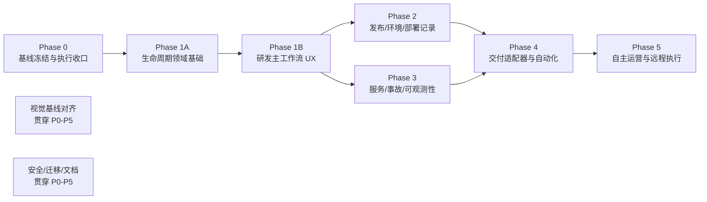
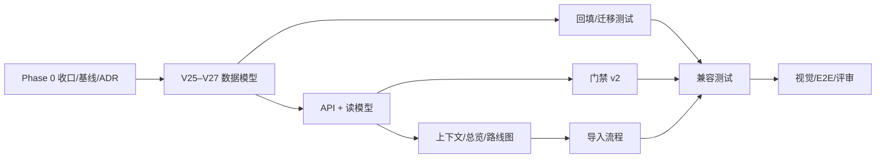
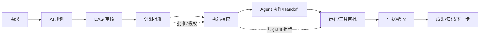
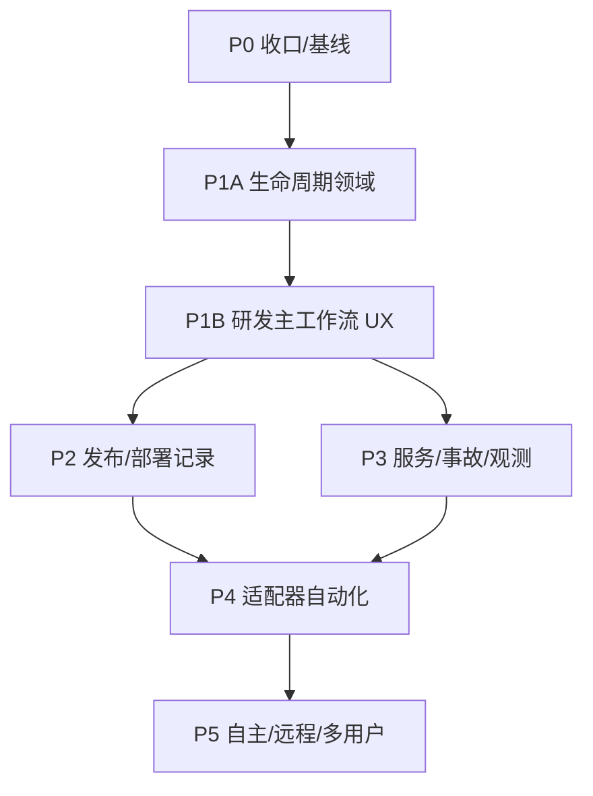

# ProjectOS V2.0 分阶段产品重构路线图

> 文档性质：实施路线图与阶段验收标准  
> 适用对象：产品、架构、研发、UI/UX、测试、发布负责人  
> 上游文档：`docs/v2/01_现状架构与能力审计报告.md`、`docs/v2/02_全生命周期总体产品与技术架构设计.md`  
> 前提：本轮只做审计、研究、设计；**不开始下一阶段开发**。本文是评审材料，不是开工指令。

---

## 0. 路线图原则

1. **先收口，再扩展。** 先封堵现有执行旁路、冻结视觉基线、建立迁移与回滚能力，再增加版本/发布/运维领域。
2. **一期只做“生命周期基础 + 研发主工作流体验”，不做全套运维。** 一期由 1A/1B 两个独立切片组成；目标是让项目能表达并行版本/迭代/环境，并把现有研发能力串成可验收旅程，而不是马上自动部署生产。
3. **纵向切片。** 每个阶段都交付“数据 + API + UI + 测试 + 文档”的可用闭环，不做只有表没有入口、或只有 UI 没有后端的半成品。
4. **旧能力不破坏。** 旧项目、旧 API、旧页面、旧测试在迁移后仍可用；新能力用特性开关/双读渐进启用。
5. **每个阶段有明确 Stop/Go。** 未达到退出标准不进入下一阶段；不用“先做 UI 再说”推进。
6. **视觉与安全是门禁，不是收尾。** 每个 UI 阶段都要截图/E2E；每个外部副作用阶段都要审批/审计/回滚。
7. **不新增第二套内核。** 任何阶段发现需要第二套 Planner/Scheduler/Agent Registry/Runtime Registry，立即停止并回到架构评审。

---

## 1. 阶段总览

| 阶段 | 主题 | 预估 | 关键交付 | 是否一期 |
|---|---|---|---:|---|
| Phase 0 | 基线冻结、P0 执行收口、ADR/迁移准备 | 2–3 周 | P0 全部关闭/禁用、基线决策、备份/回滚、ADR | 前置 |
| **Phase 1A** | **产品/版本/迭代/环境 + 项目姿态 + 门禁/证据 + 导入** | **4–5 周** | **可并行的生命周期领域基础（V25–V27）** | **是（V2.0 一期）** |
| **Phase 1B** | **需求→AI 规划→DAG 审核→批准→授权→协作→运行→验收→成果** | **3–4 周** | **可独立验收的研发主工作流体验** | **是（V2.0 一期）** |
| Phase 2 | 发布/制品/环境/部署/变更记录（先记录后自动化） | 3–4 周 | 发布与部署真相、审批、回滚记录 | 否 |
| Phase 3 | 服务/事故/告警/Runbook/SLO/只读观测 | 4–5 周 | 故障闭环、运营视图 | 否 |
| Phase 4 | CI/CD、Argo CD、Rundeck、自动部署/回滚/晋升 | 4–6 周 | 适配器自动化、对账、漂移 | 否 |
| Phase 5 | 自主运营闭环、远程 Worker、团队化 | 6–8 周 | 受控自治、远程执行、真正双人审批 | 否 |

> 估算为 1–2 名熟悉代码库的工程师、不含外部系统等待与大规模视觉返工；仅用于排期量级，不作为承诺。1A/1B 各自独立验收，不因原估算压缩安全/迁移工作。

---

## 2. Phase 0：基线冻结与执行收口（2–3 周）

### 2.0 开工准入（不要求 P0 已关闭）

- [ ] 用户批准总体方向与 1A/1B 拆分。
- [ ] 已建立独立 Phase 0 分支/Worktree；0686c41 与关键 UI 分支已保护。
- [ ] 已审计 Worktree/分支/Tag/未提交文件；脏工作区不会被覆盖。
- [ ] 已确认不执行 reset/clean/force-push。
- [ ] 已具备数据库备份/恢复方案。
- [ ] 已记录测试基线；已确认 P0 清单与负责人。
- [ ] 已明确本轮不实现 1A/1B/发布部署/运维新领域。

> P0 关闭是 Phase 0 的**退出**条件，不是开工前提；否则形成循环依赖。

### 2.1 目标

在增加任何新领域之前，先保证：

- 视觉基线有唯一、可复现的工程现场。
- 现有执行平台的 P0 旁路被记录/封堵，后续发布/运维不会建立在不完整审计上。
- 数据迁移有备份、回滚、验证方案。
- V2.0 的关键 ADR 被评审。

### 2.2 工作项

#### A. 仓库与基线冻结

- 只读盘点当前 10 个 worktree、12 个本地分支、4 个 tag、未提交/未跟踪文件；不 reset、不 clean、不 force-push。
- 由用户确认“正式 UI 集成线”（详见 04 文档 §7）：
  - 方案 A（推荐）：`v2.0-phase1` 从 `feature/v1.6-ux` @98cd5a3 建立，业务/迁移/安全走该分支；从 0686c41/`feature_dev_ux` 逐页移植 UI。
  - 方案 B：先清理 `feature_dev_ux` @49f9413 的未提交文件，建 `v2.0-ui-baseline`，再 cherry-pick `65054bf` 性能提交；不自动合并到业务分支。
  - 方案 C：暂不迁移 UI，仅以 0686c41 为视觉参考，1A/1B 用旧 UI。
- **Phase 0 已执行**：`v2.0-phase0` 从 `feature/plan-review-design-lab-integration` @9dd12f1 创建（含 98cd5a3 + 0686c41，无后端 diff）；独立 worktree `ProjectOS-v2-phase0`。
- 任何 UI 分支合并前检查 `git diff --name-only 98cd5a3..<candidate> -- apps/runtime packages` 必须为空；合并后跑 Planner/Replan/Grant/Handoff/Runtime 回归。
- **不触碰**现有 worktree 的未提交改动；不自动合并 UI 分支。
- 复制/固定 0686c41 的关键资产（Design Lab shell/tokens/graph/inspector、`PROJECTOS_UI_CONTRACT.md`）到新分支的文档/验收目录；不删除旧分支。
- 给当前 1.7.0 产物建立来源记录（commit、构建命令、SHA256、是否签名）；不把本机产物当发布真相。

#### B. P0 执行收口（必须先于新领域）

| # | 问题 | 处理类别 | Phase 0 关闭条件 |
|---|---|---|---|
| P0-1 | `runtime.execute` 从 Renderer 直达执行器：无 Run/ToolCall/审批/预算/租约，任意 cwd，注入 Key | **立即封堵** | 移除/禁用 Renderer+preload+API 入口；内部也不得绕过 Gateway；cwd 限定；负向测试通过 |
| P0-2 | `runtime.acpPrompt` 从 Renderer 直达 ACP：自建 session/prompt，无 Run/Approval/预算 | **立即封堵** | 移除/禁用 Renderer 入口；ACP 只经 AgentRunner 审批路径 |
| P0-3 | CLI/ACP Runtime 使用 `project.rootPath` 而非计划 Worktree | **立即封堵** | 统一 `state.workspaceRoot`；需 Worktree 的计划无 Worktree 即拒绝；E2E |
| P0-4 | `agentDefinition.run`/`RuntimeRunService` 自建 Run，无槽/租约/审批，可并发 | **立即封堵或硬禁用** | 收口到 `AgentRunner.startRun`；短期保留则 feature-off、无 UI/API 可达，并有延期 ADR |
| P0-5 | ExternalAgentRunner 写模式无 run 级审批、无槽、全量 env | **立即封堵写模式** | 写模式先 Approval + slot + env 白名单；只读模式保留审计 |
| P1-1 | 自动化修复 `allowedPaths` 空转 | **可禁用延期** | 未修前关闭 approved-autofix 写能力；不得仅排期 |
| P1-2 | 质量门禁 `shell:true` 无审批 | **可禁用延期** | 未修前关闭自动质量门禁执行；或改受控白名单 |
| P1-3 | 协调类工具可操作任意 taskId | **立即修复** | 校验 task 属于当前项目/计划/Agent 授权 |
| ACCEPT-1 | 外部 CLI/ACP 内部工具无法逐工具观测 | **已接受限制** | run 级审批 + Worktree + diff + env 白名单 + ADR/UI 明示；不能作为缺审批的借口 |

> **Phase 0 不接受“已知可利用但后期排期”。** P0-1~P0-5 必须全部关闭或硬禁用；P1-1/P1-2 若未修复，必须关闭对应能力。ACCEPT-1 只有在补偿控制全部具备时才可接受。

#### C. 数据与迁移准备

- 对当前数据库做真实备份/恢复演练；记录 RTO/RPO。
- 写 V25–V27 迁移草案与回填规则；只评审，不执行。
- 建立迁移测试夹具：V24 旧库、含数据、含旧计划/任务/审批；覆盖停止条件。
- 明确“旧 API 保留、旧字段双读、失败只读”的兼容策略；`current_stage` 不改名。

#### D. ADR 与评审

至少评审：

- ADR-V2-001 生命周期姿态/多轨道。
- ADR-V2-002 ProductVersion 一等聚合。
- ADR-V2-003 Environment/Deployment 先记录后自动化。
- ADR-V2-004 一套执行内核 + PlanKind/WorkType。
- ADR-V2-005 统一 ExecutionGateway/Approval。
- ADR-V2-006 适配器边界。
- ADR-V2-007 本地优先/Outbox/远程 Worker。
- ADR-V2-008 Additive migration/回滚。
- ADR-V2-010 视觉基线治理。
- ADR-V2-013 证据四维/交付回执/未知不重试。
- ADR-V2-014 事实/状态/读模型/UI 偏好分离。
- ADR-V2-015 单用户/外部可信/多用户审批语义。
- ADR-V2-016 UI 基线/分支切片合并。

#### E. 开源与许可证决策

- 锁定 8 个参考项目的 commit（见架构设计 §13.1），建立许可证/复用记录。
- 明确不复制 AGPL-3.0（Plane、Aperant、Grafana）代码/资产。
- 明确 V2.0 不新增外部运行时/服务端依赖；Argo/Grafana/SigNoz/Rundeck 只做适配器。
- 对必须参考的 Apache-2.0/MIT 代码，记录来源、许可证、修改与退出策略。

### 2.3 Phase 0 退出验收

- [ ] P0-1~P0-5 全部关闭或硬禁用，有负向测试；P1-1/P1-2 未修则对应能力已关闭。
- [ ] 合法 Agent 入口（Agent 工作台/受控 CLI-ACP）回归通过，不能只证明旧入口被禁用。
- [ ] 数据库备份/恢复演练通过。
- [ ] V25–V27 迁移与回填方案评审通过，停止条件明确。
- [ ] 关键 ADR 通过。
- [ ] 开源/许可证决策记录完成。
- [ ] `pnpm lint/typecheck/test/build` 与适用 E2E/打包 Smoke 有实际结果记录（通过/失败/跳过/未运行）。
- [ ] 没有未经审计的合并/重置/删除；已删除的合并分支有记录。
- [ ] Phase 0 Closure Report 完成，未验证事项未标记为已关闭。

### 2.4 Phase 0 实施状态（2026-10-27）

| 项 | 状态 | 证据/说明 |
|---|---|---|
| P0-1/P0-2 Renderer 原始入口 | **已关闭** | ApiSchemas/preload/dispatcher 移除；Electron 安全 E2E 验证 `undefined` |
| P0-3 CLI/ACP Worktree | **已修复** | `state.workspaceRoot`；runtime/teamwork E2E |
| P0-4 RuntimeRunService | **硬禁用** | `agentDefinition.run` 抛 `POLICY_DENIED` |
| P0-5 ExternalRunner | **写模式+公共执行禁用** | `externalAgents.execute` 抛错；slot/env 代码保留待 Phase 4 |
| P1-1 allowedPaths | **能力关闭** | `startRepair` 抛错；UI 禁用 |
| P1-2 quality gate | **默认关闭** | 显式 `PROJECTOS_ENABLE_AUTO_QUALITY_GATE=1` 才执行；Scheduler 暂停并提示 |
| P1-3 跨项目/计划 task | **已修复** | `assertCoordinatedTaskScope` + 单测 |
| `runtime.install` | **已禁用** | 全局安装无审批；UI 提示手动安装 |
| 合法 Agent 入口 | **通过** | `agent-e2e`、`v13-e2e` 通过；Teamwork 默认暂停、opt-in 后通过 |
| 数据备份/恢复 | **通过** | 真实 DB 备份/恢复 integrity=ok；V24 fixture |
| V25–V27 | **仅评审** | 未实施新领域表；报告记录依赖/停止条件 |
| ADR/许可证 | **未完成正式签署** | 不是 P0 代码阻塞；报告列为未关闭事项 |
| 测试/构建/打包 | **通过** | lint/typecheck/test/build/e2e/package smoke 均有结果 |

> 详见 `ProjectOS_V2.0_Phase0_Closure_Report.md`；未完成项不得标记为已关闭。

---

## 3. Phase 1A：生命周期领域基础（4–5 周）

### 3.1 Phase 1A 只改什么（必须明确）

**Phase 1A 只做：**

1. 产品/版本/迭代/环境四个基础领域模型与 API。
2. 项目姿态（ProjectPosture）与多条活动轨道。
3. 版本上下文/环境上下文（全局选择器 + 深链 + 页面过滤）。
4. 版本门禁 v2（主体化、条件化证据），旧 8 阶段门禁保留兼容。
5. 已上线项目导入（仓库/服务/版本/环境基线，不伪造历史）。
6. 旧页面兼容与最小改造：总览、路线图、版本详情、任务过滤、项目设置治理。
7. 执行边界收口（Phase 0 未完成的部分不得进入 1A；不存在“顺延后优先”）。
8. 迁移 V25–V27、回填、兼容、测试、视觉验收、文档。

**Phase 1A 明确不做：**

- 发布（Release）/制品库/部署（Deployment）/回滚。
- 环境自动化、CI/CD 适配器、Argo/Rundeck。
- 服务目录、事故、告警、SLO、Runbook、观测。
- 多用户/团队 ACL、远程 Worker、云同步。
- 全系统 UI 重绘；只做最小页面与上下文改造。
- 把 `currentStage` 删除或改名；只保留 legacy。
- 完整研发主工作流 UX 整合（放到 Phase 1B）。

### 3.2 数据工作项

| # | 工作项 | 说明 | 验收 |
|---|---|---|---|
| D1 | `products` | 项目下的产品/服务集合；一期默认 1 个 | 旧项目回填；可创建第二个 |
| D2 | `product_versions` | semver、phase、support_level、日期、provenance | 旧项目回填 `0.1.0`；可并行多版本 |
| D3 | `iterations` | version_id、目标、起止、状态、容量 | 一个版本多迭代；不同版本并行 |
| D4 | `environments` | key/name/type/protected/approval policy | 默认 local；可建 staging/prod |
| D5 | `requirements` 扩展 | version_id/iteration_id/priority/owner | 旧行可空；新行可归属 |
| D6 | `tasks` 扩展 | work_type/version_id/iteration_id/source_ref | 旧行可空；看板可过滤 |
| D7 | `milestones` 扩展 | version_id/type | 旧行兼容；release 关联留 Phase 2 |
| D8 | `plan_revisions` 扩展 | kind/subject_type/subject_id/environment_id | 旧计划默认 development |
| D9 | `gate_definitions`/`gate_evaluations` | 主体化门禁 + 条件化证据 | 版本门禁可独立评估 |
| D10 | `project_posture` 读模型 | 派生姿态/轨道/风险 | 查询稳定、无写副作用 |
| D11 | 回填与迁移测试 | V24→V27；幂等；旧数据可读 | 备份/恢复/校验/停止条件 |
| D12 | 证据四维 | `evidence_type`/`verification_status`/`assurance`/provenance；旧行 `unknown` | 门禁按条件判定，不按等级 |
| D13 | Run checkpoint 最小集 | 收尾记录 open loops/next action/context hash | 不替代聊天记录；可恢复审计 |
| D14 | `project_focus` | 用户关注版本/事故/发布（UI 偏好） | 不影响业务状态；不改 `current_stage` |

**约束：**

- 只 additive；不删除 `projects.current_stage`、`project_stages`。
- 回填不伪造发布/部署/事故；只建默认 Product/Version/Environment。
- `plan_revisions` 仍是计划修订，不改成产品版本。
- 所有新表有 FK/索引/时间戳；所有写路径在 Runtime。

### 3.3 API 工作项

| 方法组 | 最小方法 | 说明 |
|---|---|---|
| product | `product.list/create/update` | 一期默认产品；支持多产品预留 |
| version | `version.list/create/update/transition` | 版本状态机；门禁校验 |
| iteration | `iteration.list/create/update/close` | 迭代生命周期 |
| environment | `environment.list/create/update` | 环境与保护级别 |
| posture | `project.posture` | 姿态/轨道/风险聚合 |
| version overview | `version.overview` | 版本 360 读模型 |
| import | `project.importBaseline` | 仓库/版本/环境基线 |
| gates | `gate.list/evaluate` | 主体化门禁 |

**兼容：**

- 旧 `project.overview`、`project.advanceStage`、`task.board`、`plan.*` 保留。
- 新字段 optional；旧客户端不受影响。
- 所有新方法走命名 preload + Zod + Runtime dispatcher。
- 不新增第二套 API 网关。

### 3.4 UI 工作项（最小改造）

| # | 页面/组件 | 改动 | 验收 |
|---|---|---|---|
| U1 | 项目标题栏上下文 | 项目/版本/环境选择器；写入 URL/store | 可深链；切版本过滤任务/计划/运行 |
| U2 | 项目总览 | StageRail 降级为“阶段详情”；主视图改为姿态+轨道泳道 | 四轨并行可见；不误导为单阶段 |
| U3 | 路线图页 | 版本/迭代/范围时间线 | 创建/编辑版本/迭代；门禁状态 |
| U4 | 版本详情页 | 版本 360：范围/任务/计划/门禁/风险 | 数据真实；空态明确 |
| U5 | 任务看板 | 版本/迭代/工作类型过滤；旧看板保留 | 过滤正确；拖拽不回归 |
| U6 | 项目设置 | 治理项聚合（版本/环境/质量策略/预算/交接） | 复用现有 API；不新造 |
| U7 | 导入流程 | 现有项目导入 → 基线确认 → 版本/环境 | 不改仓库文件；可回滚 |
| U8 | 导航 | 增加“规划/版本/路线图”；不删除现有入口 | 审批/通知入口收敛留 1B |
| U9 | 空态/文案 | 未实现能力明确标注 | 不出现假发布/假部署 |

**视觉约束：**

- 使用 0686c41 的 shell/tokens/材质；不新造一套视觉语言。
- 玻璃只用于导航/浮层/检查器；数据表面实体高对比；无全屏 blur。
- 1440/1024、Light/Dark、125%、键盘可达、WCAG AA。
- 每个页面截图 + 交互录像 + E2E；用户视觉批准后才继续下一页。

### 3.5 门禁 v2（Phase 1A 最小闭环）

- 版本状态转换必须产生 `GateEvaluation`（按条件，不按单一等级）：
  - planned→discovery：目标/负责人/范围（`manual_attestation`，策略允许）。
  - discovery→build：需求批准 + ADR + 计划批准（`approval_record`/`review_record`）。
  - build→verify：任务完成 + 质量门禁（`test_report` passed，`assurance>=source_observed`）。
  - verify→release_candidate：测试报告 + 安全检查（`manual_attestation` 只能 `self_declared`，需策略 `allowSelfDeclared`；不得冒充外部确认）。
- 旧 8 阶段门禁保留为 `legacy` 读模型，不再阻塞新版本。
- 项目姿态显示“下一门禁/阻塞项”，不显示假进度。
- 门禁豁免必须记录理由/批准人/有效期。

### 3.6 导入已上线项目（Phase 1A）

流程：

1. 选择目录/仓库。
2. 扫描技术栈/Git/构建方式（复用 `project-analyzer`）。
3. 创建 Project + 默认 Product + 默认 Version（`0.1.0` 或用户输入）。
4. 创建 `local` 环境；可选录入 staging/production。
5. 可选导入需求/缺陷（明确来源/置信度）。
6. 生成“当前真实状态”报告。
7. 不伪造历史发布/部署/事故。

验收：

- 导入不修改仓库文件。
- 版本/环境可编辑。
- 旧项目可直接打开。
- 导入失败可回滚/重试。

### 3.7 Phase 1A 依赖

### 3.8 Phase 1A 验收标准

**数据：**

- [ ] V24 旧库升级 V25→V27，行数/外键/关键聚合校验通过；停止条件已验证。
- [ ] 回填幂等；重复执行不产生重复 Product/Version/Environment。
- [ ] 旧项目/旧计划/旧任务/旧审批可读。
- [ ] 备份/恢复演练通过。

**功能：**

- [ ] 一个项目可创建第二个版本；两个版本可同时 build/maintenance。
- [ ] 可创建迭代并归属版本；不同版本迭代互不阻塞。
- [ ] 可创建 local/staging/prod 环境；任务/计划/运行可按版本/环境过滤。
- [ ] 项目总览显示姿态+轨道，不再只显示单阶段。
- [ ] 版本门禁独立评估；旧 8 阶段门禁不阻塞新版本。
- [ ] 导入现有项目生成默认 Product/Version/Environment，不伪造历史。

**工程：**

- [ ] `pnpm lint/typecheck/test/build` 实跑通过。
- [ ] 新增迁移/领域/兼容测试；现有 265+ 测试不回归。
- [ ] 无第二套 Planner/Scheduler/Registry；边界检查通过。
- [ ] P0-1~P0-5 全部关闭或硬禁用；P1-1/P1-2 未修则能力已关闭。
- [ ] 性能：总览/路线图/版本 360 在 1440/1024 可接受；无全屏 blur。

**视觉：**

- [ ] 1440×900、1024×768、125%、Light/Dark 截图。
- [ ] 无横向溢出/文字裁切/空白截图；对比度 AA；焦点可见。
- [ ] 0686c41 基线对齐（或用户确认的新基线）有对照证据。
- [ ] 用户视觉批准。

**范围：**

- [ ] 没有实现发布/部署/事故/观测（或仅只读占位且明确标注）。
- [ ] 没有删除现有真实业务/路由/入口。
- [ ] 没有合并/重置现有分支。

---

## 3B. Phase 1B：研发主工作流产品体验整合（3–4 周）

> 独立验收切片：不新增发布/部署/事故领域；不新建第二套业务系统；不删除既有页面。依赖 1A 的 API/读模型，但可以独立验收。

### 3B.1 目标

把现有真实能力串成一条可演示、可验收的主旅程：

不是换 CSS，也不是把现有页面重新画一遍；是让用户在同一个项目/版本/环境上下文中完成上述动作，并清楚知道“现在能做什么、下一步是什么、为什么被阻断”。

### 3B.2 用户旅程与页面映射

| 步骤 | 用户动作 | 页面/组件 | 数据来源 | 交互验收 |
|---|---|---|---|---|
| 1 需求 | 创建/批准需求，写验收标准 | 项目总览需求区 / 新增需求页 | `requirement.*` | 需求可归属版本/迭代；批准后可用于规划 |
| 2 AI 规划 | 选择目标，生成计划 | 编排工作台 → 生成计划 | `plan.generate`、`planner_usage` | 显示模型/连接/attempts/context；本地规则必须标注 |
| 3 DAG 审核 | 编辑任务/依赖/Agent/验收 | Plan Review / DAG Inspector | `plan.get/update`、`graph.snapshot` | 环/自依赖/缺 Agent 阻断；不丢失真实拓扑 |
| 4 计划批准 | 确认范围，创建任务 | Plan Review → 批准 | `plan.approve` | 单事务创建；**不自动授权执行** |
| 5 执行授权 | 绑定 revision/tasks/agents/paths/budget | PlanGrantPanel | `plan.grant.issue` | 授权状态独立可见；撤销/过期/revision 变化即失效 |
| 6 启动 | 开始编排 | 编排工作台 → 启动 | `orchestration.start` | 无 grant 拒绝；并发/容量/依赖预检 |
| 7 Agent 协作 | 会话/群聊/Handoff | Agent 工作台、跨会话中心 | `session.*`、`inbox.*`、`handoff.*` | 责任/证据随 Handoff 传递；不重复 Run |
| 8 运行/审批 | 查看步骤，批准/拒绝工具 | Agent 工作台、运行审计、审批中心 | `run.*`、`approval.*`、`tool_calls` | 审批/拒绝/过期可见；拒绝无副作用 |
| 9 验收 | 查看证据，人工验收 | 任务详情验收 tab | `task.acceptancePolicy/request/confirm`、`artifact.*`、`evidence` | 缺证据不得 done；人工验收留痕 |
| 10 成果 | 版本状态、知识/决策、下一步 | 版本详情、知识库、项目姿态 | `version.overview`、`project.posture`、`knowledge.*` | 成果与证据可追溯；下一步明确 |

### 3B.3 关键交互规则

- **计划批准 ≠ 执行授权**：UI 显示“已批准（未授权执行）”；批准按钮不触发 grant。
- **统一审批入口**：保留审批中心为唯一队列；其他页面只显示摘要+深链，不再各自实现审批逻辑。
- **失败可恢复**：审批过期、grant 失效、Run `needs_reconciliation`、Handoff 失败都有明确下一步；不显示假成功。
- **证据可见**：任务/运行/版本详情能打开证据（类型、验证状态、保证程度、来源、哈希）；人工声明明确标注。
- **保留既有能力**：任务看板拖拽、DAG、Plan Review、Agent Studio、Handoff、Run 审计、知识库不删除；只增加上下文/状态带/深链。
- **空态诚实**：未实现的发布/部署/事故入口不展示“已完成”；必要时显示“未启用/设计中”。

### 3B.4 数据与 API

- 不新增强制 schema；复用 V25–V27；如需索引/读模型优化，只做 additive。
- 若确实需要新字段，新增独立 additive migration（如 V27b/V28）并重新评审；**不得修改已发布的 V25–V27**。
- 复用现有 API；只新增 `project.posture`/`version.overview` 读模型与必要的 UI 聚合查询。
- 不新建第二套审批/任务/运行系统。
- 所有页面使用真实 API；禁止 mock 计划/审批/运行。

### 3B.5 验收场景

1. **主旅程**：需求→计划→批准→授权→运行→工具审批→测试/Artifact→人工验收→任务 done→版本证据。
2. **负向**：批准后未授权启动必须拒绝；撤销 grant 后不能新启动；revision 变化后旧 grant 失效。
3. **恢复**：审批过期/拒绝、Run `needs_reconciliation`、Handoff 失败均有明确 UI 与下一步。
4. **证据**：缺少测试报告/验收证据时不能 done；人工验收记录可追溯。
5. **兼容**：旧项目/旧计划/旧看板/旧运行审计可打开；不因新上下文丢失旧数据。
6. **视觉**：0686c41 shell/tokens；1440/1024、Light/Dark、125%；无全屏 blur；用户批准。

### 3B.6 明确不做

- 发布/部署/环境自动化/事故/观测（Phase 2+）。
- 全站视觉重绘；只做主导航、项目标题上下文、总览/路线图/版本详情/任务验收/审批入口的最小整合。
- 新 Agent 路由；不恢复已删除的 Agent 路由页面。
- 第二套 Planner/Scheduler/Approval/任务系统。

### 3B.7 依赖与验收

- 依赖：Phase 0 全部 P0 关闭；Phase 1A 的 V25–V27/API/读模型通过。
- 可与 1A 后半段并行做只读原型，但**正式验收必须在 1A 完成后**。
- 独立 Stop/Go：主旅程 E2E、负向测试、证据验收、视觉批准、旧页面回归；缺一项不进入 Phase 2。

---

## 4. Phase 2：发布、环境与部署记录（3–4 周）

### 4.1 目标

先建立“发布/部署的真相与审计”，**不自动部署**：

- Schema 顺序：V28（approvals/ChangeRequest）→ V29（Release/Deployment/ArtifactLink）。
- 发布是什么、包含哪些制品、谁批准。
- 部署到哪个环境、期望/实际版本、健康状态、回滚目标。
- 生产变更的审批与回滚计划。

### 4.2 范围

| 工作项 | 内容 | 验收 |
|---|---|---|
| Release | `releases`、状态机、发布说明、审批 | 创建候选/批准/发布；不可变制品集 |
| ReleaseArtifact | 制品关联、哈希、URI | 发布可追溯到制品 |
| Environment | 环境详情、保护级别、审批策略 | staging/prod 策略可配置 |
| Deployment | 部署记录、intent/observation 双层状态机、事件、健康、回滚目标 | 手工记录=`recorded`+`self_declared`；只读观测=`observed`；adapter 回执才 `confirmed`；unknown 不自动重试 |
| ChangeRequest | 标准/常规/紧急变更、风险、回滚计划 | 生产部署必须关联变更单；审批语义见 Phase 4 |
| Approval 泛化 | scope=release/deployment/change；单用户确认/外部可信审批 | 审批队列统一；旧工具审批兼容；**Phase 2 不宣称双人** |
| UI | 发布页、环境页、部署详情、变更审批 | 真实数据；明确“人工登记/未验证”与“adapter 回执” |
| 审计 | 发布/部署/变更证据链 | 可查“谁在何时批准了什么、来源是什么” |

### 4.3 明确不做

- 不自动执行 CI/CD、不自动部署、不自动回滚。
- 手工记录不进入 `prepared/leased/dispatched`；这些是 Phase 4 适配器意图状态。Phase 2 只记录 `recorded`。
- 不接 Argo/Rundeck/Grafana（Phase 4）。
- 不做多环境复杂拓扑/多集群。
- 不做制品仓库服务器；只登记 URI/哈希/元数据。

### 4.4 验收

- 创建 Release → 审批（单用户确认）→ 记录 Deployment 到 staging（`recorded`/`self_declared`）→ 可选只读观测 → 记录晋升/回滚；**不得显示为 adapter 已确认**。
- 生产部署无 ChangeRequest/回滚计划时阻断。
- 发布/部署/变更审批可追溯；旧审批不破坏；UI 明确“单用户确认”而非“双人”。
- UI 明确“当前为记录模式，未连接自动部署”；人工健康状态只能是 `declared/unknown`，不得伪造 `healthy`。
- 视觉/E2E/迁移测试通过。

---

## 5. Phase 3：服务、事故与可观测性（4–5 周）

### 5.1 目标

建立生产运营的最小闭环：

- 服务目录与健康。
- 告警/手工发现 → 事故 → 缓解/修复 → 验证 → 复盘。
- 只读观测连接（Grafana/SigNoz/OTel），不重建监控系统。
- Runbook/作业记录（先手工/受控执行）。

### 5.2 范围

| 工作项 | 内容 | 验收 |
|---|---|---|
| Service | 服务目录、owner、criticality、依赖 | 服务 360；与版本/环境/部署关联 |
| Incident | 严重级别、状态机、指挥官、时间线、影响 | 告警/手工创建；关联部署/版本/任务 |
| Alert | 出站拉取优先；Webhook 仅 loopback + 签名/防重放/限流/大小上限；normal/pending/firing、silence/dedup、关联事故 | 告警→事故；保留外部 ID；不重建 Alertmanager；默认不监听公网 |
| SLO/HealthSnapshot | SLO 定义/评估、健康快照 | 查询/手工录入；趋势可见 |
| Runbook/OpsJob | Runbook 步骤、作业、执行记录 | 手工触发/审批；日志证据 |
| ObservabilityAdapter | Grafana/SigNoz/OTel 只读查询/告警 | 连接测试；查询；深链 |
| UI | 服务、事故、告警、运营总览、Runbook | 真实数据；空态明确 |
| 复盘 | Postmortem、行动项、知识 | 关闭门禁需要复盘/豁免 |

### 5.3 明确不做

- 不自动修复生产；默认只生成提案/任务。
- 不重建 TSDB/日志聚合/追踪后端。
- 不做 7×24 值班/排班（可预留）。
- 不做自动根因分析承诺；只提供证据/关联。
- **不默认监听公网端口**；告警优先出站拉取；如必须 Webhook，只绑定 loopback，由用户自备 TLS 反代，并强制 HMAC/防重放/限流/大小上限。

### 5.4 验收

- 告警/手工创建事故 → 关联服务/部署 → 创建修复任务 → 执行 → 验证 → 复盘 → 关闭。
- 事故关闭有证据/复盘；行动项进入版本/迭代。
- 观测连接只读；凭据不泄露；查询失败降级。
- 告警默认不监听公网；如启用 Webhook，验证仅 loopback、HMAC/防重放/限流/大小上限。
- 不自动改生产；所有修复仍需审批。
- 视觉/E2E/安全测试通过。

---

## 6. Phase 4：交付适配器与自动化（4–6 周）

### 6.1 目标

把 Phase 2 的记录模式升级为“受控自动化”：

- CI/CD 状态/制品读取与触发。
- Argo CD 同步/健康/漂移/回滚。
- Rundeck 作业执行与审计。
- 环境晋升、自动回滚（仍需审批/策略）。
- 生产变更风险分级与 break-glass。

### 6.2 范围

| 工作项 | 内容 | 验收 |
|---|---|---|
| AdapterGateway | 统一适配器调用、幂等、审批、审计 | 所有外部副作用可追溯 |
| GitHub Actions | workflow 查询/触发、artifact、日志 | 触发需审批；结果回写 |
| Argo CD | sync/health/drift；apply/rollback | 只读先行；写操作审批 |
| Rundeck | job 查询/执行/日志 | ACL 映射；执行审计 |
| Promotion | staging→prod 晋升门禁 | 审批（单用户确认或外部可信审批）+健康+回滚计划 |
| 审批身份 | `approverKind`/`identitySource`/`assurance` | 未配置外部 IdP/SCM 时只能标“单用户确认”；**不宣称双人** |
| 自动回滚 | 健康失败触发/人工确认 | 回滚是新 Deployment；证据完整；adapter 回执 |
| 漂移检测 | desired vs actual | 定期对账；告警/提案 |
| 安全 | 凭据、egress、webhook 签名、重放 | 安全测试通过 |

### 6.3 明确不做

- 不嵌入 Argo/Grafana/Rundeck 服务器。
- 不做 Kubernetes 控制面/CRD。
- 不做无审批的 production 自动部署。
- 不做多集群/多租户。

### 6.4 验收

- staging 自动部署（审批后）→ 健康验证 → 失败自动/人工回滚。
- production 部署需 ChangeRequest + **单用户确认或外部可信审批** + 回滚计划；不得宣称“双人审批”。
- 若配置了外部 IdP/SCM/CI 的可验证审批，记录 issuer/receipt/assurance；否则明确显示“单用户确认”。
- Argo drift 可见；Rundeck 执行有日志/审计。
- 适配器失败进入 `needs_reconciliation`，不自动重试未知副作用。
- 安全/故障注入/E2E 通过。

---

## 7. Phase 5：自主运营与远程执行（6–8 周）

### 7.1 目标

在受控边界内实现“持续运维、自主优化”：

- SLO/健康趋势 → Finding → 提案 → 低风险自动修复 → 验证。
- 生产变更仍受风险分级/审批/回滚约束。
- 远程 Worker 执行 Agent/作业（可选）。
- 团队/权限/审计增强。

### 7.2 范围

| 工作项 | 内容 | 验收 |
|---|---|---|
| 自主优化 | SLO/趋势/成本/缺陷 → 提案 | 只生成提案；低风险可授权 |
| 受控自动修复 | 沙箱/Worktree/审批/验证/回滚 | 生产默认不自动；break-glass 审计 |
| 远程 Worker | 注册、租约、心跳、能力、证据回传 | 断线恢复；无第二真相源 |
| 团队/ACL | Principal/Role/Project ACL | 审批/审计按角色；**真正双人审批在此启用** |
| 知识沉淀 | 复盘/经验/可复用 Runbook | 可检索、可失效 |
| 退役 | 版本/服务/项目退役流程 | 归档/数据保留/知识保留 |

### 7.3 明确不做

- 不做无人值守生产变更（默认）。
- 不做多租户 SaaS/计费/云控制台。
- 不做移动端。
- 不做“AI 自动决定发布范围/优先级”的不可审计决策。

### 7.4 验收

- 沙箱内完成一次“检测→提案→修复→验证→复盘”闭环，人类可随时中断。
- 生产默认只提案；授权修复有路径/环境/预算限制。
- 远程 Worker 有租约/证据/断线恢复；本地仍是真相源。
- 权限/审计/回滚演练通过。

---

## 8. 跨阶段工作流

| 工作流 | Phase 0 | Phase 1A | Phase 1B | Phase 2 | Phase 3 | Phase 4 | Phase 5 |
|---|---|---|---|---|---|---|---|
| 视觉基线 | 决策/对齐 | 上下文/总览/路线图 | 主旅程/审批/验收 | 发布/环境 | 事故/服务 | 适配器 UI | 团队/退役 |
| 安全 | P0 收口/威胁模型 | 版本/环境权限 | 授权/审批语义 | 发布/部署审批 | 事故/观测凭据 | 适配器/egress | 远程/ACL |
| 迁移 | 备份/演练 | V25–V27 | 无强制新表 | V28–V29 | V30–V31 | V32–V33 | V34–V35 |
| 文档 | 能力矩阵 | 生命周期/导入 | 旅程/验收 | 发布/部署 | 事故/观测 | 适配器 | 自治/远程 |
| 性能 | 基线 | 姿态/路线图 | 主旅程 | 发布/环境 | 事故/观测 | 适配器轮询 | 远程 |
| 测试 | P0 回归 | 迁移/并行/导入 | 主旅程/负向 | 发布/部署 | 事故/观测 | 适配器/回滚 | 自治/远程 |

### 8.1 安全门槛

- 每个阶段开始前更新威胁模型。
- 新增外部副作用必须有：Policy、Approval、ToolCall、幂等、审计、回滚/对账。
- 新增凭据只进 Main SecretStore；不写 SQLite/日志/Renderer。
- 新增 Webhook 必须验签/防重放。
- 生产变更必须有 ChangeRequest + 回滚计划 + 明确的审批语义（单用户/外部可信；Phase 5 才可双人）。

### 8.2 视觉门槛

- 每个 UI 阶段先出 2–3 个关键页面截图，用户确认后再扩展。
- 不整站重绘；逐页迁移。
- 每次迁移保留旧页面直到新页面验收通过。
- 截图/E2E/性能证据纳入 PR/验收包。

### 8.3 文档门槛

- 每个阶段更新：能力矩阵、API、迁移、ADR、测试矩阵、未实现清单。
- README/status 不得超前于实现；未实现项明确标注。
- 版本号/测试计数自动校验，避免漂移。

### 8.4 源码研究对阶段范围的影响

本轮已实读 8 个参考项目的模型/状态机/架构文档（见架构设计 §13）。结论不扩大一期范围，但会改变实现细节：

| 研究结论 | 影响阶段 | 具体调整 |
|---|---|---|
| AWR 证据模型（需拆维） | Phase 1A/1B/2 | 不照搬 `EvidenceLevel`；Phase 1A 建 `EvidenceType/VerificationStatus/Assurance/Provenance`；Phase 2 门禁按条件判定 |
| AWR `prepared/leased/dispatched/unknown/confirmed/rejected` | Phase 2/4 | Phase 2 部署记录采用 intent/observation 双层；Phase 4 适配器必须支持 unknown 对账 |
| AWR `Checkpoint/ContextPack` | Phase 1A/1B | 1A 先记录 Run 收尾 checkpoint（open loops/next action）；ContextPack 可后置 |
| Orchestrator “durable facts, derived status” | Phase 1A | `ProjectPosture`/Deployment health 只派生，不存可手改显示状态 |
| Orchestrator controller epoch/fencing | Phase 2/4 | Deployment/OpsJob/远程回调必须带 generation；旧回调只记历史 |
| Plane Cycle/Module/StateGroup/IssueView | Phase 1A/1B | 路线图/工作页采用迭代/范围容器/状态分组/保存视图；不引入 AGPL 代码 |
| Aperant 复杂度分层/QA 升级 | Phase 1B/2 | `PlanKind` 增加轻/重模板；QA 循环采用复发/连续错误/人工升级阈值 |
| Grafana alert state/silence/route | Phase 3 | Alert 归一化 + silence/dedup；Incident 由 Alert 关联 |
| Rundeck Job/Runbook/ACL/Audit | Phase 3/4 | OpsJob/Runbook/Execution + 审计四要素；不嵌入服务器 |
| 许可证矩阵（AGPL/Apache/MIT） | Phase 0 | 建立选型/许可证记录；不复制 AGPL；不新增外部运行时 |

> 这些是“实现细节约束”，不是新增里程碑；若某项导致 1A/1B 超出预算，优先后移“体验增强”，不得后移安全、迁移、证据/门禁。

---

## 9. 阶段依赖与排期

**关键路径：** Phase 0 → Phase 1A → Phase 1B → Phase 2 → Phase 4。
**可并行：** Phase 3 可与 Phase 2 并行（都依赖 1B），但 Phase 4 必须等两者。

**建议节奏：**

- 每 2 周一个可演示增量；1A/1B/每阶段末做 Stop/Go 评审。
- Phase 1A 结束做“并行版本/姿态/门禁”演示；Phase 1B 结束做“需求→计划→批准→授权→运行→验收”真实演示；Phase 2 结束做“发布/部署记录（人工声明语义）”演示；Phase 3 结束做“事故闭环”演示；Phase 4 结束做“受控自动部署/回滚”演示。
- 每个演示都用真实数据；不用演示脚本冒充产品能力。

---

## 10. 验收矩阵

| 能力 | Phase 1A | Phase 1B | Phase 2 | Phase 3 | Phase 4 | Phase 5 |
|---|---|---|---|---|---|---|
| 多版本并行 | ✅ 必须 | ✅ 使用 | ✅ | ✅ | ✅ | ✅ |
| 多迭代 | ✅ | ✅ 使用 | ✅ | ✅ | ✅ | ✅ |
| 环境 | ✅ 基础 | ✅ 使用 | ✅ 完整 | ✅ | ✅ | ✅ |
| 项目姿态/轨道 | ✅ | ✅ | ✅ | ✅ | ✅ | ✅ |
| 导入已上线项目 | ✅ 基线 | ✅ 使用 | ✅ 发布/部署可选 | ✅ 服务/事故可选 | ✅ 适配器 | ✅ |
| 研发主旅程 | — | ✅ 必须 | ✅ | ✅ | ✅ | ✅ |
| 计划批准≠授权 | ✅ API | ✅ UI/负向 | ✅ | ✅ | ✅ | ✅ |
| 证据四维/门禁条件 | ✅ 基础 | ✅ 使用 | ✅ | ✅ | ✅ | ✅ |
| 发布记录 | — | — | ✅ 人工声明 | ✅ | ✅ 自动 | ✅ |
| 部署记录/回滚记录 | — | — | ✅ `recorded` | ✅ | ✅ adapter 回执 | ✅ |
| 服务目录 | — | — | — | ✅ | ✅ | ✅ |
| 事故闭环 | — | — | — | ✅ | ✅ | ✅ 自动建议 |
| 观测只读 | — | — | — | ✅ | ✅ | ✅ |
| CI/CD 适配 | — | — | — | — | ✅ | ✅ |
| Argo/Rundeck | — | — | — | — | ✅ | ✅ |
| 生产自动部署 | — | — | — | — | ✅ 审批后 | ✅ 策略化 |
| 真正双人审批 | — | — | — | — | — | ✅ 需 ACL |
| 自主修复 | — | — | — | — | — | ✅ 受控 |
| 远程 Worker | — | — | — | — | — | ✅ 可选 |
| 多用户/ACL | — | — | — | — | — | ✅ 可选 |

---

## 11. 第一期（V2.0 Phase 1A/1B）工作包

> 这些是评审通过后的建议拆分，不是本轮实施。

**Phase 1A：生命周期领域基础**

| # | 工作包 | 产出 | 依赖 | 验收 |
|---|---|---|---|---|
| 1 | ADR 评审包 | 001/002/003/004/005/008/010/013/014/015/016 | 无 | 评审通过 |
| 2 | 基线冻结包 | 分支策略、备份/恢复、0686 资产清单 | 用户决策 | 基线可复现 |
| 3 | P0 执行收口包 | runtime.execute/acpPrompt/Worktree/外部执行器 | 1 | 安全/E2E/负向测试 |
| 4 | V25 数据模型包 | products/versions/iterations/environments/project_focus + 回填 | 1,2 | 迁移测试 |
| 5 | V26 工作项链接包 | requirement/task/milestone/planRevision 字段 + 回填 | 4 | 兼容/迁移测试 |
| 6 | V27 门禁/证据包 | gate/evidence/checkpoint + 回填 | 5 | 条件门禁测试 |
| 7 | 姿态/版本读模型包 | project.posture/version.overview | 6 | API/读模型测试 |
| 8 | 1A UI 包 | 上下文/总览/路线图/版本详情 | 7 | 截图/E2E |
| 9 | 导入包 | 现有项目基线导入 | 6,8 | 导入 E2E/回滚 |
| 10 | 迁移/兼容/验收包 | V24 夹具、旧 API、视觉、文档 | 全部 | Stop/Go |

**Phase 1B：研发主工作流 UX**

| # | 工作包 | 产出 | 依赖 | 验收 |
|---|---|---|---|---|
| 11 | 主旅程骨架包 | 需求/计划/批准/授权/运行/验收状态带 + 深链 | 1A 完成 | 页面映射/状态可见 |
| 12 | 审批/授权整合包 | 统一审批队列、PlanGrant 状态、批准≠授权 | 11 | 负向测试/E2E |
| 13 | 验收/证据体验包 | 证据四维展示、验收阻断、人工验收留痕 | 11,12 | 主旅程 E2E |
| 14 | 1B 视觉/回归包 | 0686c41 对齐、旧页面回归、截图/录像 | 11–13 | 视觉批准/Stop/Go |

> 工作包 10/14 是阶段门禁，不是“最后再说”的文档工作。

---

## 12. 明确不在 V2.0 一期范围

- 发布/制品/部署/回滚的完整实现（Phase 2）。
- 服务目录/事故/告警/SLO/Runbook（Phase 3）。
- CI/CD、Argo CD、Rundeck、Grafana/SigNoz 适配器（Phase 3/4）。
- 生产自动部署/自动回滚（Phase 4/5）。
- 多用户/团队 ACL、远程 Worker、云同步（Phase 5/更后）。
- 移动端、插件市场、计费、多租户。
- 全系统 UI 重绘；只做最小上下文/总览/路线图。
- 用 0686c41 之外的“新视觉方向”替换已批准基线。

---

## 13. Stop/Go 门禁

### Phase 0 → Phase 1A

- [ ] 用户确认 UI 线与一期范围。
- [ ] P0-1~P0-5 全部关闭或硬禁用；P1-1/P1-2 未修则能力已关闭；负向测试通过。
- [ ] 备份/恢复演练通过。
- [ ] V25–V27 迁移/回填方案评审通过，停止条件明确。
- [ ] ADR（含 013/014/015/016）通过。
- [ ] 测试基线实跑通过。

### Phase 1A → Phase 1B

- [ ] 并行版本/迭代/环境 E2E 通过。
- [ ] 旧项目/旧 API 兼容通过；`current_stage` 未被改写。
- [ ] 姿态/路线图/版本详情视觉批准。
- [ ] 无第二套内核；边界检查通过。
- [ ] P0 旁路全部收口。
- [ ] 迁移可恢复；V24→V27 幂等/停止条件验证通过。

### Phase 1B → Phase 2

- [ ] 主旅程 E2E：需求→计划→批准→授权→运行→审批→证据→验收。
- [ ] 负向：批准未授权不能启动；撤销/过期/revision 变化不能启动。
- [ ] 证据四维/门禁条件生效；缺证据不能 done。
- [ ] 旧页面/旧 API 兼容；审批入口收敛。
- [ ] 视觉/性能验收通过。

### Phase 2 → Phase 4

- [ ] 发布/部署/变更记录完整。
- [ ] 生产部署无变更单/回滚计划时阻断。
- [ ] 手工部署只标 `recorded/self_declared`，不冒充 adapter 回执。
- [ ] 审批/审计可追溯；单用户确认/外部可信语义明确。
- [ ] 视觉/E2E 通过。

### Phase 3 → Phase 4

- [ ] 事故闭环 E2E。
- [ ] 观测只读连接/告警/降级。
- [ ] 复盘/行动项可追踪。
- [ ] 凭据/网络安全测试。

### Phase 4 → Phase 5

- [ ] 适配器审批/幂等/对账/回滚。
- [ ] 生产变更使用单用户确认或外部可信审批；不得宣称双人。
- [ ] 故障注入/漂移/回滚演练。
- [ ] 安全评审。
- [ ] Phase 5 启用 Principal/ACL 后，才可验收真正双人审批。

---

## 14. 资源与风险

### 14.1 资源假设

- Phase 0：1 名架构/后端 + 1 名 UI（基线决策）。
- Phase 1A：1–2 名全栈 + 1 名 UI + 测试支持。
- Phase 1B：1 名全栈 + 1 名 UI + 测试支持；可与 1A 后半段部分并行。
- Phase 2–4：1–2 名后端 + 1 名 UI + 外部系统联调。
- Phase 5：2 名后端 + 1 名 SRE/安全 + UI。
- 视觉/安全/迁移是并行工作流，不是阶段末尾的“补作业”。

### 14.2 主要风险与缓解

| 风险 | 阶段 | 缓解 |
|---|---|---|
| 一期范围膨胀 | P1A/1B | 严格非目标；发布/部署/事故后置 |
| 视觉基线返工 | 全程 | 先决策/对齐；逐页；截图门禁 |
| P0 收口拖延 | P0/1A | 作为一期前置；不先做发布 UI |
| 迁移破坏数据 | P1A+ | 备份/双读/夹具/恢复演练/停止条件 |
| 适配器误操作生产 | P4 | 审批/回滚/单用户或外部可信审批/break-glass/审计 |
| 过度建模/性能 | P1A+ | 只建当前读模型；按需索引；性能测试 |
| 文档夸大 | 全程 | 能力矩阵/未实现标注/自动校验 |
| 外部系统不可用 | P3/P4 | 本地降级；只读优先；needs_reconciliation |

### 14.3 回滚/停止条件

- 任何阶段发现旧数据不可读、审批可绕过、生产误操作、视觉基线被覆盖：**立即停止**，回到上一稳定点。
- 每个阶段保留上一版本可执行文件/数据库备份；不删除旧分支/worktree。
- 不用“重置工作区”解决问题；先定位、备份、隔离。

---

## 15. 结论

V2.0 一期不是“把 ProjectOS 改成大而全的平台”，而是拆成两个可独立验收的切片：

1. **Phase 1A：让项目能同时表达多条生命周期轨道**（版本/迭代/环境/姿态/门禁/证据/导入）。
2. **Phase 1B：用现有真实能力形成完整研发主旅程**（需求→计划→批准→授权→协作→运行→验收→成果）。

发布、部署、事故、观测、自主运营是后续阶段的增量，不是一期的承诺。按本文节奏推进，可以在不破坏现有真实业务与已批准视觉的前提下，把 ProjectOS 从“AI 研发工作台”演进为“全生命周期平台”。
