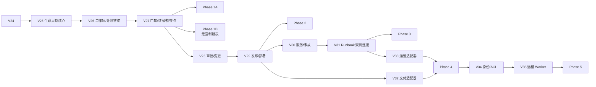

# ProjectOS V2.0 架构决策与一致性核对

> 文档性质：总体架构评审整改记录 + 一致性核对 + Phase 0 开工门禁  
> 评审轮次：V2.0 正式架构评审整改（2026-10-26/27）  
> 上游文档：`01_现状架构与能力审计报告.md`、`02_全生命周期总体产品与技术架构设计.md`、`03_分阶段产品重构路线图.md`  
> 本轮边界：**不进行业务开发、不修改数据库、不重绘 UI、不自动合并分支**；完成整改后停止，等待 Phase 0 开工批准。

---

## 0. 结论摘要

本轮整改解决了三份文档之间的六类冲突：

1. **生命周期/UI 焦点混用**：`currentStage` 不再改名为 `primaryFocus`；生命周期事实、业务状态、派生读模型、UI 偏好四层分离。
2. **证据模型过度简化**：不再用单一线性 `EvidenceLevel` 同时表示“验证可靠性”和“产品阶段”；拆成 `EvidenceType`、`VerificationStatus`、`Assurance`、`Provenance`，`LifecycleStatus` 归主体。
3. **迁移顺序不可支撑一期**：一期必需字段全部前移到 V25–V27；V28+ 只服务 Phase 2+。
4. **Phase 0 允许高风险延期**：改为 P0 全部关闭或硬禁用，不接受“后期排期”通过。
5. **双人审批语义失真**：Phase 4 只允许单用户确认/外部可信审批；真正双人审批依赖 Phase 5 的 Principal/Role/ACL。
6. **一期体验目标缺失**：一期拆成 Phase 1A（生命周期领域基础）与 Phase 1B（研发主工作流 UX），各自独立验收。

**最终状态：** 总体方向与安全/迁移/证据/审批语义的关键约束为**已批准**；具体实现方案为**推荐**；UI 集成线、产品基数、SemVer、适配器优先级等为**待用户确认**。

---

## 1. 已发现的文档冲突

| ID | 冲突 | 出现位置 | 影响 | 整改 |
|---|---|---|---|---|
| C-01 | 一处写 `currentStage` 降级为 `primary_focus`，另一处要求保留原名 | 02 §5.4/§6.1/§17.5；01 §11.2 | 会把业务事实、派生状态、UI 偏好混为一个字段 | 保留 `current_stage` 原名；新增 `project_focus`；读模型用 `legacyStage`/`focusedSubject` |
| C-02 | 用单一 `EvidenceLevel` 同时表达验证深度和发布阶段 | 02 §5.3/§6.6/§6.8/§13/§18；01 §9；03 D12/§8.4 | 可用“低等级”或“高等级”错误满足/拒绝门禁 | 拆成四维；Gate 按条件判定 |
| C-03 | Phase 1 需要的 Task/Requirement/PlanRevision 字段排到 V30，Gate 排到 V28，Approval 排到 V29 | 02 §17.3；03 D7–D12 | Phase 1A 无法交付；迁移顺序与路线图矛盾 | V25–V27 锁定一期字段；V28+ 后置 |
| C-04 | Phase 0 退出标准允许部分 P0（旧编号 P0-3~P0-6）“有排期/负责人”即通过 | 03 §2.3；01 §6.5 | 已知可利用入口可带病进入一期 | P0 全部关闭/硬禁用；P1 未修则能力关闭 |
| C-05 | Phase 4 要求“双人/负责人审批”，但 Phase 5 才有 ACL | 02 §10.4/§11.3；03 6.4/13 | 单用户确认被包装成双人审批 | 定义三种审批语义；Phase 4 不宣称双人 |
| C-06 | 执行时序把“计划批准”直接接到 `orchestration.start`，未体现 grant | 02 §8.5 | 批准与执行授权混同 | 增加 `plan.grant.issue`；明确批准≠授权 |
| C-07 | 手工部署记录被描述为 `confirmed/healthy` | 02 §6.6/§11.3；03 4.2/4.4 | 人工声明冒充 adapter 回执 | 增加 `recordSource`/`assurance`；手工只能 `recorded` |
| C-08 | UI 分支策略只写“用户确认”，未说明 0686 与各分支关系、脏状态与后端差异 | 02 §16/§19；03 §2.2A | 可能整支合并导致视觉/业务回归 | 分支事实表 + 切片策略 + 合并前硬检查 |
| C-09 | Phase 1 同时承担领域基础与完整 UX，无法独立验收 | 03 全文 | 范围膨胀/验收失真 | 拆 1A/1B，独立 Stop/Go |
| C-10 | 整改前审计 §6.5 只列 `runtime.execute`，未列 `runtime.acpPrompt`，并把 RuntimeRun 简化为“无审计” | 01 §6.5（整改前） | 漏掉同等严重入口；整改范围不准 | 增加 ACP prompt；区分 Run/ToolCall 部分审计与缺审批/槽/租约 |

---

## 2. 整改前后决策

| ID | 整改前 | 整改后 | 状态 |
|---|---|---|---|
| D-01 | `currentStage` → `primaryFocus` | 保留 `currentStage` 原名；新增 `project_focus`（UI 偏好）；姿态读模型用 `legacyStage` | **已批准约束**（名称 `project_focus` 为推荐） |
| D-02 | 单一 `EvidenceLevel` | `EvidenceType` + `VerificationStatus` + `Assurance` + `Provenance`；`LifecycleStatus` 归主体 | **已批准约束**（具体枚举名为推荐） |
| D-03 | V25 核心、V26 发布、V27 事故、V28 门禁、V29 审批、V30 任务字段 | V25 核心、V26 工作项、V27 门禁/证据；V28–V35 后置 | **已批准约束**（一期字段不得后置；版本号细分为推荐） |
| D-04 | P0 可延期 | P0 全部关闭/硬禁用；P1 未修则关闭能力 | **已批准约束**（安全底线） |
| D-05 | Phase 4 双人审批 | 单用户确认/外部可信审批；Phase 5 才真正双人 | **已批准约束**（不得假装双人；外部来源为推荐） |
| D-06 | UI 整支合并或逐页迁移未定 | 业务分支不直接合并 UI；切片移植/清理后 UI 基线；合并前后端 diff + 业务回归 | **推荐**（UI 线待确认） |
| D-07 | 批准→启动 | 审核→批准→授权→启动→工具审批→证据验收 | **已批准约束**（计划批准≠执行授权） |
| D-08 | 手工部署=`confirmed` | 手工=`recorded/self_declared`；adapter 回执才 `confirmed` | **已批准约束**（不得冒充 adapter 回执） |
| D-09 | 单一 Phase 1 | Phase 1A 领域基础 + Phase 1B UX，独立验收 | **已批准拆分方向**；时间/范围待确认 |
| D-10 | UX 未定义 | 需求→计划→批准→授权→运行→验收→成果旅程 + 页面映射 + 负向验收 | **已批准方向**（页面细节为推荐） |

---

## 3. 统一领域模型

### 3.1 四层分离

| 层 | 内容 | 是否参与门禁 |
|---|---|---|
| 持久化事实 | `current_stage`（legacy）、version.phase、iteration.state、environment、evidence、gate evaluation、events | 作为证据输入，不直接判定 |
| 业务状态机 | Version/Iteration/Release/Deployment/Incident/Gate 的合法转移 | 是 |
| 派生读模型 | `ProjectPosture`、`Version360`、`ServiceHealth`、`EnvironmentStatus` | 否，只展示/排序 |
| UI 偏好 | `project_focus`（focusedSubject） | **否** |

### 3.2 核心聚合

```text
Project
 ├─ Product (1..N)
 │   ├─ ProductVersion (1..N)
 │   │   ├─ Iteration (1..N)
 │   │   ├─ Requirement / Issue / Task
 │   │   ├─ Plan / PlanRevision / GateEvaluation / Evidence / Checkpoint
 │   │   ├─ Release (Phase 2+) ── Deployment (Phase 2+)
 │   │   └─ Incident (Phase 3+)
 │   └─ Service (Phase 3+)
 ├─ Environment
 ├─ ProjectFocus (UI preference)
 └─ Event/Evidence/Audit
```

### 3.3 证据模型（统一）

| 维度 | 取值/结构 | 说明 |
|---|---|---|
| `EvidenceType` | test_report / code_diff / build_artifact / run_log / metric_snapshot / deployment_receipt / approval_record / review_record / manual_attestation / postmortem / other | 证据是什么 |
| `VerificationStatus` | pending / passed / failed / unknown / waived | 本次验证结论 |
| `Assurance` | self_declared / source_observed / independently_reproduced / externally_confirmed | 可信程度/确认者 |
| `Provenance` | sourceSystem/sourceRevision/uri/contentHash/command/actor/environment/capturedAt/validUntil/receiptId | 来源与可复现 |
| `LifecycleStatus` | Version phase / Release / Deployment / Incident status | **属于主体**，不属于证据 |

**Gate 条件：**

```text
GateDefinition.conditions: [{
  evidenceType, requiredStatus: passed, minAssurance,
  sourceSystem?, environmentId?, maxAgeMs?, minCount?, allowSelfDeclared?
}]
```

**规则：**

- 所有条件满足才 passed；不比较“等级数字”。
- `manual_attestation` 只能 `self_declared`；只有策略显式允许才可满足门禁。
- `deployment_receipt` 只有 adapter 可验证回执才 `externally_confirmed`。
- 人工登记的部署记录不能作为 `deployment_receipt`。
- AWR 的线性 `EvidenceLevel` **不直接采用**；只借鉴“证据必须有来源/哈希/等级”的思想。

### 3.4 审批身份模型

| 语义 | 身份来源 | 独立性 | 适用 | 不能宣称 |
|---|---|---|---|---|
| 单用户确认 | 本机 `local-user` | 同一人 | Phase 1A–4 低中风险 | 双人/独立复核 |
| 外部可信审批 | 外部 IdP/SCM/CI 的签名/回执 | 外部主体 | Phase 4（需配置） | 内部 ACL 已实现 |
| 多用户审批 | Principal/Role/Project ACL | 两个不同本地用户 | Phase 5 | Phase 4 提前具备 |

**Approval 字段：** `approverKind`、`identitySource`、`assurance`、`externalReceiptId`、`requestInfo`、`resourceInfo`。

---

## 4. 统一迁移及实施依赖图

### 4.1 Schema 版本

| 版本 | 阶段 | 内容 |
|---|---|---|
| V25 | 1A | products/product_versions/iterations/environments/project_focus |
| V26 | 1A | requirements/tasks/milestones/plan_revisions 的版本/迭代/workType/subject 字段 |
| V27 | 1A | gate_definitions/gate_evaluations/evidence/evidence_links/run_checkpoints |
| V28 | 2A | change_requests；approvals 泛化（scope/subject/approverKind） |
| V29 | 2B | releases/release_artifacts/deployments/deployment_events/artifact_links；record_source/assurance/receipt_id |
| V30 | 3A | services/service_instances/incidents/alerts/slos/health_snapshots |
| V31 | 3B | runbooks/ops_jobs/ops_executions/observability_connections/alert_rules |
| V32 | 4A | delivery_adapters/delivery_receipts/drift_reports/adapter_credentials |
| V33 | 4B | ops_adapters/ops_receipts/远程执行准备 |
| V34 | 5 | principals/roles/project_acl/approval_quorum |
| V35 | 5 | remote_workers/worker_leases/worker_artifacts |

> Phase 1B 原则上不新增强制表；若确实需要新字段，必须新增独立 additive migration（如 V27b/V28）并重新评审，**不得修改已发布的 V25–V27**。

### 4.2 依赖图



### 4.3 回填与兼容

- 旧项目 → 默认 Product/Version `0.1.0`/Environment `local`；`provenance='backfill-v25'`。
- `current_stage` 原样保留；不做改名/重算；读模型 `legacyStage`。
- 旧 Task/Requirement 的版本/迭代字段 NULL；不阻塞旧页面。
- 旧 Artifact 证据 `assurance=self_declared/unknown`；不自动升为外部确认。
- 旧 Approval `scope=tool`、`approverKind=local_user`、`assurance=self_declared`。
- 不自动创建 Release/Deployment/Incident；不伪造历史。

### 4.4 备份/幂等/停止条件

- 迁移前自动备份 SQLite + 关键文件；校验 SHA256/schema。
- V24→V27 可重复执行；自然键唯一；只补缺失，不覆盖用户编辑。
- 停止条件：checksum/行数/FK/关键聚合失败；backfill 孤儿/重复；旧 API 关键读失败；备份/恢复失败；任何 P0 未关闭。
- 失败只读，等待人工处理；不做破坏性 down migration。

---

## 5. 安全执行边界

### 5.1 分类

| 编号 | 入口 | 分类 | 关闭条件 |
|---|---|---|---|
| P0-1 | `runtime.execute` | 立即封堵 | 移除 Renderer/preload/API；内部不得绕过 Gateway；cwd 限定 |
| P0-2 | `runtime.acpPrompt` | 立即封堵 | 移除 Renderer 入口；ACP 只经 AgentRunner 审批路径 |
| P0-3 | CLI/ACP 使用 `project.rootPath` | 立即封堵 | 改用 `state.workspaceRoot`；无 Worktree 则拒绝 |
| P0-4 | RuntimeRunService 无槽/租约/审批 | 立即封堵/硬禁用 | 收口到 AgentRunner；或 feature-off 无入口 |
| P0-5 | ExternalRunner 写模式无 run 审批/无槽/env | 立即封堵写模式 | Approval + slot + env 白名单 |
| P1-1 | allowedPaths 空转 | 可禁用延期 | 未修则关闭 approved-autofix 写 |
| P1-2 | quality gate shell 无审批 | 可禁用延期 | 未修则关闭自动质量门禁 |
| P1-3 | 协调工具任意 taskId | 立即修复 | 校验项目/计划/Agent 范围 |
| ACCEPT-1 | 外部 CLI 逐工具不可见 | 已接受限制 | run 审批 + Worktree + diff + env + ADR/UI |

### 5.2 Gateway 关系

- `AgentRunner`：Run/循环/预算/租约/槽；调用 Gateway。
- `ExecutionGateway`：Policy/Approval/ToolCall/幂等/对账/证据；唯一副作用出口。
- `RuntimeExecutionService`/`AcpClient`：纯传输；不直接暴露 Renderer。
- `ExternalAgentRunner`：外部适配；调 Gateway 取 run 审批。
- `RuntimeRunService`：用例；收口到 `AgentRunner.startRun`。
- `PlanGrantService`：执行授权；Gateway 检查；不替代逐次审批（除非策略覆盖）。

### 5.3 Phase 0 退出安全门槛

- P0-1~P0-5 全部关闭/硬禁用，并有负向测试。
- P1-1/P1-2 未修则能力已关闭，不是“排期”。
- ACCEPT-1 只有在 run 审批+Worktree+diff+env+ADR 全部具备时才接受。
- 不允许任何“已知可利用但后期排期”的入口通过。

---

## 6. 一期用户体验目标及验收场景

### 6.1 主旅程

```text
需求 → AI 规划 → DAG 审核 → 计划批准 → 执行授权 → Agent 协作/Handoff
     → 运行/工具审批 → 证据/验收 → 成果/知识/下一步
```

### 6.2 页面映射

| 步骤 | 页面/组件 | 数据来源 |
|---|---|---|
| 需求 | 项目总览需求区/需求页 | `requirement.*` |
| AI 规划 | 编排工作台生成计划 | `plan.generate` + provenance |
| DAG 审核 | Plan Review/DAG Inspector | `plan.get/update`、`graph.snapshot` |
| 计划批准 | Plan Review | `plan.approve` |
| 执行授权 | PlanGrantPanel | `plan.grant.issue` |
| 启动/运行 | 编排、Agent 工作台、运行审计 | `orchestration.start`、`run.*` |
| 协作 | 跨会话中心 | `inbox.*`、`handoff.*` |
| 审批 | 审批中心/运行审计 | `approval.*`、`tool_calls` |
| 验收 | 任务详情验收 | `task.acceptance*`、`artifact.*`、evidence |
| 成果 | 版本详情/知识库/姿态 | `version.overview`、`project.posture` |

### 6.3 验收场景

| # | 场景 | 期望 |
|---|---|---|
| S1 | 需求→计划→批准→授权→运行→审批→测试/Artifact→验收 | 全链路真实数据；无 mock |
| S2 | 批准后未授权启动 | 拒绝并提示“未授权执行” |
| S3 | 撤销/过期/revision 变化后启动 | 拒绝；旧 grant 失效 |
| S4 | 工具拒绝/审批过期 | 不执行；无副作用；审计可见 |
| S5 | Handoff | 责任/证据传递；不重复 Run |
| S6 | 缺测试报告/验收证据 | 任务保持 review/blocked；不能 done |
| S7 | 旧项目/旧页面 | 可打开；`current_stage` 未改写 |
| S8 | 视觉 | 0686c41 shell/tokens；1440/1024、Light/Dark、125% |

**非目标：** 发布会话/部署/事故；全站重绘；第二套 Planner/Scheduler/Approval；恢复 Agent 路由。

---

## 7. 分支与 UI 基线治理方案

### 7.1 事实

| 分支/提交 | 关系 | 后端 diff | 脏状态 | 角色/处理 |
|---|---|---|---|---|
| `feature/v1.6-ux` @98cd5a3 | Teamwork 业务基线 | — | 主工作区有 docs/临时未跟踪 | 保留；不作为唯一最新实现 |
| `0686c41` + tag | 98cd5a3 后代 +6 | 无 | 干净 | **只读视觉基线**；tag 不移动 |
| `feature/plan-review-design-lab-integration` @9dd12f1 | 0686 后代 | 无（相对 98cd5a3） | 干净 | **Phase 0 集成基线**；已创建 `v2.0-phase0` |
| `v2.0-phase0` @9dd12f1 | Phase 0 工作分支 | 无 | 本轮修改 | Phase 0 实施；不自动合并 |
| `feature/projectos-next-ui-full-migration` @acfd86f | 0686 后代 | 无 | 干净 | UI 候选；保留 |
| `feature_dev_ux` @49f9413 | 0686 后代 | 无 | `SettingsModal.tsx` 未提交 | 全页面迁移候选；保留 |
| `perf/electron-v1.6-audit` @65054bf | 49f9413 + 性能 | 无（仅 renderer/docs/scripts） | `main/index.ts` 未提交 | 性能候选；保留 |
| `build/formal-0686style` @8a9ba85 | 0686 后代 | 无 | 干净 | 窄范围视觉候选；保留 |
| `fix/plan-review-inspector-actions` @cfa26ef | 独立 | 需审查 | `main/index.ts` 未提交 | 未合并修复候选；保留 |
| `chore/ai-tool-routing` @d3686c4 | 独立 | 文档/技能 | 干净 | 工具路由文档；保留 |
| `backup/next-ui-before-restore-20261022` @ef7bfee | 旧备份 | 需审查 | 干净 | 历史备份；保留 |
| `restore/visual-baseline-0686c41` @0686 | 视觉现场 | 无 | 干净 | 基线现场；保留 |
| `main` @6b65d4f | 主线 | — | 干净 | 保留 |

**本轮已删除（均验证为 `v2.0-phase0` 祖先，分支 tip 仍在历史中）：**

`backup/formal-plan-review-20261023`、`feature/v1.6-commercial-ui-redesign`、`feature/v1.6-liquid-glass-design-lab`、`feature/v1.6-next-ui`、`feature/v1.6-premium-liquid-glass`、`feature/v1.6-overlay-system`、`phase1-baseline-a9cba63`。
另移除了已合并的 `ProjectOS-commercial-ui` 干净 worktree；其余脏/独立 worktree 未触碰。

**核验命令：** `git diff --name-only 98cd5a3..<candidate> -- apps/runtime packages`。

### 7.2 已执行的 Phase 0 基线方案

1. **集成基线**：`v2.0-phase0` 从 `feature/plan-review-design-lab-integration` @9dd12f1 创建；该分支包含 98cd5a3（Teamwork）与 0686c41（视觉基线），且相对 98cd5a3 无后端 diff。
2. **独立工作区**：`C:\Users\Administrator\Desktop\workplace\ProjectOS-v2-phase0`；主工作区/其他 worktree 未被 reset/clean/覆盖。
3. **UI 候选保留**：`feature_dev_ux`、`perf`、`next-ui-full-migration`、`build/formal-0686style` 均保留；Phase 0 不整支合并。
4. **合并前硬检查**：后端 diff 为空；否则停止。
5. **合并后回归**：Planner/Replan/Grant/Handoff/Runtime/Approval/Lease tests + E2E。
6. **基线不可变**：0686c41 tag 不重命名/不移动；不覆盖。
7. **仍待用户确认**：Phase 1B 采用哪条 UI 线（A 切片 / B UI 基线 / C 延后）。

**禁止：**

- 不做破坏性 reset/clean/force-push。
- 不在脏 worktree 上直接合并。
- 不用 UI 合并替代业务回归。
- 不删除 0686 资产/旧页面。

---

## 8. 尚待用户决定的问题

| ID | 问题 | 选项 | 影响 |
|---|---|---|---|
| Q1 | UI 集成线 | A 切片 / B UI 基线 / C 延后 | 1A/1B 页面范围与排期 |
| Q2 | 项目与产品基数 | 1:1 / 1:N | 领域模型/导航 |
| Q3 | 版本号 | 强制 SemVer / 日期版本 / 自定义 | ProductVersion/Release |
| Q4 | 环境模型 | 固定 dev/staging/prod / 自定义 / 一期是否生产 | 1A 环境/2B 部署 |
| Q5 | 一期拆分验收 | 接受 1A/1B 独立 Stop/Go？1B 是否可先做只读原型？ | 排期/资源 |
| Q6 | Phase 4 外部审批 | 是否配置 IdP/SCM/CI 可信审批？还是只做单用户确认？ | 生产变更语义 |
| Q7 | 首个适配器 | GitHub Actions / Argo CD / Rundeck / Webhook | Phase 4 |
| Q8 | 可观测性后端 | Grafana / SigNoz / OTel / 只读告警先 | Phase 3 |
| Q9 | 数据保留 | Run/事件/日志/指标快照保留期/导出 | 存储/合规 |
| Q10 | 远程执行 | 是否进入一期？建议不进入 | 范围 |

---

## 9. Phase 0 开工准入与退出验收

> 修正循环依赖：**开工准入不要求 P0 已关闭**；P0 关闭是 Phase 0 的退出条件，不是进入条件。

### 9.1 开工准入（Entry，满足即可开始整改）

- [ ] 用户批准总体方向与 Phase 1A/1B 拆分。
- [ ] 用户选择 UI 集成线（Q1）或明确“先不迁移 UI”。
- [ ] 已建立独立 Phase 0 分支/Worktree；0686c41 tag 与关键 UI 分支已记录保护。
- [ ] 已审计所有 Worktree/分支/Tag/未提交文件；脏工作区已登记且不会被覆盖。
- [ ] 已确认不会 reset/clean/force-push/覆盖其他会话修改。
- [ ] 已具备数据库备份与恢复方案（可在 Phase 0 内执行演练）。
- [ ] 已记录测试基线（lint/typecheck/test/build 或明确未运行项）。
- [ ] 已确认 P0 清单、修复顺序与负责人。
- [ ] 关键 ADR 进入评审（不要求已全部通过）。
- [ ] 已明确本轮不实现 Phase 1A/1B、发布部署或运维新领域。

### 9.2 退出验收（Exit，全部满足才算 Phase 0 完成）

- [ ] P0-1~P0-5 全部关闭/硬禁用，负向测试通过。
- [ ] P1-1/P1-2 未修则对应能力已关闭；P1-3 修复。
- [ ] ACCEPT-1 的 run 审批+Worktree+diff+env+ADR 全部具备。
- [ ] 合法 Agent 入口回归通过（不能只证明旧入口被禁用）。
- [ ] V25–V27 迁移依赖图/回填/停止条件评审通过。
- [ ] 数据库备份/恢复演练通过（真实数据）。
- [ ] ADR-V2-001/002/003/004/005/008/010/013/014/015/016 通过。
- [ ] 开源/许可证决策记录完成；无 AGPL 代码进入。
- [ ] lint/typecheck/test/build 与适用 E2E/打包 Smoke 有实际结果记录（通过/失败/跳过/未运行）。
- [ ] Phase 0 Closure Report 完成并列出未解决问题。
- [ ] 未把未验证事项标记为已关闭；未自动进入 Phase 1A。

### 9.3 No-Go（退出验收任一命中）

- 仍有已知可利用的 P0 执行入口可达。
- 把 P0 整改仅写成“后期排期”。
- 禁用旧入口但没有验证合法替代入口。
- 迁移仍把一期字段放到 V28+。
- 仍把 `currentStage` 改名/当 UI focus。
- 仍用单一证据等级判定门禁。
- 仍宣称 Phase 4 具备真正双人审批。
- UI 整支合并前未做后端 diff/业务回归。
- 没有备份/恢复或停止条件。
- 测试结果被隐藏/未记录，或用删测试/改预期达到通过。

### 9.4 Phase 0 实施结果（2026-10-27）

| 验收项 | 结果 | 证据 |
|---|---|---|
| P0-1/P0-2 Renderer 原始入口 | **通过** | ApiSchemas/preload 移除；安全 E2E `undefined` |
| P0-3 Worktree | **通过** | `state.workspaceRoot`；runtime/teamwork E2E |
| P0-4 RuntimeRunService | **通过（硬禁用）** | `agentDefinition.run` -> `POLICY_DENIED` |
| P0-5 ExternalRunner | **通过（写模式/公共执行禁用）** | slot/env 白名单代码保留；`externalAgents.execute` 拒绝 |
| P1-1 allowedPaths | **通过（能力关闭）** | `startRepair` 拒绝；UI 禁用 |
| P1-2 quality gate | **通过（默认关闭）** | 显式 opt-in 才执行；Scheduler 暂停并提示 |
| P1-3 coordination | **通过** | `assertCoordinatedTaskScope` + 6 个安全单测 |
| ACCEPT-1 | **不依赖** | 外部执行公共入口已禁用 |
| 合法 Agent 回归 | **通过** | `agent-e2e`、`v13-e2e`；Teamwork opt-in 后通过 |
| 备份/恢复 | **通过** | 真实 DB integrity=ok，backup/restore 计数一致 |
| V25–V27 | **仅评审** | 未建新领域表；报告列出依赖/停止条件 |
| ADR/许可证正式签署 | **未完成** | 列为未关闭事项，不作为代码已验收 |
| 测试/构建/打包 | **通过** | lint/typecheck/test/build/e2e/package smoke 有记录 |

> 结论：**Phase 0 代码/安全门槛 Go；ADR/许可证正式签署与 V25–V27 实施仍为 Phase 1A 前置未关闭项**。详见 Closure Report。

---

## 10. 决策登记（最终分类）

### 10.1 已批准（本轮约束/方向）

- 产品最终定位：AI 原生、Local-first 的全生命周期管理与自主运营平台。
- 保留项目姿态、多版本/多活动并行、版本/迭代/发布/部署/故障/维护领域。
- 保留一套 Planner/Scheduler/AgentRunner/Policy/Approval。
- 保留现有真实业务与 0686c41 已认可视觉基线。
- 一期以 AI 自主研发与生命周期基础为重点，发布/部署/运维后置。
- 禁止恢复 Agent 路由；禁止第二套 Planner/Scheduler/Registry/Runtime。
- 本轮完成 Phase 0 代码/安全整改与文档同步；未重绘 UI、未进入 Phase 1A、未自动合并 UI 分支。

### 10.2 推荐实现（在已批准约束内）

- `currentStage` 保留原名；`project_focus` 独立。
- 证据四维 + 条件门禁。
- V25–V27 一期迁移；V28+ 后置。
- P0 全部关闭/硬禁用；P1 未修则关闭能力。
- 审批三语义；Phase 4 不宣称双人。
- 手工部署 `recorded/self_declared`；adapter 回执才 `confirmed`。
- 计划批准→授权→启动分离。
- 1A/1B 独立验收；1B 主旅程+负向测试。
- UI 切片/清理后 UI 基线；不整支合并。

### 10.3 待用户确认

- Q1–Q10（见 §8）。
- 特别是：UI 集成线、项目/产品基数、Phase 4 外部审批来源、1B 是否可先做只读原型。

---

## 11. 本轮完成后的停止条件

- 三份原文档已完成矛盾修正；本文与三份文档一致。
- Phase 0 代码/安全整改已在独立 `v2.0-phase0` worktree 实施；主工作区未覆盖。
- 未进入 Phase 1A；未自动合并 UI 分支；未实现 V25–V27 新领域表。
- 等待用户对 Closure Report、Q1–Q10 与 Phase 0 → Phase 1A 验收的确认。
