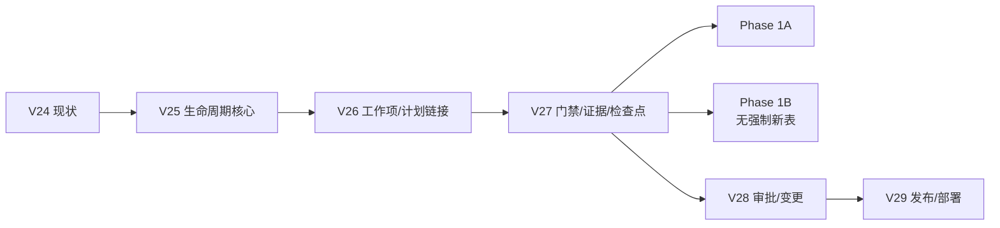

# ProjectOS V2.0 Phase 0 — V25–V27 Migration Readiness Review

> 状态：**评审稿 / 未实施**。本文件只锁定 Phase 1A 所需的一期字段与迁移顺序，不创建新领域表，不修改数据库。
> 基线：V24（24 个迁移）；历史夹具：`tests/fixtures/v24-baseline.sqlite`；升级测试：`tests/phase0-migration.test.ts`。

## 1. 结论

- V25–V27 必须承载 Phase 1A **全部**必需字段；不得后移到 V28+。
- Phase 1B 原则上不新增强制表；若必须新增字段，只能新增 V27b/V28 并重新评审，**不得修改已发布 V25–V27**。
- 本轮**未写 SQL、未创建新表**；只确认依赖、回填、兼容与停止条件。
- 进入 Phase 1A 前仍需用户批准本评审 + ADR-008/013/014/015 正式签署。

## 2. V25–V27 范围

| 版本 | 表/字段 | 为什么一期需要 | 回填/兼容 |
|---|---|---|---|
| **V25** | `products`、`product_versions`、`iterations`、`environments`、`project_focus` | 项目姿态、多版本/迭代、环境上下文、UI focus | 旧项目建默认 Product/Version/Environment；`current_stage` 原样保留 |
| **V26** | `requirements.version_id/iteration_id/priority/owner`；`tasks.work_type/version_id/iteration_id/source_type/source_id`；`milestones.version_id`；`plan_revisions.kind/subject_type/subject_id/environment_id` | 需求/任务/计划归属版本/迭代；PlanKind；1B 主旅程 | 旧行 NULL；旧计划默认 `kind=development`；不重写旧 JSON |
| **V27** | `gate_definitions`、`gate_evaluations`、`evidence`、`evidence_links`、`run_checkpoints`；`artifacts` 证据字段 | 版本门禁、证据四维、Run 收尾 | 旧阶段门禁保留 legacy；新版本 seed 默认 gate；不伪造历史评估 |

## 3. 依赖顺序

**硬依赖：**

- `tasks.version_id` 依赖 `product_versions`；`iterations` 依赖 `product_versions`；`environments` 独立。
- `gate_evaluations` 依赖 `gate_definitions` + `evidence`；`evidence_links` 依赖 `evidence`。
- `plan_revisions.subject_id` 可能是 version/iteration/release；V26 只校验 version/iteration，release 留 V29。
- 旧 `project_stages` 不删除；只作为 legacy 读模型。

## 4. 回填规则

| 旧数据 | 回填 | 禁止 |
|---|---|---|
| Project | 默认 Product + Version `0.1.0` + Environment `local` | 不自动创建 Release/Deployment/Incident |
| `current_stage=release` | Version phase=`release_candidate` | 不因旧 release-note 自动标 `released` |
| Task | `work_type=development`；version/iteration NULL | 不猜测版本归属 |
| PlanRevision | `kind=development`；subject=默认版本 | 不重写旧 plan_json |
| Artifact | 保留 task/run 关联；evidence `assurance=self_declared/unknown` | 不自动升为 `externally_confirmed` |
| Stage gate | 保留 legacy；新版本 seed 默认 gate | 不把旧阶段完成当新版本证据 |

## 5. 迁移测试与停止条件

**测试（Phase 1A 实施时必须补）：**

1. V24 fixture → V25→V26→V27，行数/FK/聚合校验。
2. 重复执行不产生重复 Product/Version/Environment/Evidence。
3. 旧 API（overview/advanceStage/task.board/plan.*）仍可读；`current_stage` 不被改写。
4. 旧 Task/Plan/Artifact/Approval 可读；NULL 字段不阻塞旧页面。
5. 备份→迁移→恢复演练；失败只读。

**停止条件（任一命中）：**

- schema checksum/迁移记录不匹配。
- 行数/FK/关键聚合失败；自然键重复或 backfill 孤儿。
- 旧 API 关键读路径失败。
- 备份/恢复校验失败。
- 任何 P0 入口重新可达。

## 6. 未决事项

- 用户批准 V25–V27 范围/顺序。
- V25 是否支持“一项目多产品”；一期默认 1 个，但表结构预留。
- 版本号是否强制 SemVer。
- 环境是否允许自定义 key/保护级别。
- V27 gate seed 的默认条件（test_report / approval_record / manual_attestation 的 minAssurance）。
- 旧 `project_stages` 读模型保留多久。

## 7. 本轮不做

- 不写 migration SQL。
- 不建 products/product_versions/iterations/environments/gates/evidence 表。
- 不修改 V24 数据库。
- 不开始 Phase 1A 代码。
