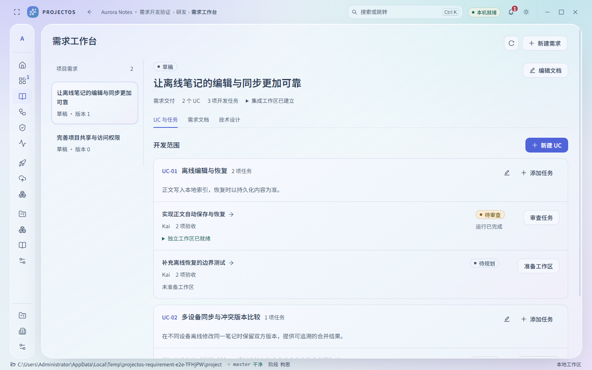
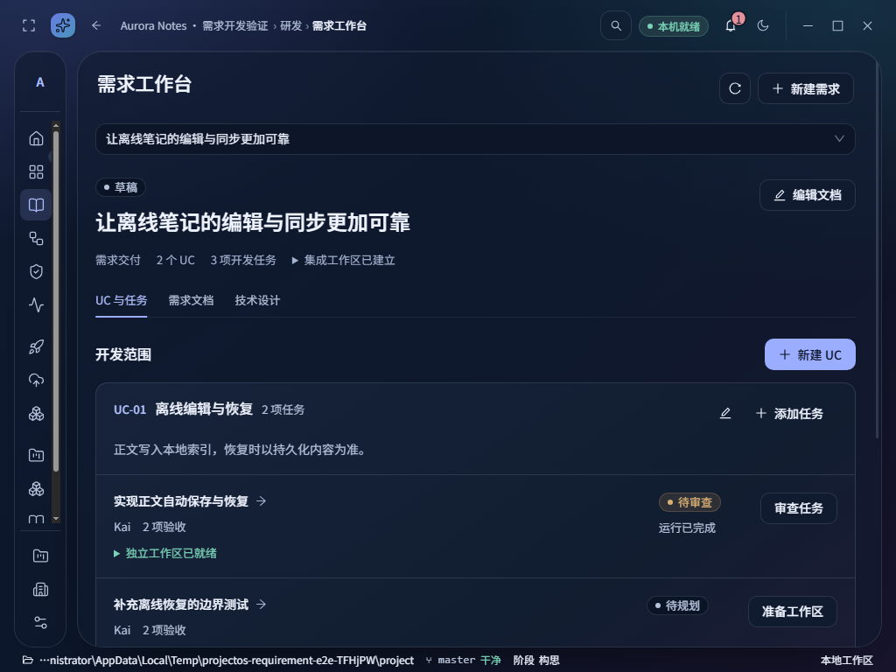
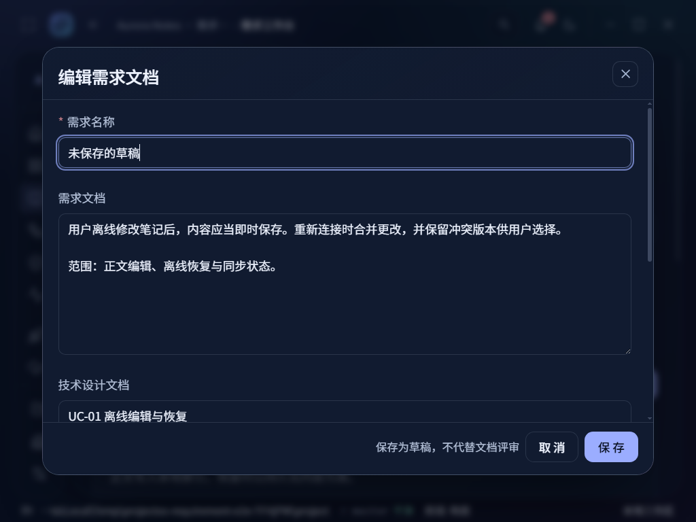

# A3.1 — 需求交付、UC 分组与开发任务隔离

日期：2026-10-30。分支：`codex/premium-system`。
基础 HEAD：`f71d33e8acd70ec579501873c327e5b1180ee02a`，本批为该 HEAD 上的未提交工作区改动。
保留本轮之前的蓝青玻璃恢复、组织、Agent 协作图等修改；没有 reset、远程推送、合并或发布。
决策先于数据变更记录在 [ADR-0073](../../../adr/0073-requirement-uc-task-isolation.md)。

## 本批交付

- 新增真实入口“研发 → 需求工作台”，保留所有原入口和深链接。
- 需求作为交付归属，保存需求文档、可选技术设计和验收标准；文档编辑使用版本检查，保存为草稿，不冒充评审通过。
- UC 是需求内的工作分组。支持新建、编辑 UC，以及为 UC 创建真实开发任务、选择执行 Agent、填写验收和前置依赖。
- 需求集成工作区 + 每开发任务独立分支/worktree。创建前产生独立的 Run、ToolCall 和人工审批，冻结代码提交及需求/UC/任务版本。
- 审批时重新校验归属、目录、分支、基线、版本、过期时间与策略。旧任务保持原执行方式；不自动给历史任务绑定需求。
- 任务执行只能使用登记目录；启动、工具调用、审批恢复均核对目录/仓库/分支。指派变化不搬动工作区。
- 运行开始时固定该需求及 UC 文档快照。任务执行中的文档修改不影响当前运行；过长内容明确标识截断。
- 中断后标记“待核对”，不自动重试。用户点击“核对工作区”时只读核对 Git 实际状态，登记精确匹配原审批的结果；确认任务目录未创建时允许重新申请审批。未知分支、缺失目录、修改过的内容继续阻塞，绝不自动覆盖或清理。
- 保留原有工具授权、执行租约、预算、审批、运行审计、任务详情/验收、真实 DAG 和布局持久化。新需求任务尚不进入旧的共用工作区调度器。

## 信息层级与界面

沿用 `packages/design-tokens/src/unified.css` 的蓝青光学材料、随包中文字体及共享弹层；未引入新配色、字体、组件库或着色覆盖层。

- 宽窗口：左侧需求清单，右侧需求身份与文档页签，UC 分组下直接排列任务；没有新增等权指标卡。
- 窄窗口：需求清单转为选择器，保留完整工作区域和滚动，使用同一套交互。
- 任务显示实际状态、执行 Agent、验收条目数、工作区状态；目录与分支按需展开。审批、错误和未知结果可见。
- 待审查任务的操作进入真实任务详情；运行完成与任务验收明确分开。审批结束可返回对应需求。
- 需求页面不套用旧计划的九阶段旅程：实际检查发现它会把手工整理中的草稿标为“AI 正在处理”。其他页面的原旅程保留；需求工作台展示自身的真实状态。
- 表单保留未保存内容保护、错误反馈、清晰焦点及共享 Motion 减少动效行为。正文 14px、辅助 13px；长标题换行，密集列表可滚动到末项。

## 实际验证

原始输出见本目录 `logs/`；截图和检查明细见 [checks.json](checks.json)。`manifest.json` 记录实际源文件、截图与产物 SHA256。截图为真实 Electron 的 `webContents.capturePage()`，使用独立测试数据和真实 SQLite/Git，非设计原型。Agent 回路使用确定性本地测试 Provider，不能据此宣称真实外部模型质量通过。

| 检查 | 结果 |
|---|---|
| `pnpm typecheck` | PASS |
| `pnpm lint` + 依赖边界检查 | PASS；0 error，24 条原有 warning |
| `pnpm test` | PASS；586 passed / 4 skipped，103 文件通过、2 文件跳过 |
| `pnpm exec vitest run tests/requirement-work.test.ts` | PASS；15 项隔离、审批、归属、漂移、上下文、核对恢复测试 |
| V18/V24 历史数据库迁移回归 | PASS；5 项；旧数据与任务归属保留，新版本为 V38 |
| `pnpm build` | PASS；Runtime、Desktop、Server |
| `node scripts/e2e.mjs` | PASS；桌面创建与重启恢复 |
| `node scripts/agent-e2e.mjs` | PASS；真实审批暂停、批准写入与运行续接 |
| `node scripts/v12-e2e.mjs` | PASS；设置、连接、原生运行、重启 |
| `node scripts/v13-e2e.mjs` | PASS；扫描、计划批准、真实 DAG、布局保存、重启 |
| `node scripts/requirement-work-e2e.mjs` | PASS；30 项检查、17 张最终截图、0 renderer errors |
| `pnpm package:dir` | PASS；生成本地 Windows x64 目录产物 |
| `pnpm test:package` | PASS；打包 EXE 创建项目并重启恢复 |
| Impeccable detect | PASS；输出 `[]`，不能替代视觉验收 |
| 1440×900 / 1280×800 / 1024×768，浅/深色 | 六状态各自无页面横向溢出，正文/辅助字号达标，axe 0 violations |
| 1024×768、125% 应用缩放、减少动效 | PASS；截图、表单保护、键盘焦点、减少动效偏好 |
| 真实异常/密集列表 | PASS；未提交基线阻止准备并显示错误、无效需求链接、21 项任务列表可到达末项 |

检查覆盖：项目切换不串数据、需求与 UC/任务创建、文档保存、审批前没有 Git 写入、审批后登记两个工作区、重启保留绑定、准备授权不代替写文件授权、等待写文件审批期间重启、批准后仅任务目录产生文件、真实任务详情与返回需求。

首轮发现并修复：历史迁移用例固定 V37；中文两字按钮空格影响测试定位；装饰图标混入可访问名称；窄窗口 Select 改为 block 后箭头错位；任务待审查时仍提示执行；后台轮询改变弹窗保存版本的问题已修复，并验证并发冲突保留输入。
一次验收与打包构建交叠，重启正遇 Runtime 输出被构建清理，应用正确显示“Runtime bundle 不存在”。构建完成后单独重跑 30 项全部通过。对应诊断保留在 `diagnostics/`，不算最终截图。

## 真实画面

视觉参考：[用户确认的 DAG](../../../design/baselines/2026-10-29-user-confirmed-DAG.png)；当前新业务页面沿用其材料和字体，不复制演示数据或审批按钮。

其余截图包括空状态、工作区待审批、实际审批页、真实任务详情、1280 双主题、错误状态与密集列表。

## 设计来源的实际使用

- 重新阅读根 AGENTS、UI_CONTRACT、DESIGN、CHANGELOG、OVERLAY_SYSTEM/AUDIT、PROJECTOS_DESIGN_SYSTEM、全部指定 next-ui 恢复/进度/问题/基线记录，以及 Design Lab 源码和用户 DAG 图。
- UI UX Pro Max：实际读取 `.tmp/reference-uiux/.claude/skills/ui-ux-pro-max/SKILL.md`，执行 typography/color/layout/focus/reduced-motion 查询。保留匹配的 Noto Sans SC、焦点和布局指导；拒绝检索给出的暖橙强调色/青绿产品配色，原因是与用户冻结的蓝青玻璃主题冲突；不从在线 Google Fonts 加载字体。
- Vercel composition/react skills：实际读取 `.tmp/reference-vercel/skills/` 两个 SKILL。组合页面、共享弹层、请求缓存和独立读取；没有新增并行前端框架。
- Impeccable：实际读取 `.tmp/reference-impeccable/plugin/skills/impeccable/SKILL.md`、craft-floor/new-work/operate；运行 context 和最终 detect。context 报没有 PRODUCT.md，按仓库要求不杜撰，使用已确认产品/设计资料。技能专用加载工具未暴露，以上通过本地文件及脚本读取执行，不宣称调用了不存在的 skill loader。
- Sim：本地稀疏克隆读取 blob 因网络失败，改用已连接 GitHub 工具读取真实 `organization-header.tsx`（blob `a5790cd9e3571bc8cc7dc033750599c2c861e318`）。参考收拢导航时保留明确名称与焦点的方式；未拷贝品牌资产或执行引擎。本批不修改画布结构。
- Liquid Glass React：核对已安装 `1.1.1` 与现有文档的低帧率证据；未为新页面启用新的滤镜。React Bits `Aurora.jsx` 来源与许可保留，未增添装饰动画；本批不声称新的 GPU/FPS 测量。
- Motion：复用已有 overlay-shell 与 useReducedMotionPreference，真实桌面验证减少动效设置。

## 尚未完成及验收边界

1. 本批只交付本地需求/UC/任务、独立目录准备和执行。任务合并、依赖成果集成、需求整体验证与交付、自动调度接入未完成。有前置依赖的新需求任务目前明确阻止准备/启动，不能静默从缺少成果的基线运行。
2. 插件式 Agent 组合、可配置流程与文档门禁、设置整理尚未实施；按 ADR-0073 后续批次推进。它们不是 UI 上可点却无效的占位操作。
3. 组织 A2.2b 的远程作业桥和服务端权威同步仍是多人跨设备执行的前提。本批任务指派沿用本地 Agent，尚未接入组织成员指派，不能宣称团队远端任务调度可用。
4. 未新增工作区删除、合并或清理功能；工作区不需要时由后续带审批的生命周期操作处理。人工核对不修复不匹配的目录。
5. 4 项现有环境测试跳过，详见全量日志；人工屏幕阅读器、Windows 系统 DPI、其他 OS、真实外部模型/CLI 与真实团队远端执行未验证。125% 为应用 zoom，不冒称系统缩放。加载组件复用已有逻辑，未人为延迟 IPC 拍摄加载态或给出首帧耗时结论。
6. 此前额外 `v13-orchestration-e2e.mjs` 的 reReview 等待超时未在本批修复或重跑；本次 PASS 的 `v13-e2e.mjs` 不能被解读为完整自动编排闭环通过。
7. 最终美学验收仍由用户判断；源码检查和 axe 不能替代视觉认可。目录产物未数字签名，不属于发布版本。

## 使用

在项目根目录运行 `pnpm start`，或启动 `release/win-unpacked/ProjectOS.exe`。
进入项目 → 需求工作台 → 新建需求 → 编辑技术设计（按需）→ 新建 UC → 添加开发任务 → 准备工作区 → 审批 → 执行任务。
项目仓库需要已有提交；后续代码写入、命令执行仍会按原策略单独审批。

下一批先完成经过评审的任务集成与需求整体验收，再推进 Agent 能力组合、流程配置和设置归类。
